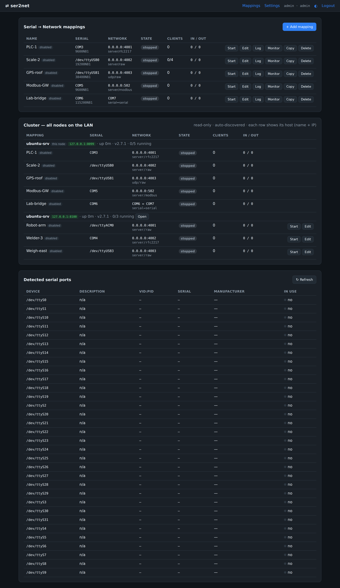
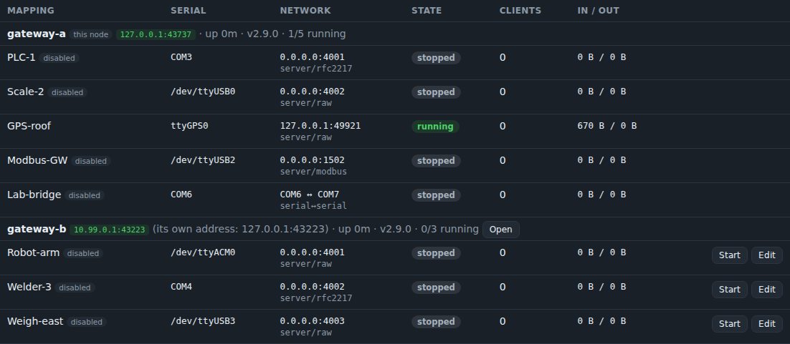
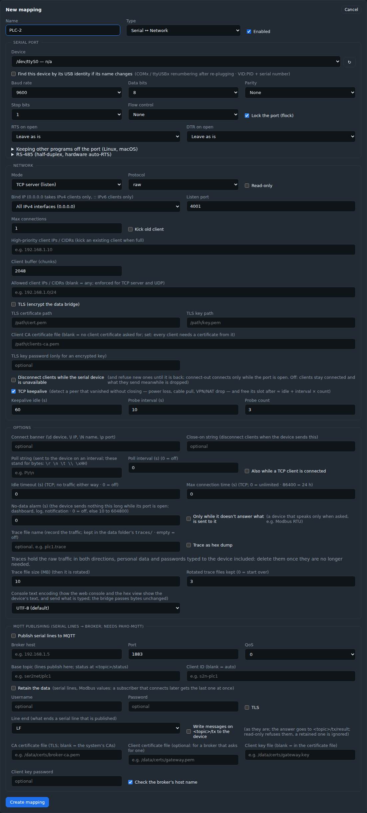
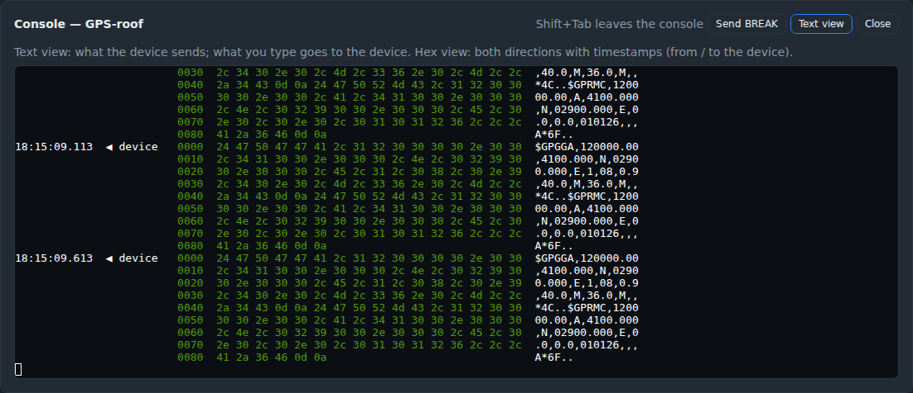
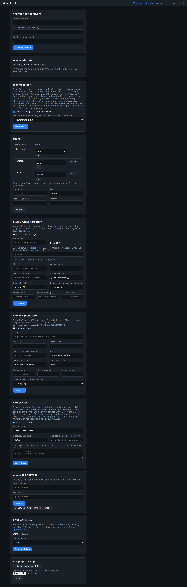
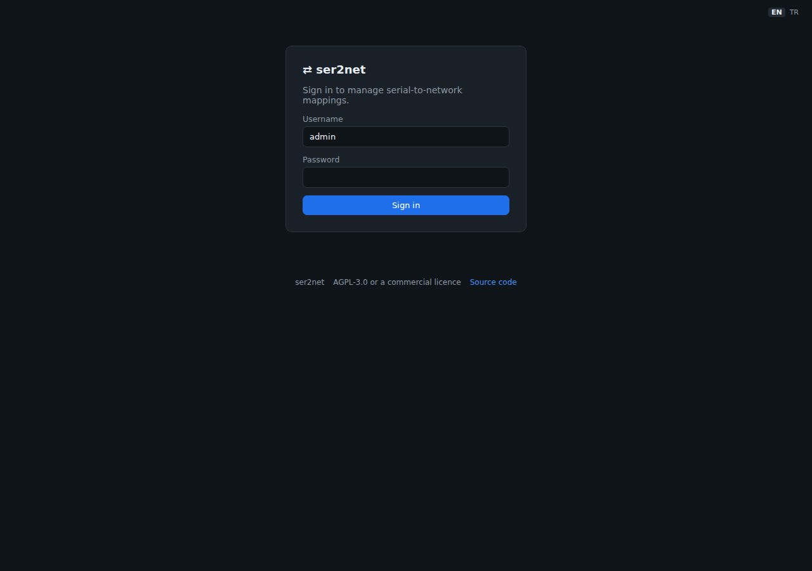

<!-- ser2net — README (English). Türkçe (default): README.md -->

**🌐 [Türkçe](README.md) · [English](README.en.md)**

# ser2net

[](LICENSE) [](COMMERCIAL_LICENSE.md) [](https://github.com/sponsors/haliskilic)

**A cross-platform (Windows + Linux), pure-Python serial-to-network bridge with a
web management UI** — a modern, web-managed take on the classic `ser2net`. Map dozens
of serial ports (COM / ttyUSB / ttyACM / ttyS) to TCP/UDP endpoints, bidirectionally,
with low latency.

---

## 📸 Screenshots

**Dashboard — dozens of mappings, live status, detected ports and the LAN cluster panel:**



**LAN cluster — every node's mappings in one table; per-node health + remote start/stop:**



| Add mapping (all serial/network options) | In-browser serial console (xterm.js) |
|---|---|
|  |  |

| Settings (password · TLS · cluster · backup) | Login |
|---|---|
|  |  |

---

## 📌 Purpose

Industrial devices, PLCs, instruments, GPS/modems, microcontrollers and console ports
usually speak **serial** (RS-232/485/USB-serial). `ser2net` bridges each serial port to
a **TCP/UDP endpoint** so any computer on the network can reach it, and manages
everything from a **password-protected web UI** — no CLI or hand-edited config files.

**Typical use cases:**
- Expose 10+ USB-serial devices attached to one server to networked applications
- Reach SCADA / Modbus-RTU devices from remote clients (raw or RFC2217)
- Network access to device consoles (switches, routers, embedded boards)
- RFC2217 for devices that need remote baud/parity changes
- Bridge two serial ports together (serial↔serial)

---

## ✨ Features

- **Transports:** TCP **server** (listen), TCP **client** (connect-out), **UDP**, and
  **serial↔serial** bridging; optional per-mapping **TLS** for TCP bridges.
- **Protocols:** `raw`, `telnet` (8-bit clean), `rfc2217` (remote live changes to
  baud/parity/data bits/stop bits/flow control), `modbus` (RTU↔TCP gateway).
- **Modbus gateway:** bridges Modbus/TCP masters to serial Modbus/RTU slaves —
  multiple masters, transaction serialization on the shared bus + transaction-id
  integrity, and a `0x0B` (gateway-timeout) exception when an RTU slave doesn't answer.
  If the serial port goes away (a USB adapter unplugged), masters get `0x0A` (gateway path
  unavailable) at once meanwhile and the port is reopened like any mapping's (state
  `reconnecting`, device lost/back notifications). Masters are admitted like other
  clients (allowed IPs, max connections, priority IPs, kick-old-user); a **read-only**
  gateway answers every request that is not a read (writes such as FC5/6/15/16/22/23,
  diagnostics that restart or silence a slave, unknown function codes) with exception
  `0x01` without putting it on the bus. Banner, open/close strings and `closeon` don't
  apply (they would break the Modbus framing).
  **Edge mode:** also polls coils and registers on an interval and publishes the decoded
  values to MQTT (bool, uint/int/float 16/32, scaling); `"writable": true` points take
  values from MQTT (`<topic>/<point>/set`, one value for that point only: FC5 for a coil,
  FC6/FC16 for a holding register's own one or two registers; a JSON list or other text
  gets `error: …` on `.../set/result`). **Read-only** refuses these writes too (`error:
  mapping is read-only`; a refused DCMD is logged), and the dashboard marks a mapping that
  takes MQTT writes with **CMD** (see Security: the broker decides who may send them).
  Optionally as a **Sparkplug B** edge node with one device per Modbus unit (`unit1`, …):
  NBIRTH/NDEATH with `bdSeq`, DBIRTH/DDATA with `seq`, writes via DCMD, rebirth via NCMD.
  A command is written once, when it is published: a retained `/set` that the broker sends
  again after a reconnect, a restart or a configuration save is ignored (and logged)
  unless **Re-apply a retained /set after every connect** is ticked; a retained Sparkplug
  NCMD/DCMD is always ignored, an empty message (clearing a retained one) is not a
  command, and a command published while ser2net is not connected is not delivered later.
- **Client-side virtual COM:** recipes to surface a remote port as a local `COMx`/`tty`
  (pySerial `rfc2217://`, Linux `socat`, Windows com0com+com2tcp / HW VSP3) — see
  [`docs/VIRTUAL-COM.md`](docs/VIRTUAL-COM.md).
- **Full serial config:** baud (incl. custom), data/stop bits, parity, flow control
  (none/RTS-CTS/XON-XOFF/DSR-DTR), RTS/DTR on open, exclusive open, and RS-485 hardware
  auto-RTS (Linux `TIOCSRS485`: enable + pre/post-TX delays + RTS-during-TX level).
- **Live port list:** privilege-free polling + optional event hotplug (Linux pyudev /
  Windows WM_DEVICECHANGE), falling back to polling. On Linux the kernel's placeholder
  `ttyS` ports without hardware are hidden and the stable `/dev/serial/by-id` names are
  shown and selectable. **IP picker** from the machine's own addresses (localhost / LAN /
  0.0.0.0) or custom.
- **Find a device by its USB identity:** tick the box in the mapping form and the adapter
  is bound by VID:PID (+ serial number), so re-plugging it as `ttyUSB1` or under another
  COM number still opens the right device.
- **Dozens of mappings:** add/edit/delete/start/stop from one screen, with live status;
  search, state filter, sorting and start/stop/restart of the selected mappings. The
  table only redraws when it changed (no flicker, selections stay).
- **Per-mapping access control:** allowed IP/CIDR list, **high-priority** client IPs
  (a priority client evicts the oldest when the port is full), max connections,
  kick-old-user, read-only, banner, open/close strings, `closeon` (a Modbus gateway uses
  no banner, open/close strings or `closeon`).
- **Connection lifecycle (per mapping, TCP):** **dead-peer detection via TCP keepalive**
  — a client or remote server that vanishes without a FIN/RST (power cut, cable pull,
  Wi-Fi/VPN/NAT drop) no longer stays `ESTABLISHED` forever: with the defaults (on ·
  60 s idle · 10 s interval · 3 probes) it is dropped within ~90 s and its slot freed —
  also while the device keeps sending (Linux `TCP_USER_TIMEOUT`). Plus a **connect
  timeout** for connect-out (default 10 s), an **idle timeout** and a **max connection
  time** (e.g. 24 h); every disconnect is logged with its reason.
- **Observability:** per-mapping traffic trace (hex/timestamp, rotated files, downloadable
  from the UI), Prometheus `/metrics`, an audit log page, live log viewer, an in-browser
  **serial console** (xterm.js over WebSocket — watch traffic or type to the device) and a
  timestamped **live hex view** of both directions.
- **Notifications:** a webhook (JSON, Slack, Microsoft Teams, Discord, Telegram) and/or
  e-mail (SMTP) when a device is lost or comes back, a mapping fails to start, clients
  come and go, or a sign-in fails; repeats are suppressed, a test message can be sent.
- **Security:** password (set on first access, scrypt), CSRF, signed-cookie sessions,
  login rate-limiting, strict security headers, session revocation on password change.
  For trusted networks the login requirement can be switched off under **Settings → Web
  UI access** (visitors then use the UI with a chosen role; see Security).
- **Multi-user / RBAC:** `admin` / `operator` / `viewer` roles — viewer is read-only,
  operator manages mappings, admin does everything plus user management. Existing
  single-password setups migrate automatically to one `admin` user.
- **LDAP / Active Directory auth (optional):** users authenticate by binding to the
  directory; LDAP group membership maps to a role. Works alongside local accounts;
  needs `ldap3`.
- **OIDC single sign-on (optional):** authorization-code flow with Keycloak / Entra ID /
  Google / Okta; the id_token is validated (signature/iss/aud/exp/nonce) and a claim maps
  to a role. Needs `authlib`.
- **REST API:** a JSON API (`/api/v1`) for automation — mapping CRUD, start/stop/restart,
  status and ports; **bearer-token** auth (with a role — `viewer` is read-only); OpenAPI
  3.0 (`/api/v1/openapi.json`). The token is generated in Settings.
- **LAN cluster (fleet management):** nodes on the same network **auto-discover** each
  other (signed UDP broadcast — no mDNS) and one node shows **every node's mappings in a
  single table**, each row tagged with its host (name + IP) and each node's **health**
  (uptime · version · running/total). Operators can **remotely start/stop/restart and edit**
  a peer's mappings from that view. For routed/L3 networks broadcast can't reach, add
  **manual peers** (host:port). Trust = the **same shared key** on every node; off by
  default, enable under Settings → LAN cluster.
- **Deployment:** official **Docker** image + `docker-compose`; **systemd** unit;
  Linux+Windows × Python 3.10–3.13 **CI** (GitHub Actions).
- **MQTT publishing (optional):** publish each mapping's serial lines to an MQTT
  broker (host/port/topic/QoS/TLS/credentials) with a retained birth/death status.
  Needs `paho-mqtt` (optional; the bridge runs normally without it).
- **Migrating from classic ser2net:** `ser2net.yaml` (4.x) and `ser2net.conf` (3.x) files
  import through Settings with a preview; options without an equivalent are listed as
  warnings.
- **Turkish / English UI:** pick **TR / EN** in the top bar (remembered per browser);
  otherwise the browser's language or the admin's default (Settings → Web UI access), which
  notifications use as well. Logs, the audit log and the REST API stay English.
- **Fully offline:** all dependencies bundled as wheels; no internet required.

---

## 🧰 Requirements

- **Python 3.10+** installed. Nothing else — dependencies ship in `vendor/wheels/` and
  install to `./lib` on first run (offline).
- Linux: membership in the `dialout` group to **open** serial ports (listing ports
  needs no privilege):
  ```bash
  sudo usermod -aG dialout "$USER"   # then log out/in
  ```
- Windows: no extra privileges for COM ports.
- Optional: `openssl` (self-signed TLS); `pyudev` (Linux) / `pywin32` (Windows) for
  event-driven hotplug — polling is used otherwise.

---

## 🚀 Install & run

```bash
# Linux / macOS
python3 ser2net.py            # or: ./start.sh

# Windows
start.bat
```

### Standalone binary (nothing else to install)
Every release attaches a Windows `.exe` and a Linux binary to **GitHub Releases**. Each
is one file with everything inside — Python, OpenSSL, the VC++ runtime (Windows), MQTT /
LDAP / OIDC support — so no Python, `openssl` or other package is needed. Download and
run; config/logs are written to `data/` next to the binary.

| File | Runs on |
|---|---|
| `ser2net-windows-x64.exe` | Windows 10/11, Windows Server 2016 or newer (x64) |
| `ser2net-linux-x64` | x86_64 Linux with glibc ≥ 2.28: RHEL / AlmaLinux / Rocky 8+, Debian 11+, Ubuntu 20.04+, Fedora, openSUSE Leap 15 (not musl/Alpine — use Docker there) |
| `ser2net-linux-arm64` | 64-bit ARM Linux with glibc ≥ 2.28: Raspberry Pi 3/4/5 (64-bit Raspberry Pi OS 11+ or Ubuntu), ARM industrial gateways, AWS Graviton, the same distributions |

Every release also publishes `SHA256SUMS`, a CycloneDX SBOM per binary (`*.cdx.json`) and
the license texts, and the binaries carry GitHub build provenance:
`sha256sum -c SHA256SUMS --ignore-missing`,
`gh attestation verify ser2net-linux-x64 -R haliskilic/ser2net`. The Windows exe is signed
on releases once a signing service is configured ([`docs/SIGNING.md`](docs/SIGNING.md)).

Every pull request and release proves it (`tests/test_standalone.py`): the bundle may
need nothing but OS-base libraries (glibc ≤ 2.28 / Windows system DLLs; Linux on x86_64
and arm64), the binary must
work with an empty `PATH` (no Python, no `openssl`), and the Linux one must run in clean
AlmaLinux 8/9, Debian 11/12, Ubuntu 20.04/22.04/24.04, openSUSE Leap 15.6 and Fedora
containers.

Linux notes: `chmod +x ser2net-linux-x64`; serial ports usually need the `dialout`
group. The binary unpacks itself to `$TMPDIR` (default `/tmp`) on start — if `/tmp` is
mounted `noexec`, point `TMPDIR` at a directory that isn't. For certificate checks (MQTT
over TLS, OIDC) it uses the distribution's CA bundle, or `SSL_CERT_FILE` if set.

`ser2net --about` shows the versions (Python, OpenSSL, components) — add it to bug
reports. `ser2net --licenses` prints the license text of every component inside the
executable (releases also attach it as `*.THIRD-PARTY-LICENSES.txt`).

Build it yourself — Windows: `pip install -r requirements.txt -r requirements-optional.txt pyinstaller && pyinstaller ser2net.spec`;
Linux (in an old-glibc container, so the result runs on older distributions too):
`docker run --rm -v "$PWD:/src" -w /src almalinux:8 bash tools/build_standalone_linux.sh`.

On first run:
1. The **console** asks which local IP the admin UI binds to (machine IPs or custom)
   and a port (default 8080). Headless/service default is the safe **127.0.0.1**.
2. Open the printed URL; **set the admin password** on the first screen.
3. From the dashboard, **+ Add mapping**: pick a COM/tty and map it to an IP:port.

Change the bind IP later:
```bash
python3 ser2net.py --reconfigure
```

### Offline install (no-internet machine)
Dependencies live in `vendor/wheels/`; `ser2net.py` installs them to `./lib` on first
launch (`pip install --no-index`). No internet needed. The set covers Python 3.10–3.14 on
Linux x86_64 and Windows x64; after a `requirements.txt` change, refresh it with
`python3 tools/refresh_wheels.py` (`tests/test_vendor_wheels.py` checks it).
To enable the optional features (MQTT/LDAP/OIDC) on an offline source install, download
their wheels too: `pip download -r requirements-optional.txt -d vendor/wheels`, then
`pip install --no-index --find-links vendor/wheels -r requirements-optional.txt`. (The
standalone binary already bundles them.)

### Docker
```bash
docker compose up -d        # edit the `devices:` line in docker-compose.yml first
# or:
docker build -t ser2net . && docker run -d -p 8080:8080 \
  --device /dev/ttyUSB0 --group-add dialout -v ser2net-data:/data ser2net
```
Published image (amd64 + arm64, every release): `docker pull ghcr.io/haliskilic/ser2net:latest`
(or `:2.8`, `:2.8.0`); `docker-compose.yml` uses it.
Inside the container the UI binds to `0.0.0.0` (set via `SER2NET_BIND_IP` /
`SER2NET_PORT` — the interactive picker can't run headless). The process runs as the
`ser2net` user (uid 10001), not root; a `/data` volume written by an older (root-running)
image is taken over on the first start, so upgrading needs no manual step. The image has
a `HEALTHCHECK` (`ser2net --healthcheck`). Details: [`docs/DOCKER.md`](docs/DOCKER.md).

---

## 🖥️ Usage

- **Add mapping:** name, type (Serial↔Network / Serial↔Serial), serial port +
  parameters, network mode (server/client/udp), protocol, bind/remote IP:port, access
  rules.
- **Start/Stop/Restart/Copy/Delete:** per row.
- **Log:** the mapping's history (newest first, persists across restarts).
- **Monitor:** live serial terminal in the browser (xterm.js); type to the device on
  network mappings.
- **Settings:** change password, **web UI access** (login required / open access with a
  role), admin TLS (provide paths or generate self-signed), generate/revoke the **REST API
  token**, mappings **backup/restore** (JSON), status.
- **/metrics:** Prometheus-format metrics (authenticated).

---

## 🔌 REST API

Alongside the browser UI, a JSON API at `/api/v1` for automation. Authenticate with
`Authorization: Bearer <token>`; generate the token under **Settings → REST API token**
(shown only once). Full description: `GET /api/v1/openapi.json`.

```bash
TOKEN="s2n_..."   # generated in Settings
# all mappings (config + live status)
curl -H "Authorization: Bearer $TOKEN" http://HOST:8080/api/v1/mappings
# create a mapping
curl -X POST -H "Authorization: Bearer $TOKEN" -H "Content-Type: application/json" \
  -d '{"name":"PLC-1","kind":"net","serial":{"port":"/dev/ttyUSB0","baudrate":9600},
       "network":{"mode":"server","bind_ip":"0.0.0.0","port":4001}}' \
  http://HOST:8080/api/v1/mappings
# start / stop / restart
curl -X POST -H "Authorization: Bearer $TOKEN" http://HOST:8080/api/v1/mappings/<id>/stop
```
Endpoints: `GET/POST /mappings`, `GET/PUT/DELETE /mappings/{id}`,
`POST /mappings/{id}/{start|stop|restart}`, `GET /status`, `GET /ports`,
`GET /health` (unauthenticated), `GET /openapi.json`.

---

## 🔒 Security

The UI is **password-protected by default** and binds to **127.0.0.1** by default.
Exposing it to the network requires an explicit IP choice at startup and warns when
bound without TLS. For LAN deployments, use TLS (`admin_ui.tls_*`) and per-mapping
`allowed_client_ips`. Raw TCP is plaintext — be careful on untrusted networks. A bare
`0.0.0.0`/`::` in an allow/priority list means "any client". A mapping's serial port is a
device path or COM name only; pyserial URL handlers (`socket://`, `rfc2217://`, `spy://`,
`loop://`, ...) are not accepted as a port.

**MQTT commands (Modbus edge mode):** writable points take values from any client the
broker lets publish to `<topic>/<point>/set` or, for Sparkplug B, to
`spBv1.0/<group>/NCMD/<node>` and `spBv1.0/<group>/DCMD/<node>/<device>`. ser2net does not
authenticate these clients itself, and `allowed_client_ips` covers only the Modbus/TCP port,
so the broker's access rules (ACLs) are the authorization: let only the clients that must
switch outputs publish to the command topics, and connect to the broker with TLS and a
username/password. **Read-only** refuses every write. The dashboard marks a mapping that
takes MQTT writes with **CMD**, and with **CMD ⚠** (plus a warning in its log at start)
when its broker connection has no TLS or no username. A Mosquitto `acl_file` for the base
topic `plant/line3`, for example:
```
user ser2net
topic readwrite plant/line3/#
user scada
topic write plant/line3/+/set
topic read plant/line3/#
user historian
topic read plant/line3/#
```

**Open access (optional):** for trusted networks only, an admin can untick "Require
login" under **Settings → Web UI access** and give visitors a role (`viewer` read-only /
`operator` / `admin`). Signing in still works (you get your own role), RBAC and CSRF
apply unchanged, and the **REST API always needs its token**. Open access is honoured
only when the UI is reached by **IP address, `localhost` or this machine's own name** —
requests via any other host name (e.g. a malicious page doing DNS rebinding) are sent to
the login page. Behind a reverse proxy, the proxy must pass the original name in
`X-Forwarded-Host` (otherwise keep login on). **Other LAN-cluster nodes** are only shown
and managed after signing in, and open consoles are closed when access is revoked or the
role changes. While it is on, the UI shows a warning and startup logs it.

---

## ⚙️ Run as a service

- **Docker:** official `Dockerfile` + `docker-compose.yml` (see above and
  [`docs/DOCKER.md`](docs/DOCKER.md)) — `restart: unless-stopped`, `/data` volume.
- **Linux (systemd):** `systemd/ser2net.service` — a dedicated unprivileged user,
  `SupplementaryGroups=dialout`, `Restart=on-failure`, hardening directives.
  **Do not run as root.**
- **Windows:** nothing else needed. From an elevated ("Run as administrator") prompt:
  ```bat
  ser2net-windows-x64.exe --install-service --data-dir C:\ser2net\data
  ```
  The service starts at boot, needs no signed-in user (LocalSystem) and restarts 5 s after
  it crashes or exits with an error. On the first install the console asks for the UI
  address. Remove it with `--uninstall-service` (the data folder is kept); run several
  instances with different data folders via `--service-name`. Stop/start: `sc stop ser2net`
  / `sc start ser2net` or *Services* (services.msc).

---

## 🗂️ Configuration & state files

All state lives in the **data dir** (default `data/`). The data directory is locked to
owner-only (POSIX `0700`; Windows `icacls` owner/SYSTEM/Administrators), so the files
inside aren't readable by other users:
- `config.json` — admin IP, password hash, all mappings (atomic write).
- `backups/` — the previous `config.json` before every change (newest 50). Download or
  restore one under Settings → *Configuration backups*; a restore can be undone too.
- `all.log` — global activity (size-rotated); `audit.log` — sign-ins and config changes,
  who/from where/what (rotated). Searchable under Settings → *Audit log*, CSV export.
- `logs/<id>.log` — per-mapping history (hourly maintenance: trimmed >15 days / >100 MB).
- `traces/<id>-<name>` — a mapping's traffic trace. Traces are kept **only here** and
  rotate at their size limit (default 10 MB × 3 old files). Full paths from v2.7 configs
  are reduced to the file name, which is logged at start-up.
- `tls/` — certificate/key if self-signed is generated.

Mapping ids (the `<id>` above, also used by the REST API) are 1–64 letters, digits or `_`;
new mappings get 12 hex digits. An id in any other form (hand-edited or imported) is
replaced when the config is loaded or the file is imported; the start-up log or the import
preview says so.

Deleting `config.json` + `all.log` fully resets the system (orphan logs auto-pruned;
`backups/` is never restored by itself — delete it too if you want it gone).

**Session lifetime:** Settings → *Web UI access* → *Session lifetime* (default 8 hours).
**Import:** shows a preview first; choose *merge* (update mappings with the same name, add
the new ones) or *replace all*.

---

## 🧪 Testing

Unified test runner — the portable suite (no hardware, no socat) runs on every OS:
```bash
python3 tests/run_all.py            # portable suite (Windows + Linux)
python3 tests/run_all.py --socat    # + socat-based data-path tests (Linux)
python3 tests/run_all.py -v         # also show the output of passing tests
```
The socat tests use virtual serial ports (Linux); no hardware needed. Individual
files still run directly, e.g. `python3 tests/test_rest_api.py`. On every pull request
CI (GitHub Actions) runs ruff, mypy, `pip-audit`, the offline-wheel check, the full
matrix (ubuntu/windows × Python 3.10–3.13) and coverage (`python3 tests/coverage_run.py`,
which also measures the servers the tests start). Development setup and rules:
[CONTRIBUTING.md](CONTRIBUTING.md).

`tests/test_dead_peer.py` also exercises dead-peer detection against **real half-open
TCP connections**: with `SER2NET_BLACKHOLE_TESTS=1` it drops the packets of a loopback
flow (Linux: root/passwordless sudo + `iptables`; Windows: Administrator +
`pip install pydivert`). Since that edits the firewall it is opt-in locally (on Linux,
best run inside a throwaway network namespace); CI always runs it on both OSes.

`tests/test_ui_layout.py` opens the web UI in a real browser (Playwright + Chromium)
with very long mapping names / device paths at desktop-to-phone widths and fails if
anything sticks out of its panel (`pip install playwright && python -m playwright
install chromium`; CI job `ui`). `tests/test_standalone.py` checks a built executable
(`SER2NET_STANDALONE_BIN=dist/ser2net`; CI workflow `standalone.yml`, also used by
every release).

---

## 📜 License

ser2net is **dual-licensed**:

- **Open source — [GNU AGPL-3.0](LICENSE):** free to use, study, modify and share. If you distribute it, or run a modified version as a network service, you must make your complete source code available under the AGPL-3.0.
- **Commercial license:** for closed-source products, devices or SaaS without the AGPL-3.0 obligations — see [COMMERCIAL_LICENSE.md](COMMERCIAL_LICENSE.md) or email **mail@haliskilic.com.tr**.

Bundled third-party components keep their own licenses — see [`THIRD-PARTY-NOTICES.md`](THIRD-PARTY-NOTICES.md);
the full texts inside an executable: `ser2net --licenses`. The LGPL-licensed ldap3 stays
in the executable as plain source files; `SER2NET_LIB_OVERRIDE=<dir>` loads another
version of it. Reporting a vulnerability: [SECURITY.md](SECURITY.md).

Contributions are welcome! On your first pull request you'll be asked to sign a one-time [Contributor License Agreement](https://gist.github.com/haliskilic/7a7fdcd355f54d1db6943959d7b76823); you keep the copyright to your work.

Copyright © 2026 Halis KILIÇ.

## ❤️ Support the project

If ser2net is useful to you, please consider **[sponsoring my work on GitHub Sponsors ❤️](https://github.com/sponsors/haliskilic)** — sponsorships pay for test hardware and the time to keep the project maintained.

No GitHub account? You can also **[buy me a coffee ☕](https://buymeacoffee.com/haliskilic)**.

Roadmap: [`ROADMAP.md`](ROADMAP.md) · Türkçe: [`README.md`](README.md)
