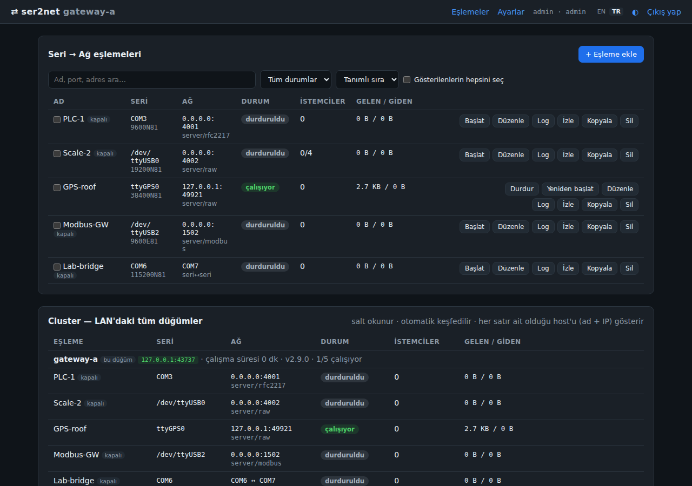
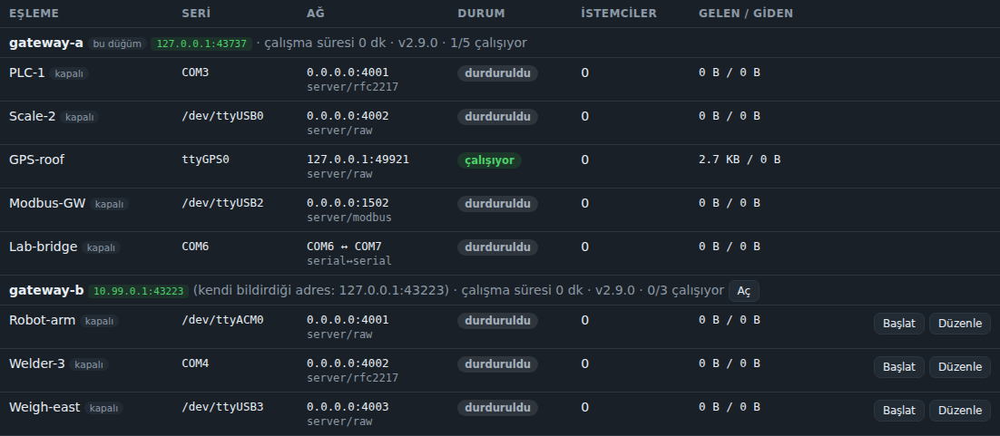
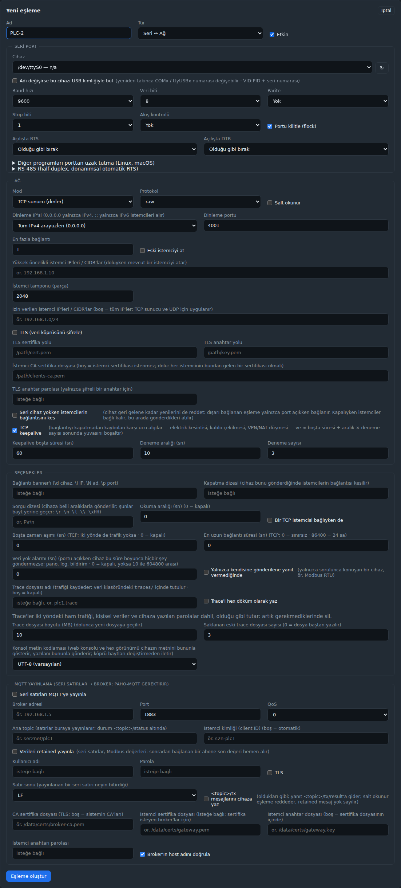
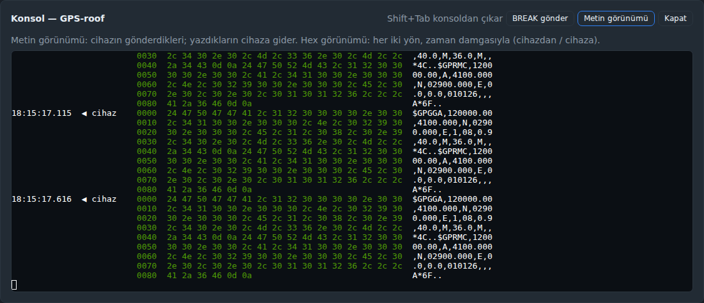
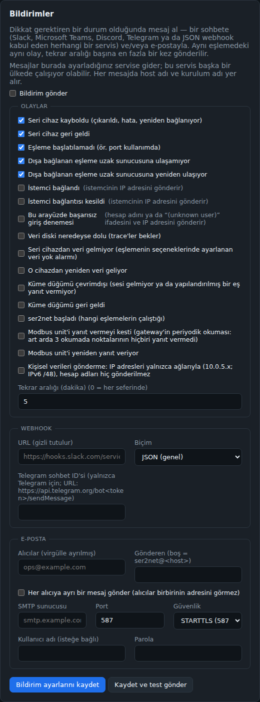
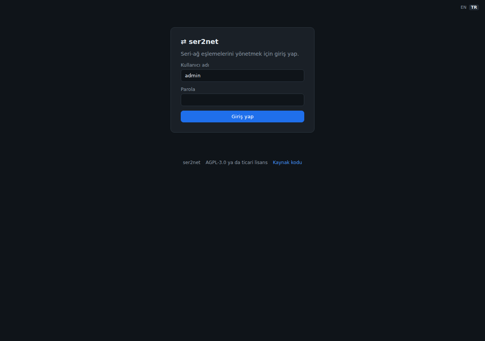

<!-- ser2netweb — README (Türkçe / varsayılan). English: README.en.md -->

**🌐 [Türkçe](README.md) · [English](README.en.md)**

# ser2netweb

[](LICENSE) [](COMMERCIAL_LICENSE.md) [](https://github.com/sponsors/haliskilic)

**Seri portları (COM / ttyUSB / ttyACM / ttyS) ağ üzerinden erişilebilir kılan,
web arayüzünden yönetilen, çapraz-platform (Windows + Linux) saf-Python köprü.**

> C ile yazılmış klasik `ser2net`'e web arayüzüyle yönetilen bir alternatif. Tek ekrandan
> onlarca seri portu IP:port'a eşleyin; raw / telnet / RFC2217; çift yönlü; düşük gecikme.

> **ser2netweb** (2.9.x'e kadar adı ser2net'ti) bağımsız bir Python projesidir. Corey
> Minyard'ın GPL-2.0 lisanslı [ser2net](https://github.com/cminyard/ser2net)'iyle bir
> bağlantısı yoktur ve ondan türetilmemiştir; yalnızca onun klasik yapılandırma dosyalarını
> içe aktarabilir. Ticari lisans yalnızca bu projeyi kapsar.

---

## 📸 Ekran Görüntüleri

**Pano — eşlemeler, canlı durum, arama ve toplu işlemler, LAN cluster paneli:**



**LAN cluster — tüm düğümlerin eşlemeleri tek tabloda; düğüm sağlığı + uzaktan başlat/durdur:**



| Eşleme ekleme (tüm seri/ağ seçenekleri) | Tarayıcı-içi seri konsol, hex görünümü |
|---|---|
|  |  |

| Ayarlar → Bildirimler | Giriş |
|---|---|
|  |  |

---

## 📌 Amaç

Endüstriyel cihazlar, PLC'ler, ölçüm aletleri, GPS/modem, mikrodenetleyiciler ve
konsol portları çoğunlukla **seri (RS-232/485/USB-serial)** haberleşir. Bu cihazlara
ağdaki herhangi bir bilgisayardan erişmek için her seri portu bir **TCP/UDP uç
noktasına** köprülemek gerekir. `ser2netweb` bunu yapar ve tüm yönetimi **parola
korumalı bir web arayüzünden** sunar — komut satırı veya elle config dosyası
düzenlemeye gerek yok.

**Tipik kullanım senaryoları:**
- Bir sunucuya bağlı 10+ USB-serial cihazı ağdaki uygulamalara açmak
- SCADA / Modbus-RTU cihazlarını uzak istemcilere ulaştırmak (raw veya RFC2217)
- Cihaz konsollarına (switch, router, gömülü kart) ağdan erişim
- Uzak baud/parity değişimi gereken cihazlar için RFC2217
- İki seri portu birbirine köprüleme (serial↔serial)

**Rehberler** (`docs/` altında, İngilizce): [Docker](docs/DOCKER.md) ·
[Linux paket depoları](docs/PACKAGES.md) ·
[Windows](docs/WINDOWS.md) · [Linux seri portları](docs/LINUX-SERIAL.md) ·
[reverse proxy](docs/REVERSE-PROXY.md) ·
[MQTT, Modbus noktaları ve Sparkplug B](docs/MODBUS-MQTT.md) ·
[LDAP / AD ve OIDC ile giriş](docs/SSO.md) ·
[klasik ser2net'ten geçiş](docs/MIGRATING-FROM-SER2NET.md) ·
[istemcide sanal COM port](docs/VIRTUAL-COM.md) · [gizlilik](docs/PRIVACY.md) ·
[kod imzalama](docs/SIGNING.md) ·
[bir dağıtım için paketleme](docs/PACKAGING.md).

---

## ✨ Özellikler

- **Taşıma modları:** TCP **sunucu** (dinleme), TCP **istemci** (dışarı bağlanma),
  **UDP**, ve **serial↔serial** köprüleme. TCP köprüleri için isteğe bağlı **TLS**
  (istemci sertifikaları, CA dosyası ya da parmak iziyle sunucu denetimi: bkz. Güvenlik). UDP,
  cihazın çıktısını izinli bir IP'den gelen son datagram'ın göndericisine ya da her zaman
  sabit bir yanıt adresine (**Yanıt gönderilecek IP** ve **Yanıt gönderilecek port**) gönderir; **karşı uç zaman aşımı** sessiz kalan
  göndericiyi unutturur. **Cihazın çıktısını ayrıca şuraya gönder** çıktıyı her zaman (kimse
  göndermeden önce de, kim gönderirse göndersin) alan başka hedefleri listeler
  (`udp_targets`, `IP:port`): bir yerel ağın yayın adresinde UDP 10110'a NMEA 0183 akışı
  (**Broadcast'e izin ver** ile, `udp_broadcast`), bir multicast grubu, birkaç makine.
  Datagram'lar seri portu en fazla 64 KiB'lık bir kuyrukta bekler: hattan hızlı gönderen
  birinin bunu aşan datagram'ları atılır, sayılır ve loglanır. UDP her zaman raw'dır
  (kayıtlı bir `telnet` `raw` okunur; fiilen hep böyle çalışıyordu) ve bir kapatma dizesinin
  kapatacağı bağlantısı yoktur. Hiçbir etkisi olmayan bir ayar — bu, serial↔serial köprüde
  MQTT, okuma noktası olmayan bir Modbus gateway'de MQTT — eşleme başlarken loglanır,
  düzenleme formunda ve REST API yanıtındaki `warnings`'te gösterilir.
- **Protokoller:** `raw`, `telnet` (8-bit temiz), `rfc2217` (uzaktan canlı
  baud/parity/databit/stopbit/akış kontrolü değişimi), `modbus` (RTU↔TCP gateway). Portun
  yerine getiremediği bir RFC 2217 isteği (bozuk ya da ayrılmış bir değer veya seri portun
  reddettiği bir değer) RFC 2217'nin dediği gibi güncel ayarla yanıtlanır ve portu olduğu
  gibi bırakır; istemci bağlı kalır. Kaybolan seri port yeniden açılırken de RFC 2217
  istemcisi bağlı kalır ve yeniden açılan port onun ayarlarını alır; istenirse istemci
  ayrılınca port eşlemenin ayarlarına döner (bkz.
  [`docs/VIRTUAL-COM.md`](docs/VIRTUAL-COM.md)). 1 KiB'tan uzun bir telnet ya da RFC 2217
  alt müzakeresi (gerçekleri birkaç bayttır) o istemcinin oturumunu sonlandırır; nedeni
  log'a yazılır. **Seri BREAK:** telnet istemcisinin BREAK'i (IAC BRK: PuTTY'de *Special
  Command → Break*, telnet'te `send brk`) ve RFC 2217 istemcisininki (SET-CONTROL BREAK
  on/off ya da IAC BRK), kendilerinden önce gönderilen veriden sonra seri hatta ulaşır
  (telnet BREAK'i 0,25 sn sürer); salt okunur eşleme BREAK göndermez, bir RFC 2217
  istemcisinin açık bırakıp ayrıldığı BREAK de kapatılır. Raw TCP'de bant içi BREAK yoktur.
  Komutlar veriyle sıralarını korur: istemcinin bir RFC 2217 ayar değişikliğinden önce
  gönderdiği veri eski ayarla çıkar. RFC 2217 istemcisi ayrıca SIGNATURE'a (`ser2net` ya da
  eşlemenin **RFC 2217 imzası**), BREAK / DTR / RTS ve gelen yön akış kontrolü sorgularına
  ve hat/modem durumu maskelerine yanıt alır; akış kontrolü aynı anda tek moddadır.
  Desteklenmeyen bir telnet seçeneği her istendiğinde reddedilir.
- **Modbus ağ geçidi:** Modbus/TCP master'larını seri Modbus/RTU slave'lere köprüler —
  çoklu master, paylaşımlı bus'ta transaction serileştirme + transaction-id koruması,
  RTU yanıtı yanıt süresi içinde gelmezse `0x0B` (gateway-timeout) exception; süre, istek
  hatta tamamen gönderildikten sonra başlar ve eşleme formunun Seçenekler bölümünde
  ayarlanır (varsayılan 1 sn, 0,01–60 sn). Bir yanıt, başlığının söylediği uzunluğa
  ulaşınca biter (başlığı uzunluk vermeyen FC8, FC43 ya da kullanıcı tanımlı fonksiyon
  kodlarında hat 50 ms sessiz kalınca); USB adaptörlerin gecikmesi ya da Windows'un saati
  yanıtları bölmez. Yanıt isteğe uymalıdır (aynı fonksiyon ya da onun exception'ı, okunan
  adede uyan bayt sayısı, yazmanın yankısı); zamanında yanıt alamayan bir istekten sonra
  gateway, sıradaki isteği göndermeden önce hattın 250 ms'ye kadar (en çok yanıt süresi
  kadar) sessiz kalmasını bekler; geç gelen bir yanıt böylece sıradaki master'a ya da poll
  noktasına verilmez, atılır ve geç kalan slave loglanır. Yanıt olmayan baytlar atılır;
  trace'te `ser>drop` olarak, konsolda ve hex görünümünde görünür. Broadcast (unit 0) bir
  yazma (FC5/6/15/16/22) hatta gönderilir ve 200 ms'lik dönüş beklemesinden (en çok yanıt
  süresi kadar) sonra bir slave'in vereceği yankıyla yanıtlanır; unit 0'a okuma hatta hiç
  gitmeden hemen `0x0B` alır. Seri port kaybolursa (USB adaptör çıkarıldığında)
  master'lar bu sürede hemen `0x0A` (gateway yolu yok) alır (o anda yanıt bekleyen istek
  de) ve port, her eşlemede olduğu gibi yeniden açılır (durum `reconnecting`, cihaz
  kayboldu/geri geldi bildirimleri).
  Master'lar diğer istemciler gibi kabul edilir (izinli IP'ler, max bağlantı, öncelikli
  IP'ler, eski-kullanıcıyı-at); **salt okunur** bir gateway okuma olmayan her isteği
  (FC5/6/15/16/22/23 gibi yazmalar, slave'i yeniden başlatan ya da susturan tanılama
  komutları, bilinmeyen fonksiyon kodları) hatta göndermeden `0x01` exception ile yanıtlar.
  Banner, open/close string ve `closeon` burada kullanılmaz (Modbus çerçevelerini bozar).
  **Edge modu:** coil ve register'ları periyodik okuyup MQTT'ye yayınlar (bool,
  uint/int 16/32/64, float 32/64, metin, register'ın tek biti, ölçek, kelime sırası:
  aşağıda Modbus noktaları); `"writable": true` noktalar MQTT'den yazılır
  (`<topic>/<nokta>/set`, yalnızca o noktaya tek değer: coil için FC5, holding register için
  kendi register'larına FC6/FC16; JSON liste ya da başka bir metin `.../set/result`'ta
  `error: …` alır). Unit 0'daki bir nokta okunmaz; ona yazma broadcast
  olarak gider ve geri okunmaz. Eşleme formu ve log, unit 0'daki ve seri hattın ayırdığı
  248–255 unit'lerindeki noktalar için uyarır. **Salt okunur** bu yazmaları da reddeder
  (`error: mapping is read-only`; reddedilen DCMD loglanır); MQTT'den yazma alan eşlemeler
  panoda **CMD** etiketiyle gösterilir (bkz. Güvenlik: kimin komut gönderebileceğine broker
  karar verir). Noktalar unit unit okunur ve her unit'in sağlığı izlenir: art arda 3
  okumada noktalarının hiçbirine yanıt vermeyen (ya da seri portu o kadar süre yok olan)
  bir unit **offline** olur, bir kez loglanır ve bundan sonra her turda tek noktayla
  (sırayla) yoklanır; böylece hattı her turda bir yanıt süresi kadar tutar. Yanıt verince
  bütün noktaları yeniden okunur. Bir slave exception'ı (olmayan bir register için `0x02`
  gibi) da yanıttır; böyle bir nokta hata vermeye başladığında (en çok dakikada bir) ve
  yeniden okunduğunda unit'iyle birlikte loglanır. Modbus/TCP master'larının istekleri
  bundan etkilenmez. Her unit'in durumu status'ta (REST API) ve `/metrics`'te yer alır;
  pano yanıt vermeyen unit'leri gösterir, **Modbus unit'i yanıt vermeyi kesti** bildirimleri
  (ve yeniden yanıt vermesi; işaretlenene kadar kapalı) haber verir ve düz MQTT bu durumu
  `<topic>/unit<N>/status`'a retained olarak yayınlayabilir (`online` / `offline`; eşleme
  formunda **Her unit'in durumunu yayınla**; eşleme durduğunda son durumu korur, bu yüzden
  `<topic>/status` ile birlikte okunmalı). İstenirse **Sparkplug B** edge node olarak, her
  Modbus unit'i bir cihaz (`unit1`, …): `bdSeq` ile NBIRTH/NDEATH, `seq` ile DBIRTH/DDATA,
  DCMD ile yazma, NCMD ile rebirth. Offline olan bir unit DDEATH alır ve birth'lerin
  dışında kalır; yeniden yanıt verince yeni okunan değerlerle DBIRTH alır (okunamayan bir
  nokta birth'te eski değeriyle değil null olarak gider). Veri ancak oturumun NBIRTH ve
  DBIRTH'lerinden sonra gider, her metrik okunduğu anla damgalanır ve NaN olarak kalan bir
  değer bir kez gönderilir. `bdSeq` (Int64) yeniden başlatmalardan sonra devam eder
  (`data/sparkplug-bdseq.json`); böylece host, elektrik kesintisinde kopan oturumun
  Will'ini yeni oturumdan ayırabilir. DDATA metrik datatype'larını taşımaya devam eder
  (spesifikasyon yalnızca göndermemeyi öneriyor; eski Tahu host'ları ve basit tüketiciler
  bunlara dayanıyor). İsteğe bağlı bir **primary host ID** ile düğüm o host uygulamasının
  STATE mesajını izler (Sparkplug 3.0 `spBv1.0/STATE/<id>` ya da eski `STATE/<id>`):
  birth'ler yalnızca host online iken gider; host offline olunca düğüm NDEATH gönderir ve
  onu beklemek için yeniden bağlanır. Eşleme başına tek broker vardır (dolaşılacak broker
  listesi yok; yedekli broker'ların önüne konan bir DNS adı ya da sanal IP temel failover
  sağlar) ve host yokken veri saklanmaz (store and forward yok). Bir komut yayınlandığında
  bir kez yazılır: broker'ın yeniden bağlanma, yeniden başlatma ya da config kaydından
  sonra tekrar gönderdiği retained bir `/set`, **Retained /set komutunu her bağlantıdan
  sonra yeniden uygula** işaretli değilse yok sayılır (ve loglanır); retained bir
  Sparkplug NCMD/DCMD her zaman yok sayılır, boş bir mesaj (retained mesajı temizleyen)
  komut değildir ve ser2netweb bağlı değilken yayınlanan bir komut sonradan iletilmez.
- **MQTT komutları (edge modu):** `/set` ve Sparkplug DCMD yazmaları geldikleri sırayla,
  tek tek yapılır ve hatta poll ile Modbus/TCP master'larıyla sırayla erişir;
  `.../set/result` cevapları da bu sırayı korur. Hat için en çok 32 yazma bekler: fazlası
  `error: busy` alır, sırası gelene kadar 10 sn'den uzun bekleyen bir yazma yapılmaz
  (`error: expired: …`). 64 KiB'tan büyük bir `/set` `error: too large: …` alır; 256 KiB'tan
  büyük bir Sparkplug NCMD/DCMD, cihazının nokta sayısından çok metrik taşıyan bir DCMD ve
  64'ten çok metrikli bir NCMD yok sayılır; bir komutun dışarıda bıraktıkları (cihazın
  yazılabilir noktası olmayan metrikler, null'lar) tek satırda, en çok dakikada bir
  loglanır. Son birth'lerden sonraki 2 sn içinde istenen bir rebirth bu süre dolunca
  gönderilir. Broker'ın kendi sınırları (Mosquitto `message_size_limit`) ve ACL'ler ilk
  savunma olmaya devam eder. Cevaplar, `/set` aboneliğiyle uyumlu olarak QoS 1 ile (eşlemenin
  QoS'u daha yüksekse onunla) gider. Bir `/set` JSON da olabilir: `{"value": 25, "id":
  "abc"}` (id isteğe bağlıdır: en çok 64 karakterlik bir metin ya da bir tamsayı); cevabı
  da JSON olur: cihazdan geri okunan değerle `{"id": "abc", "ok": true, "value": 25}`
  (okunamazsa null) ya da `{"id": "abc", "ok": false, "error": "…"}`. Düz bir değer yine
  düz `ok` / `error: …` alır. Bir yazmaya yanıt vermeyen unit `error: no reply from unit N
  within T s` verir. Sparkplug B'de yazılabilir bir noktaya gelen her DCMD'den sonra nokta
  geri okunur ve değişmiş olsun olmasın DDATA ile gönderilir (yazma reddedildiğinde ya da
  slave exception ile yanıt verdiğinde de); böylece host sonucu görür (unit 0'daki ve
  yalnızca yazılan noktalar hiç geri okunmaz). Yanıt vermeyen bir unit için DDATA
  gönderilmez; 3 okuma üst üste yanıt vermezse offline olur (DDEATH). Bir nokta MQTT'nin ona yazabileceği
  değerleri sınırlayabilir (isteğe bağlı, nokta JSON'unda): `"min"` ve `"max"` (noktanın
  kendi biriminde, yayınlandığı gibi) ve `"allowed": [0, 1, 2]` (yalnızca açılabilen bir
  coil için `[true]`); bunların dışındaki bir değer hatta ulaşmadan reddedilir (`error:
  3000 is outside the range 0..1500 of 'setpoint'`). Bu sınırlar Modbus/TCP master'larını
  kapsamaz; v2.8 bir düğüm (onun yaptığı bir küme düzenlemesi) ya da sürüm düşürme onları
  atar. `"poll": false` yazılabilir bir noktayı, okunamayan bir komut register'ı için
  yalnızca yazılan bir nokta yapar: hiç okunmaz, yazıldıktan sonra geri okunmaz. Tamsayı
  tipleri ondalıklı bir değeri yuvarlar (eşitlikte çifte: `12.5` → 12) ve cevap yine `ok`
  olur; yazmanın log satırı yazılan ham değeri gösterir (`raw value 12`). **Güvenli
  çıkışlar:** ser2netweb, broker ya da host gidince kendiliğinden güvenli bir değer yazmaz.
  Bunun için heartbeat kullanın: host birkaç saniyede bir `/set` (ya da DCMD) ile bir
  holding register'a artan bir sayaç yazar, PLC'nin kendi mantığı (bir watchdog
  zamanlayıcısı) sayaç değişmez olunca çıkışları güvenli duruma alır. Cihazın kendi
  iletişim kaybı timeout'u tek başına yetmez, çünkü ser2netweb'in poll'u cihazla konuşmayı
  sürdürür. Eşlemeyi durdurmak (onu değiştiren bir kayıt, yeniden başlatma ya da
  içe aktarma da) MQTT bağlantısı kapanmadan önce her yazmayı cevaplar: hattaki yazma
  bitebilir (en çok 2 sn; bitmezse `error: cancelled: mapping stopped (sent, outcome
  unknown)` ya da `(not sent)`), bekleyenler `error: cancelled: mapping stopped`, bu
  sırada gelen bir komut `error: mapping stopped` alır; yapılmayan yazmalar loglanır.
- **Modbus noktaları (edge modu):** her nokta, eşleme formundaki noktalar JSON'unda
  `{"name", "unit", "fn", "address", "dtype", "scale", …}` olarak yazılır; **Noktaları
  alanlarla düzenle** ile her nokta için bir alan kutusu da kullanılabilir (formun kaydettiği
  yine JSON'dur; alanı olmayan anahtarlar, örneğin `"min"`, korunur). Tipler: `uint16`/`int16`
  (bir register), `uint32`/`int32`/`float32` (iki), `int64`/`uint64`/`float64` (dört, FC16
  ile yazılır), register cinsinden `"length"` değeriyle `"string"` (register başına iki
  karakter; ilk NUL'da biter, sondaki boşluklar atılır) ve `"bool"`: coil ya da discrete
  input, veya `"bit": 0–15` ile bir holding ya da input register'ın tek biti; string'ler ve
  register bitleri salt okunurdur. `"word_order"` cihazın değerin baytlarını register'lara
  nasıl dizdiğini söyler, okuma ve yazmada geçerlidir: `"ABCD"` (varsayılan, önce yüksek
  register), `"CDAB"` (önce düşük register; 32-bit sayaçlarda sık görülen "word swap"),
  `"BADC"` (her register'ın baytları yer değiştirmiş) ya da `"DCBA"`; bir string'in
  karakterleri önce yüksek baytta (`"ABCD"`) ya da önce düşük baytta (`"BADC"`) olur.
  Sparkplug B bunları Int64, UInt64, Double, String ve Boolean olarak gönderir (diğer
  tiplerin veri tipleri değişmez). Değerler eşleme düzenlenirken denetlenir (form, REST API,
  içe aktarma, küme düzenlemesi): `"unit": "1"` ve `"scale": "0.1"` sayı, `"writable":
  "false"` false sayılır; kullanılamayanlar (sayı olmayan bir scale, formda `"adress"` gibi
  yanlış yazılmış bir anahtar) noktanın adını veren bir mesajla reddedilir; form geçersiz
  JSON'un nerede bozulduğunu (satır ve sütun) söyler ve yazılanı korur. 2.9'da eklenen
  anahtarlar (`word_order`, `bit`, `length`, `min`, `max`, `allowed`, `poll`) yalnızca doğru
  tipte alınır; gateway'in kullanamadığı kayıtlı bir değer (elle düzenleme) yok sayılır,
  yerine varsayılan kullanılır ve açılışta eşlemenin log'una bir uyarı yazılır. **Komşu noktaları
  tek istekle oku** (varsayılan kapalı), bir birimin aynı fonksiyondaki yakın noktalarını
  tek istekle okur (en çok 125 register ya da 2000 coil, arada verilen sayıda kullanılmayan
  register olabilir): 9600 baud'da 100 nokta okuma başına birkaç saniye yerine saniyenin bir
  bölümünde okunur. Slave'in reddettiği bir blok (exception 02 ya da 03) o andan itibaren
  nokta nokta okunur (bir kez loglanır), yanıtsız kalan bir blok ise içindeki her nokta için
  yanıt yok sayılır. Düzenleme formundaki **Bu noktaları şimdi oku**, noktaları yazıldığı gibi
  (kaydetmeden) çalışan ağ geçidi üzerinden okur ve değerlerini gösterir; status (REST API)
  her noktanın son değerini, ne zaman okunduğunu ve son okumanın neden başarısız olduğunu
  listeler. **Birim yönlendirme** (Modbus ağ geçitleri, isteğe bağlı): `255=1, 0=1`,
  master'ın unit 255 ve unit 0 isteklerini RTU unit 1'e gönderir ve master'ın gönderdiği id
  ile yanıtlar (birçok master ağ geçidinin arkasındaki cihazı 255 ya da 0 ile adresler).
  Retry eklenmez: yanıt vermeyi kesen bir birim döngü başına bir kez okunur (yukarıya
  bakın). v2.8 bir düğüm (ya da oradan yapılan bir küme düzenlemesi) veya sürüm düşürme
  `word_order`, `bit`, `length`, `"poll": false` (yalnızca yazılan nokta orada yeniden
  okunur), blok okuma ve birim yönlendirme ayarlarını atar; o sürümlerde yeni tiplerin
  okunması hata verir. Bütün topic'ler, payload'lar, yazmalar ve Sparkplug B metrikleri
  tablolar halinde, bir REST API örneğiyle (İngilizce):
  [`docs/MODBUS-MQTT.md`](docs/MODBUS-MQTT.md).
- **Client-side sanal COM:** uzaktaki portu yerel `COMx`/`tty` olarak göstermek için
  reçeteler (pyserial `rfc2217://`; Linux'ta rfc2217 eşlemesi için ttynvt, raw eşleme için
  `socat`; Windows'ta com0com + hub4com'un `com2tcp-rfc2217.bat`'ı, HW VSP3) — bkz.
  [`docs/VIRTUAL-COM.md`](docs/VIRTUAL-COM.md).
- **Tam seri yapılandırma:** baud (custom dahil), data bit, parity, stop bit, akış
  kontrolü (none/RTS-CTS/XON-XOFF/DSR-DTR), açılışta RTS/DTR, port kilitleme ve RS-485
  donanım auto-RTS (Linux `TIOCSRS485`: aç + TX öncesi/sonrası gecikme + TX'te RTS seviyesi).
  `on` / `off` seçilen RTS ya da DTR, port açıldığı andan itibaren o durumdadır (`keep`
  sürücünün varsayılanını, yani açığı bırakır). Bu yüzden Windows'ta `off` seçilen hat hiç
  darbe vermez; Linux'ta ise port açılırken DTR ile RTS'yi çekirdeğin kendisi yükseltir,
  `off` bu darbeyi yalnızca kısaltır ve DTR ile resetlenen bir kartın (Arduino) her açılışta
  resetlenmesini önleyemez. Portun kabul etmediği bir ayar (çoğu USB adaptörde RS-485, modem
  hattı olmayan bir portta RTS/DTR) portun açılmasını engellemez: pano bunu eşlemenin
  durumunun altında gösterir, eşlemenin log'u bir kez yazar; kabul edilmeyen RS-485 modu
  yeniden kapatılır, böylece portun ayarlarındaki sonraki değişiklikler (bir RFC 2217
  istemcisinin baud hızı) çalışır.
- **Port kilitleme (Linux, macOS):** varsayılan olarak açık **Portu kilitle (flock)**, diğer
  ser2netweb eşlemelerini ve portu aynı şekilde kilitleyen programları (picocom, tio,
  miniterm) dışarıda tutar; ama minicom'u, hiç kilit kullanmayan programları (`cat`, `stty`,
  script'ler), oturum açma istemini ya da ModemManager'ı tutmaz. Varsayılan olarak kapalı
  iki seçenek, klasik ser2net'in yaptığı gibi daha fazlasını dışarıda tutar: **Port açıkken
  diğer programları dışarıda tut** (`TIOCEXCL`: başka bir programın açma denemesi root'unki
  dışında "meşgul" hatasıyla başarısız olur) ve **Başka bir programın UUCP kilit dosyasıyla
  kilitlediği portu açma** (minicom, cu: `/run/lock` ya da `/var/lock` içindeki `LCK..`
  dosyaları yalnızca okunur; ser2netweb kilit dosyası oluşturmaz ve hiçbirini silmez; pano
  kilitleyen programın adını söyler). Windows'ta bir port her zaman yalnızca tek bir
  programda açıktır ve bunların etkisi yoktur. Docker'da `--device` ile verilen port
  container'ın kendi cihaz düğümüdür ve flock düğümü kilitler; bu yüzden host'taki
  programları dışarıda tutması beklenmez (`-v /dev:/dev` ile düğüm host'unkidir);
  `TIOCEXCL` ise portun kendisi için geçerlidir.
- **Canlı port listesi:** ayrıcalık gerektirmez. Her 2 sn'de ucuz bir kontrol bir portun
  gelip gelmediğine bakar (Linux: sysfs'teki tty cihazları ve `/dev/serial` linkleri;
  Windows: kayıt defterinin listelediği COM portları); portlar yalnızca o zaman, arayüz ya
  da API 2 sn'den eski bir liste gösterecekken ve en az dakikada bir yeniden taranır.
  Linux'ta yalnızca pyserial'ın baktığı adlar değil, çekirdekteki her seri sürücünün portu
  listelenir (`/proc/tty/drivers`); böylece kartın kendi UART'ları da görünür (i.MX'te
  `ttymxc*`, `ttyLP*`, Jetson'da `ttyTHS*`, Zynq'te `ttyPS*`, `ttyMSM*`, `ttyMAX*`, 6.5
  öncesi kernel'lerde Raspberry Pi'nin `ttyS0`'ı ...). Arkasında donanım olmayan `ttyS`
  portları gizlenir; udev'in adları gösterilir ve seçilebilir: `/dev/serial/by-id` (seri
  numarasına göre: hangi USB soketinde olursa olsun yeniden takmaya dayanır) ve
  `/dev/serial/by-path` (USB soketine göre: adaptör aynı sokette kaldıkça doğrudur). by-id
  adı üretici, model ve seri numarasından oluşur; bu yüzden kendi seri numarası olmayan
  özdeş adaptörler (CH340, çoğu PL2303, hepsi aynı numarayı taşıyan klonlar) tek bir adı
  paylaşır, udev onu birine verir ve hangisine verdiği reboot ya da yeniden takmayla
  değişebilir: *Algılanan seri portlar* listesi böyle adaptörleri işaretler (`aynı USB kimliği`,
  `by-id benzersiz değil`), form da bunu söyler; bunları USB soketine göre bağlayın.
  Eşleme formunda Cihaz'ın yanındaki ↻ formu kapatmadan portları yeniden listeler, **Başka
  bir cihaz yolu…** ise listede olmayan bir yolu alır (bir kartın `/dev/ttymxc1` gibi
  UART'ı, henüz takılmamış bir adaptör, Windows'ta bir `\\.\` adı); `/dev/serial0` gibi
  ayarlı bir link, gösterdiği cihazla birlikte görünür (`/dev/serial0 → /dev/ttyS0`) ve o
  portun kullanımda sayılmasını sağlar.
- **Cihazı USB kimliğiyle bulma:** eşleme formundaki kutu işaretlenince adaptör VID:PID
  (+ seri no) ile bağlanır; çıkarılıp takılınca `ttyUSB0`→`ttyUSB1` ya da COM numarası
  değişse de eşleme doğru cihazı açar. Kendi seri numarası olmayan özdeş adaptörler (CH340,
  çoğu PL2303) ve çok portlu bir çipin kanalları (FT4232H) aynı kimliği taşır: bunlardan
  ayarlı port aralarındaysa o, değilse başka bir eşlemenin açık tutmadığı ilki açılır ve
  pano tahmin yapmak zorunda kaldığını söyler. Bağlı adaptör yokken portunu artık başka bir
  USB adaptörü almışsa o açılmaz: bağlı adaptör geri gelene ya da eşleme yeni adaptöre
  bağlanana kadar (kutunun işaretini kaldırıp yeniden işaretleyin, kaydedin) eşleme
  `cihaz yok` gösterir.
- **IP seçici:** makineye atanmış IP'ler (tüm arayüzler, localhost, iki ailenin LAN
  adresleri) veya custom.
- **IPv4 ve IPv6:** `0.0.0.0`'daki bir eşleme yalnızca IPv4, `::`'daki yalnızca IPv6
  istemcileri alır (TCP'de de UDP'de de, Linux'ta da Windows'ta da); **Tüm arayüzler
  (IPv4 + IPv6)** ikisini birden alır (`config.json`'da ve REST API'de
  `"bind_ip": "0.0.0.0", "dual_stack": true`; 2.9'dan eski bir sürüm bunu `0.0.0.0` olarak
  okur). `0.0.0.0` ve `::` birer aileyi aldığından birindeki bir eşlemeyle ötekindeki bir
  başkası aynı portu paylaşabilir. `::1` (IPv6 localhost) da `127.0.0.1` gibi bir dinleme
  IP'sidir. IPv6 adresleri port yanında köşeli parantezle yazılır (`[::1]:4001`). Eski bir
  sürümden gelen, Linux'ta `::`'da dinleyen bir UDP eşlemesi IPv4 datagramlarını da
  alıyordu: `dual_stack` açık olarak gelir, yani almaya devam eder (yapılandırma yeniden
  kaydedilene kadar açılış log'u bunu söyler); `dual_stack` olmadan gönderilen biri de öyle
  (bir REST API betiği, eski bir küme düğümü).
- **Eksik ya da meşgul seri cihaz:** cihaz yokken (çıkarılmış, henüz tanınmamış) eşleme
  `cihaz yok`, açık port az önce kaybolduğunda ya da başka bir nedenle açılamadığında
  `yeniden bağlanıyor` gösterir; birkaç saniyede bir (en fazla yaklaşık 10 sn arayla), port
  listesi yeni bir cihaz gördüğünde ise hemen yeniden denenir (yeniden takılan bir adaptör
  yaklaşık 2 sn içinde kullanılır). USB kimliğine bağlı bir eşleme, her denemede portları
  taramak yerine cihazını bu listede bulur. Log, her denemede bir satır yazmak yerine ilk
  hatayı ve hatanın her değişmesini, aynı hatayı ise yalnızca 15 dakikada bir, ne zamandan
  beri kaç denemenin başarısız olduğuyla birlikte yazar; port yeniden açılınca ne kadar süre
  kapalı kaldığını söyler (başarısız olmayı sürdüren dışa bağlantılar için de aynısı).
  `/api/v1/status`, açılamayan denemeleri (`open_failures`) ve açık portun kaybedilmesini
  (`device_lost`) ayrı sayar; `reconnects` eskisi gibi ikisini birden sayar. Pano,
  söyleyebildiğinde hatanın altında ne anlama geldiğini de yazar (`/api/v1/status` içinde
  `hint`; `last_error` pyserial'ın metni olarak kalır): "Permission denied" için cihazın ait
  olduğu grubu, cihazın kendisinden okuyarak (`dialout`, Arch'ta `uucp`, …), ve neyin eksik
  olduğunu (kullanıcı o grupta değil, ser2netweb başladıktan sonra eklendi, container'da o grup
  yok: `--group-add <gid>`); kullanımdaki bir port için onu hangi eşlemenin açık tuttuğunu
  ya da başka bir programın ne tür bir kilit tuttuğunu. Aynı `hint`, sistemin bir dinleyicinin
  portunu neden reddettiğini de söyler (`CAP_NET_BIND_SERVICE` olmadan 1024 altı, Windows'un
  tuttuğu bir port): REST API'de İngilizce, panoda sayfanın dilinde ve genel cümlenin
  yerine.
- **Dinleyiciler kendiliğinden açılır:** başlarken adresini kullanamayan bir eşleme
  (açılışta IP henüz atanmamış ya da port hâlâ dolu) `error` durumunda "N sn sonra yeniden
  denenecek" gösterir ve çalışana kadar en fazla 30 sn arayla yeniden başlatılır (Durdur
  bunu bitirir). Seri portu ve MQTT bağlantısı ancak dinleyicisi açıldıktan sonra açılır;
  denemeler cihaza dokunmaz.
- **Onlarca eşleme:** tek ekrandan ekle/düzenle/sil/başlat/durdur, canlı durum; arama,
  durum filtresi, sıralama ve seçili eşlemeleri toplu başlat/durdur/yeniden başlat
  (*Gösterilenlerin hepsini seç*; toplu işlem yalnızca filtrenin gösterdiği işaretli
  satırlara uygulanır ve önce sorar). Arama büyük/küçük harfe ve aksanlara bakmaz, Türkçe
  İ/ı da buna dahil (`istanbul` *İSTANBUL DEPO*'yu, `corlu` *Çorlu*'yu bulur); adlar,
  içlerindeki sayılar sayı olarak ele alınarak sıralanır (*Hat 2*, *Hat 10*'dan önce
  gelir; algılanan portlarda da COM2, COM10'dan önce). Tablo yalnızca gösterdiği şey
  değiştiğinde yeniden
  çizilir: yeni bayt sayıları yalnızca kendi hücrelerini günceller, bağlantı süreleri
  tarayıcıda sayılır, arka plandaki sekme yenilenmez; böylece titreme olmaz, seçim, ipucu
  ya da tıklama kaybolmaz. Çizim, köprüleri yürüten olay döngüsünün dışında yapılır.
  Gelen / Giden B / KB / MB / GB olarak gösterilir (kesin sayılar REST API'de ve
  `/metrics`'te).
- **Erişim kontrolü (eşleme başına):** izinli IP/CIDR listesi, **yüksek-öncelikli**
  istemci IP'leri (doluyken eski istemciyi atar), max bağlantı, eski-kullanıcıyı-at (yeni
  istemci öncelikli olmayan en eskiyi atar, öncelikli bir istemciyi asla: yalnızca
  öncelikli istemciler bağlıyken reddedilir), salt-okunur, banner, open/close string,
  `closeon` (Modbus gateway banner, open/close string ve `closeon` kullanmaz).
- **Bağlantı yaşam döngüsü (eşleme başına, TCP):** **TCP keepalive ile ölü bağlantı
  tespiti** — FIN/RST göndermeden kaybolan istemci ya da uzak sunucu (elektrik kesintisi,
  kablo çekilmesi, Wi-Fi/VPN/NAT düşmesi) artık sonsuza dek `ESTABLISHED` kalmaz:
  varsayılan ayarlarla (açık · 60 sn boşta · 10 sn aralık · 3 deneme) ~90 sn içinde
  düşürülür ve yuvası boşalır — cihaz veri gönderirken de (Linux `TCP_USER_TIMEOUT`).
  Ayrıca dışa bağlanmada **bağlantı zaman aşımı** (varsayılan 10 sn), **Boşta zaman aşımı**
  ve **En uzun bağlantı süresi** (ör. 24 sa); her kopuş nedeniyle loglanır. Varsayılan
  olarak seri cihaz yokken (çıkarılmış, yeniden bağlanıyor) TCP istemcileri bağlı kalır ve
  yenileri kabul edilir; bu arada gönderdikleri atılır ve sayılır (`bytes_dropped`).
  **Seri cihaz yokken istemcilerin bağlantısını kes** (`network.disconnect_without_device`,
  raw / telnet / rfc2217, varsayılan kapalı) açıkken port gidince istemcilerin bağlantısı
  kesilir ve port geri gelene kadar yeni gelenler (RFC 2217 istemcisinin beklediği kısa
  sürenin, `options.rfc2217_net_timeout_s`, ardından) reddedilir; böylece bir poller, bir
  SCADA master'ı ya da sanal COM yönlendiricisi kesintiyi görür. Dışarı bağlanan eşleme de
  o zaman yalnızca portu açıkken bağlanır.
- **Gözlemlenebilirlik:** per-mapping trafik trace (hex/timestamp, döner dosyalar,
  arayüzden indirilir), Prometheus `/metrics`, denetim kaydı ekranı, canlı log görüntüleyici,
  **tarayıcı-içi seri konsol** (xterm.js, WebSocket — trafiği izle veya cihaza yaz) ve
  iki yönlü, zaman damgalı **canlı hex görünümü**. Panodaki **Gelen / Giden** sayaçları
  (`/api/v1/status`'ta `bytes_in` / `bytes_out`, `/metrics`'te
  `ser2net_mapping_bytes_in_total` / `ser2net_mapping_bytes_out_total`) seri cihazdan
  okunan ve cihaza yazılan baytlardır; cihazı kaç istemci paylaşırsa paylaşsın bir kez
  sayılır (serial↔serial: A → B / B → A). Ağdan gelip cihaza yazılamayan veri (port açık
  değilken ya da bir UDP datagram'ı kuyruğu dolu bulduğunda) atılmış sayılır
  (`bytes_dropped`, `ser2net_mapping_bytes_dropped_total`), panoda işaretlenir ve loglanır.
- **Bildirimler:** webhook (JSON, Slack, Microsoft Teams, Discord, Telegram) ve/veya e-posta
  (SMTP). Varsayılan olarak açık olanlar: cihaz koptuğunda/geri geldiğinde, eşleme
  başlamadığında, dışa bağlanan bir eşleme uzak sunucusunu kaybettiğinde/yeniden
  bulduğunda. Ayarlar'da istenirse işaretlenenler: istemci bağlanıp düştüğünde, hatalı
  girişte, veri diski neredeyse dolduğunda (trace'lerin beklediği boş alanın altına inince;
  all.log her durumda uyarır), **cihazdan veri gelmemesi** (eşlemenin seçeneklerindeki
  *Veri yok alarmı*: port açık ama cihaz o kadar saniyedir hiçbir şey göndermedi ya da
  yalnızca sorulunca konuşan bir cihaz için kendisine gönderilen yanıtsız kaldı; panoda,
  eşlemenin log'unda ve `/metrics`'te de görünür, cihazın son baytının zamanı
  `ser2net_mapping_last_rx_timestamp_seconds` ile birlikte) ve yeniden veri gelmesi, **küme
  düğümünün çevrimdışı olması** (sesi gelen bir düğümün 20 sn boyunca duyulmaması ya da
  yapılandırılmış bir eşin bir dakika arayla iki isteğe yanıt vermemesi) ve geri gelmesi,
  **ser2netweb'in başlaması** (bir açılıştan 15 sn sonra: hangi eşlemelerin çalıştığı ve önceki
  çalışmayı event loop watchdog'unun sonlandırıp sonlandırmadığı) ve bir gateway'in periyodik
  okuduğu bir **Modbus unit'inin yanıt vermeyi kesmesi** (3 okuma üst üste hiçbir noktasına
  yanıt vermemesi) ve yeniden yanıt vermesi, ve **süresi dolmak üzere olan bir TLS
  sertifikası** (yönetim arayüzününki ve etkin her TLS eşlemesininki, günde bir kez okunur:
  30, 7 ve 1 günden az kaldığında birer mesaj, süresi dolduğunda bir mesaj daha — sertifika
  ve eşik başına bir kez, yeniden başlatmalardan sonra da; yenilenen sertifika baştan
  başlar) ve ser2netweb çalışırken **sistem saatinin değiştirilmesi** (bkz. *Saat
  senkronizasyonu*). Tekrarlar bastırılır, test mesajı gönderilebilir. Bu olaylar gönderilsin ya da gönderilmesin all.log'a yazılır.
  Genel URL ayarlıysa (Ayarlar → Reverse proxy) her mesaj onunla biter, JSON biçiminde de
  bir `url` alanı olur. İstemci olayları istemcinin IP adresini, hatalı giriş hesap adını
  (ya da `(unknown user)`) ve IP adresini gönderir; *Kişisel verileri gönderme* seçeneği
  adresleri yalnızca ağlarıyla (`10.0.5.x`, IPv6 /48) gönderir, hesap adlarını hiç
  göndermez; e-posta her alıcıya ayrı da gönderilebilir. Mesajlar *Web arayüzü erişimi*
  altında seçilen varsayılan dilde yazılır (o ayar tarayıcının dili iken İngilizce). SMTP kullanıcı adı ve parolasında ya da webhook
  adresinde Türkçe (ASCII dışı) harfler olabilir: kimlik bilgileri UTF-8 olarak (SMTP AUTH
  PLAIN / LOGIN / CRAM-MD5), adres IDNA ve yüzde kodlamasıyla gönderilir.
- **Dışa bağlanma durumu:** dışa bağlanan bir eşlemenin durumu seri tarafı göstermeye devam
  eder; uzak sunucuyla bağlantısı yanında gösterilir ("bağlantı yok" ve nedeni, Sorunlu
  filtresi bunu sayar; "bağlanıyor"), `/api/v1/status`'ta (`link`: `connecting` / `up` /
  `down`, `link_error`, `link_since`, `connect_failures`) ve filo görünümünde de. Kapanıp
  hemen yeniden kurulan bir bağlantı (maksimum bağlantı süresi, idle timeout) kesinti sayılmaz.
- **Güvenlik:** parola (ilk erişimde belirlenir, scrypt), yerel hesap başına isteğe bağlı
  iki adımlı giriş (doğrulama uygulamasından TOTP kodu), CSRF, imzalı-çerez oturum,
  login oran sınırı, sıkı güvenlik başlıkları; oturumlar çıkışta, parola değişince, kullanıcı
  bazında ya da herkes için (Ayarlar) kapanır, unutulan parola `ser2netweb --set-password` ile
  sıfırlanır (bkz. Güvenlik).
  Güvenilir ağlar için giriş zorunluluğu **Ayarlar → Web arayüzü erişimi**'nden kapatılabilir
  (ziyaretçiler seçilen rolle parolasız kullanır; bkz. Güvenlik).
- **Çok-kullanıcı / RBAC:** `admin` / `operator` / `viewer` rolleri — viewer salt-okunurdur
  ve cihazların gönderdiklerini izler; operator eşlemeleri yönetir, cihazlara gönderilenleri
  de görür (hex görünümü, trace dosyaları: cihaz isteminde yazılan bir parola da buraya
  düşer); admin her şey + kullanıcı yönetimi. Tek-parola kurulumları otomatik olarak bir
  `admin` kullanıcısına geçer.
- **LDAP / Active Directory auth (opsiyonel):** kullanıcılar dizine bind ederek doğrulanır;
  LDAP grup üyeliği role eşlenir. Yerel hesaplarla birlikte çalışır; `ldap3` gerektirir.
  LDAPS / StartTLS'te sunucunun sertifikası denetlenir (sistemin CA'ları ya da kendi CA
  dosyanız). Active Directory ve OpenLDAP kurulumu (İngilizce): [`docs/SSO.md`](docs/SSO.md).
- **OIDC tek-oturum (SSO, opsiyonel):** Keycloak/Entra ID/Google/Okta ile PKCE'li
  authorization-code akışı; id_token doğrulanır (imza/iss/aud/exp/nonce), claim→rol eşlenir.
  `authlib` gerektirir. Keycloak, Entra ID ve Google ayarları, `all.log`'da nelere
  bakılacağı (İngilizce): [`docs/SSO.md`](docs/SSO.md).
- **REST API:** otomasyon için JSON API (`/api/v1`) — eşleme CRUD, başlat/durdur/yeniden,
  durum ve portlar; **bearer-token** kimlik doğrulama (rol seçilebilir — `viewer`
  salt-okunur); OpenAPI 3.0 (`/api/v1/openapi.json`). Token, Ayarlar'dan üretilir.
- **LAN cluster (filo yönetimi):** aynı ağdaki düğümler birbirini **otomatik bulur**
  (imzalı UDP broadcast — mDNS yok) ve bir düğüm **tüm düğümlerin eşlemelerini tek
  tabloda** gösterir; her satır hangi bilgisayara ait olduğunu (ad + IP) ve her düğümün
  **sağlığını** (uptime · sürüm · çalışan/toplam) belirtir. Operatörler bu ekrandan
  başka bir host'un eşlemelerini **uzaktan başlat/durdur/yeniden başlat ve düzenle** edebilir.
  Broadcast'in ulaşmadığı yönlendirilmiş/L3 ağlar için **manuel peer** (host:port)
  eklenebilir. Güven = her düğümde **aynı paylaşılan anahtar** (Türkçe harfler dahil her
  karakter olabilir; kullanılmadan önce Unicode NFKC ile normalleştirilir, başka bir sistemde
  yazılan ya da yapıştırılan aynı anahtar da eşleşir); varsayılan kapalı, Ayarlar → LAN
  cluster'dan açılır. Düğümler arasındaki istekler anahtarı taşımak yerine onunla
  **imzalanır** (anahtarın kendisini yalnızca 2.8.0 ya da daha eski sürümle çalışan düğümler
  alır; bkz. Güvenlik → LAN cluster). Eşlere her zaman doğrudan bağlanılır, hiçbir zaman HTTP
  proxy üzerinden bağlanılmaz (`HTTP(S)_PROXY` / `ALL_PROXY` yalnızca webhook ve SSO için
  geçerlidir).
- **Dağıtım:** resmi **Docker** imajı + `docker-compose`; **systemd** birimi;
  Linux+Windows × Python 3.10–3.14 **CI** (GitHub Actions).
- **MQTT yayınlama (opsiyonel):** seri satırlarını eşleme başına bir MQTT broker'ına
  yayınlar (host/port/topic/QoS/TLS/kimlik), retained birth/death durumuyla:
  `<topic>/status` broker'a her bağlanışta (yeniden bağlanınca da) `online`, eşleme
  durunca ya da broker bağlantıyı kaybedince (Last-Will) `offline` olur. Client ID boşsa
  broker yeni bağlantıyı kopan eskisiyle eşleştiremez ve eskisinin Will'ini yeni
  `online`'dan sonra yayınlayabilir (30 s'lik keepalive'ın 1,5 katına kadar bekler); bu
  yüzden `online` her bağlantıdan 50 s sonra bir kez daha gönderilir. Bağlantı her
  değiştiğinde loglanır (bağlanıyor, bağlandı, broker'ın verdiği nedenle reddedildi,
  hatasıyla bağlanamıyor — DNS, yanıt yok, TLS sertifikası — ve koptu; her sorun, değişene
  kadar bir kez); broker'ın reddettiği abonelikler ve bir topic'e ilk başarısız yayın da
  loglanır. Eşlemenin durumu (REST API'de `mqtt`: durum, broker, ne zamandan beri, hata,
  teslim edilemeyen mesajlar) ve `/metrics` bunu taşır; pano nedeniyle birlikte
  **⚠ MQTT: … ile bağlantı yok** gösterir. `+` ya da `#` içeren bir base topic (hiçbir mesaj
  ona yayınlanamaz) eşlemenin MQTT'sini kapalı tutar ve loglanır. Düzenlemeler (eşleme
  formu, REST API, içe aktarma, bir küme düğümünün kaydı) böyle bir base topic'i, düz
  biçimde `+`, `#` ya da null karakter içeren bir nokta adını (`/` sorun değil) ve topic'i
  eşlemede zaten kullanılan bir noktayı reddeder: `status`, unit durumları açıkken
  `unit<N>/status` ya da başka bir noktanın `<nokta>/set` veya `/set/result` topic'i. Aynı
  broker'daki (host:port) iki etkin eşleme açık bir client ID'yi (broker her ID için tek
  bağlantı tutar), bir Sparkplug B grup ve edge düğüm ID'sini ya da bir komut topic'ini —
  ikisinin de alacağı bir `/set`'i (ya da bir seri eşlemenin `<topic>/tx`'ini) ya da
  birinin verisini yayınladığı, diğerinin komut aldığı bir topic'i — paylaşamaz. Yalnızca aynı topic'lere yayın yapan eşlemelere (ortak
  bir base topic; `<topic>/status` o zaman en son bağlananı gösterir) izin verilir, eşleme
  başlarken log'una bir uyarı yazılır. Böyle bir çakışması zaten olan bir config.json
  yüklenmeye ve çalışmaya devam eder: açılış ve eşlemenin her başlatılışı bunu loglar,
  iki eşlemeden birinin düzenlemesi ise çakışmayı gidermeli (ya da birini kapatmalı); etkin
  bir eşlemeyle çakışacak kapalı bir eşlemeyi başlatmak (Başlat, toplu başlatma, REST API,
  bir küme düğümü) paylaşılan bir seri porttaki gibi nedeniyle reddedilir. İki
  ayrı ser2netweb kurulumu birbirinin eşlemelerini göremez: her birine kendi topic'lerini ve
  client ID'lerini ver. **TLS**'te broker'ın
  sertifikası sistemin güvendiği bir CA'ya — **CA sertifika dosyası** (PEM ya da DER)
  verilmişse yalnızca o dosyadaki bir CA'ya — bağlanmalı ve broker'ın host adını (DNS adı
  ya da IP adresi) taşımalı; **Broker'ın host adını doğrula** kapalıyken host adını
  taşımayan bir sertifika da kabul edilir (yine de güvenilen bir CA'dan gelmeli). CA
  dosyasındaki her sertifikaya olduğu gibi güvenilir: bir ara CA ya da self-signed bir
  broker'ın kendi sertifikası yeter. Bir
  **istemci sertifikası** (PEM; anahtarı ayrı dosyada ya da aynı dosyada, şifreli anahtar
  **parolasıyla**) sertifika isteyen broker'a sunulur (karşılıklı TLS, ör. AWS IoT Core);
  form kayıtlı anahtar parolasını hiç göstermez (boş bırakılan alan onu korur, *Kayıtlı
  parolayı sil* siler).
  Eşleme formu ve REST API kullanılamayan dosyaları reddeder; içe aktarma böyle bir eşlemeyi
  uyarıyla alır, dosyaları kaybolan bir eşleme ise yüklenmeye devam eder ve MQTT'siz çalışır
  (loglanır, panoda görünür) — asla düz metinle bağlanmaz. Göreli bir yol, bir eşlemenin TLS
  dosyalarında olduğu gibi veri klasöründeki bir dosyayı gösterir. Docker'da dosyaları `/data`
  altına koy (ör. `/data/certs/`); Windows servisi bunları okuyabilmeli. Broker'a
  ulaşılamadığı sürece QoS 0 mesajlar kaybolur (teslim edilemeyen olarak sayılır); QoS
  1/2'de eşleme başına en çok 10 000 mesaj bekler ve yeniden bağlanınca gönderilir — bunun
  ötesinde en yeniler atılır (sayılır, kesinti başına bir kez loglanır) — periyodik okunan
  Modbus değerlerinde ise her noktanın yalnızca son değeri tutulur (kesintiden sonra eski
  okumalar art arda gönderilmez). Bir eşlemeyi durdurmak ya da yeniden başlatmak,
  broker'ın son mesajı (`offline` ya da Sparkplug NDEATH) almasını en çok 3 s bekler
  (ötesinde aynısını Last-Will söyler); bu sırada diğer eşlemeler ve arayüz beklemez.
  **Verileri retained yayınla** (düz biçim) seri satırları ve periyodik okunan Modbus
  değerlerini retained yayınlar; böylece sonradan bağlanan bir abone (Home Assistant,
  Node-RED, Telegraf) bir sonraki okumayı ya da satırı beklemeden son değeri hemen alır
  (Sparkplug B veriyi hiç retain etmez, komut sonuçları retain edilmez; retained bir değeri
  silmek için topic'ine boş bir retained mesaj yayınla). Modbus değerleri varsayılan olarak
  düz metindir; **Değer biçimi: JSON** `{"value": 21.5, "ts": 1731400000123, "quality":
  "good"}` yayınlar (`ts`: okunduğu an, epoch'tan beri ms; bit `true` / `false`, NaN okuma
  `null`) ve okuması başarısız olan ya da unit'i yanıt vermeyi kesen bir nokta için, yeniden
  okunana kadar bir kez `{"value": null, …, "quality": "bad"}` gönderir. İstemci MQTT 3.1.1
  konuşur. `paho-mqtt` gerektirir (opsiyonel; yoksa köprü normal çalışır). Bir satır
  **LF**'de (varsayılan; önündeki CR satıra dahil edilmez), **CR**'de (kayıtlarını CR ile
  bitiren terazi, analizör
  gibi cihazlar; yanındaki LF dahil edilmez) ya da **CR ya da LF**'de biter
  (`mqtt.line_end`); 64 KiB boyunca satır sonu gelmezse en eski baytlar atılır ve log bunu
  bir kez söyler. **`<topic>/tx` mesajlarını cihaza yaz** (`mqtt.tx_enabled`, varsayılan
  kapalı) her mesajı olduğu gibi, TCP istemcilerinin gönderdikleri arasında tek parça halinde
  seri porta yazar ve `<topic>/tx/result`'a yanıt verir (`ok` / `error: …`: salt okunur, çok
  uzun, 64 KiB beklerken meşgul, port açık değil); retained mesaj hiçbir zaman yazılmaz. Bir
  **sorgu dizesi** (`options.poll_string`, `\r \n \t \\ \xHH` ile) port açıkken ve bağlı
  TCP istemcisi yokken (ya da **Bir TCP istemcisi bağlıyken de** ile her zaman) her **okuma
  aralığında** (*Okuma aralığı (sn)*) gönderilir; böylece yalnızca sorguya yanıt veren bir cihaz, TCP bağlantısını
  tutan harici bir poller olmadan MQTT'ye, bir trace'e ya da bir UDP hedefine ulaşır.
- **Klasik ser2net'ten geçiş:** `ser2net.yaml` (4.x) ve `ser2net.conf` (3.x) dosyaları
  Ayarlar → *Eşlemeleri dışa / içe aktar* ile önizlemeli olarak alınır; önizleme her eşlemenin içe aktarma
  sonrası halini (açık ya da kapalı, TLS, her istemci ya da kaç izinli adres, salt okunur)
  kendi uyarılarıyla birlikte kendi satırında gösterir, uygulandığında uyarılar log'a
  yazılır. Karşılığı olmayan seçenekler uyarı olarak gösterilir, burada daha açık hale
  gelecek bir bağlantı (gtlssh girişi, `CA=`
  dosyası bu makinede olmayan TLS istemci sertifikası, sertifikası bu makinede olmayan TLS,
  yalnızca yazılan cihaz) kapalı olarak gelir; CA dosyası burada olan
  `ssl(clientauth,CA=...)` istemci sertifikalarını denetlemeye devam eder (**İstemci CA
  sertifika dosyası**). ser2net'in port kilitleri de aktarılır: 4.x `flock` (varsayılan açık)
  **Portu kilitle** ile **Port açıkken diğer programları dışarıda tut** olur, `uucplock`
  (varsayılan açık; 3.x'te her zaman) **Başka bir programın kilitlediği portu açma** olur;
  bir uyarı da hâlâ farklı olanı söyler (eşleme portunu başladığı andan itibaren açık tutar
  ve kilit dosyası oluşturmaz). Dinleme adresleri ailesini korur (`ipv6,::1` `::1` kalır,
  adressiz `ipv6` yalnızca IPv6 için `::` olur; IPv4 istemcilerini de alan bir IPv6 soketi
  olan `ipv6n4` ise **Tüm arayüzler (IPv4 + IPv6)** olur). İkisini de belirtmeyen bir accepter (`tcp,2000`)
  ser2net'te IPv4 ve IPv6 istemcileri alıyordu; burada `0.0.0.0` olarak, yalnızca IPv4 için
  gelir ve bir uyarı **Tüm arayüzler (IPv4 + IPv6)**'ya geçirilebilecek olanları sayar. Bir
  RFC 2217 bağlantısının imzası (4.x `signature`, 3.x `SIGNATURE`) **RFC 2217 imzası** olur;
  `hangup-when-done` ve `nobreak` saklanır ama burada etkisi yoktur (port bağlantılar
  arasında açık kalır), içe aktarma da bunu söyler. Aynı dosya sonradan yeniden
  birleştirilirse yalnızca dosyanın söyledikleri alınır, eşlemelerde burada ayarlananlar
  korunur (USB kimliği, RS-485, MQTT, Modbus noktaları; kapalı bir eşleme kapalı kalır; RFC
  2217 imzası yalnızca ilk içe aktarmayla gelir); bind IP, izinli istemciler ve salt okunur
  ayarı dosyadan yalnızca eşlemeyi daha açık yapmıyorsa alınır, TLS hiç kapatılmaz: hiçbir
  eşleme daha açık hale gelmez ve önizleme her güncellemenin neyi değiştirip neyi
  koruduğunu listeler.
- **Türkçe / İngilizce arayüz:** üst menüdeki **TR / EN** ile seçilir (tarayıcıda hatırlanır);
  seçilmemişse tarayıcının dili ya da admin'in **Ayarlar → Web arayüzü erişimi**'nde seçtiği
  varsayılan dil.
  Bildirimler varsayılan dille gider; log'lar, audit log ve REST API İngilizce kalır.
- **Tamamen offline:** gerekli bağımlılıklar wheel olarak birlikte gelir, internet gerekmez
  (isteğe bağlı olanlar için *Offline kurulum*'a bakın; standalone binary hepsini içerir).

---

## 🧰 Gereklilikler

- **Python 3.10+** (sistemde kurulu) ve pip (Debian / Ubuntu / Raspberry Pi OS'ta ayrı
  paket: `sudo apt install python3-pip`). Başka hiçbir şey gerekmez — bağımlılıklar
  `vendor/wheels/` içinde gelir ve ilk çalıştırmada `./lib`'e kurulur (offline), her işletim
  sisteminde ve işlemcide. Daha eski bir `python3` (RHEL / AlmaLinux / Rocky 8 ve 9) bir
  mesajla reddedilir: daha yenisini kurun (`sudo dnf install python3.11`; `./start.sh` onu
  bulur) ya da standalone binary'yi kullanın.
  CI 3.10–3.14'ü dener; ömrünü doldurmuş bir Python (3.10), onun için sabitlenmiş bir
  bağımlılıkta onu destekleyen hiçbir sürümün düzeltmediği bilinen bir açık çıkana kadar
  desteklenir ve bırakılması bir ara sürüm önceden duyurulur
  ([CONTRIBUTING → Python sürümleri](CONTRIBUTING.md#python-sürümleri)).
- Linux'ta seri portu **açmak** için kullanıcının seri cihazların grubunda olması gerekir
  (port **listelemek** için ayrıcalık gerekmez). Bu grup Debian, Ubuntu, Raspberry Pi OS,
  Fedora, RHEL ve openSUSE'de `dialout`, Arch, Manjaro ve EndeavourOS'ta ise `uucp`'dir (bu
  dağıtımlarda `dialout` grubu yoktur); hangisi olduğunu cihaz söyler:
  `stat -L -c %G /dev/ttyUSB0`.
  ```bash
  sudo usermod -aG "$(stat -L -c %G /dev/ttyUSB0)" "$USER"   # ardından oturumu kapatıp aç
  ```
  Açılmayan bir port, kaybolan bir cihaz, Raspberry Pi UART'ı:
  [`docs/LINUX-SERIAL.md`](docs/LINUX-SERIAL.md) (İngilizce).
- Windows'ta COM portları için ek yetki gerekmez.
- (Opsiyonel) self-signed yönetim sertifikası üretmek için `cryptography`
  (`requirements-optional.txt`); yoksa varsa `openssl` komutu kullanılır.

---

## 🚀 Kurulum & Çalıştırma

| Yol | Nerede çalışır | Ne gerekir |
|---|---|---|
| [Standalone binary](#standalone-binary-başka-hiçbir-şey-kurmak-gerekmez) | Windows x64; glibc ≥ 2.28 olan Linux x86_64 ve arm64 (64-bit işletim sistemli Raspberry Pi 3/4/5) | hiçbir şey |
| [winget](#windows-paket-yöneticileri-winget-scoop-chocolatey) (`winget install haliskilic.ser2netweb`) | Windows 10/11, Windows Server 2016 ya da daha yenisi (x64) | winget; veri `%LOCALAPPDATA%\ser2netweb`'de |
| [Scoop](#windows-paket-yöneticileri-winget-scoop-chocolatey) (`haliskilic/scoop-bucket` bucket'ı) | Windows 10/11, Windows Server 2016 ya da daha yenisi (x64) | Scoop; veri `~\scoop\persist\ser2netweb\data`'da |
| [Chocolatey](#windows-paket-yöneticileri-winget-scoop-chocolatey) (`choco install ser2netweb`) | Windows 10/11, Windows Server 2016 ya da daha yenisi (x64) | Chocolatey; veri `%LOCALAPPDATA%\ser2netweb`'de |
| [`.deb` / `.rpm` paketi](#linux-paketleri-deb--rpm) (apt / dnf) | Debian 11+, Ubuntu 20.04+, 64-bit Raspberry Pi OS; Fedora, RHEL / AlmaLinux / Rocky 8+ (x86_64, arm64) | hiçbir şey; veri `/var/lib/ser2netweb`'te |
| [APT deposu](#paket-depoları-apt-dnf-zypper) | Debian 11+, Ubuntu 20.04+, 64-bit Raspberry Pi OS (amd64, arm64) | hiçbir şey; güncellemeler `apt upgrade` ile gelir |
| [DNF / YUM deposu](#paket-depoları-apt-dnf-zypper) (zypper da) | Fedora, RHEL / AlmaLinux / Rocky 8+, openSUSE Leap 15.6+ (x86_64, aarch64) | hiçbir şey; güncellemeler `dnf upgrade` / `zypper update` ile gelir |
| [Docker](#docker) (GHCR, Docker Hub) | Linux host'lar: amd64, arm64, arm/v7 (32-bit Raspberry Pi OS) | Docker |
| [pipx / pip](#pipx--pip) (PyPI) | her işletim sistemi ve işlemci | Python 3.10+, pipx; veri kullanıcının veri klasöründe |
| [Homebrew](#homebrew-macos-linux) (`brew install haliskilic/tap/ser2netweb`) | macOS (Apple silicon, Intel), Linux | Homebrew; veri `$(brew --prefix)/var/ser2netweb`'te |
| [AUR](#arch-linux-aur) (`ser2netweb-bin`) | Arch Linux, Manjaro, EndeavourOS (x86_64, aarch64) | bir AUR yardımcısı ya da `makepkg`; veri `/var/lib/ser2netweb`'te |
| [Snap](#snap) (`snap install ser2netweb`) | snapd olan Linux (amd64, arm64): yalnızca USB seri adaptörler | snapd; veri `/var/snap/ser2netweb/common/data`'da |
| Kaynaktan (aşağıda) | her işletim sistemi ve işlemci: macOS, 32-bit ARM, ARM üzerinde Windows da | pip'li Python 3.10+; paketlenmiş wheel'lerle offline |

```bash
# Linux / macOS / Raspberry Pi (her işlemci)
python3 ser2netweb.py            # veya: ./start.sh

# Windows
start.bat
```

### Standalone binary (başka hiçbir şey kurmak gerekmez)
Her sürümde Windows `.exe` ve Linux binary'si **GitHub Releases**'a eklenir. İkisi de
her şeyi içinde taşıyan tek bir dosyadır: Python, OpenSSL, VC++ runtime (Windows),
MQTT / LDAP / OIDC desteği. Python, `openssl` ya da başka bir paket gerekmez. İndir,
çalıştır; config/log `data/` altında binary'nin yanına yazılır.

| Dosya | Çalıştığı sistemler |
|---|---|
| `ser2netweb-windows-x64.exe` | Windows 10/11, Windows Server 2016 ve sonrası (x64) |
| `ser2netweb-linux-x64` | glibc ≥ 2.28 olan x86_64 Linux: RHEL / AlmaLinux / Rocky 8+, Debian 11+, Ubuntu 20.04+, Fedora, openSUSE Leap 15 (musl/Alpine değil — orada Docker kullanın) |
| `ser2netweb-linux-arm64` | glibc ≥ 2.28 olan 64-bit ARM Linux: Raspberry Pi 3/4/5 (64-bit Raspberry Pi OS 11+ veya Ubuntu), ARM endüstriyel gateway'ler, AWS Graviton, aynı dağıtımlar |

2.9.x'e kadar bu dosyaların adı `ser2net-*` idi (`ser2net-linux-x64`, …); 3.0.0'dan itibaren
bir sürümde yalnızca `ser2netweb-*` adlarıyla bulunurlar. Eski adları kullanan bir indirme
script'inin yeni adlara geçmesi gerekir.

Diğer platformlar — 32-bit ARM (32-bit Raspberry Pi OS, armv7 gateway'ler), macOS, ARM
üzerinde Windows: kaynaktan çalıştırın (`python3 ser2netweb.py`); orada da offline çalışır (bkz.
*Offline kurulum*). 32-bit ARM'da Docker imajı (arm/v7) da kullanılabilir. ARM üzerindeki Windows 11 x64 exe'yi de (emülasyonla) çalıştırır.

Her sürümde ayrıca `SHA256SUMS`, her binary için CycloneDX SBOM (`*.cdx.json`), lisans
metinleri, Linux binary'leri için systemd unit'i `ser2netweb-standalone.service`, bir binary'yi
onunla kuran `ser2netweb-install.sh` (bkz. *Servis olarak çalıştırma*) ve Linux binary'lerinin
`.deb` / `.rpm` paketleri (bkz. *Linux paketleri*) yayımlanır; binary'ler ve paketler GitHub'ın
derleme kaynağı imzasıyla (build provenance) doğrulanabilir: `sha256sum -c SHA256SUMS --ignore-missing`,
`gh attestation verify ser2netweb-linux-x64 -R haliskilic/ser2netweb`. Windows exe'si **henüz
imzalanmıyor** (bir imzalama servisi tanımlanınca imzalanacak —
[`docs/SIGNING.md`](docs/SIGNING.md)); bu yüzden ilk çalıştırmada SmartScreen uyarabilir.
Windows'ta `Get-FileHash` ile `SHA256SUMS`'a karşı ve `gh attestation verify` ile
doğrulayın, sonra *Ek bilgi → Yine de çalıştır* ([`docs/WINDOWS.md`](docs/WINDOWS.md)).

Bu, her PR'da ve her sürümde test edilir (`tests/test_standalone.py`):
- paketin içindekiler işletim sisteminin temel kütüphanelerinden (glibc ≤ 2.28 / Windows
  sistem DLL'leri) başka bir şeye ihtiyaç duymamalı (Linux'ta x86_64 ve arm64);
- binary boş bir `PATH` ile (Python yok, `openssl` yok) çalışmalı;
- Linux binary'si temiz AlmaLinux 8/9, Debian 11/12, Ubuntu 20.04/22.04/24.04/26.04,
  openSUSE Leap 15.6 ve Fedora konteynerlerinde çalışmalı; termios sabiti olmayan bir hızda
  (250000 baud) bir seri port da açabilmeli.

Linux notları:
- `chmod +x ser2netweb-linux-x64`; seri portlar cihazların grubunu gerektirir (`dialout`;
  Arch'ta `uucp`, bkz. Gereklilikler).
- Binary açılışta kendini `$TMPDIR`'e (varsayılan `/tmp`) açar. `/tmp` `noexec` ile
  bağlıysa `TMPDIR`'i öyle olmayan bir klasöre yönlendirin (`ser2netweb-install.sh` bunu servis
  için yapar). Çalıştığı sürece bu kopyayı
  kilitli tutar ve erişim zamanlarını tazeler; böylece systemd-tmpfiles, tmpreaper gibi
  geçici dosya temizleyicileri uzun süre çalışan bir binary'nin dosyalarını silmez.
  Öldürülen bir sürecin geride bıraktığı kopya ise her zamanki gibi temizlenir.
- Sertifika kontrolleri (TLS üzerinden MQTT, OIDC, LDAPS / StartTLS, HTTPS webhook'lar,
  TLS'li SMTP) için dağıtımın CA paketini, ayarlıysa `SSL_CERT_FILE` / `SSL_CERT_DIR`'i
  kullanır (MQTT eşlemesi ya da LDAP için bir CA dosyası verilmemişse).

`ser2netweb --about` sürümleri (Python, OpenSSL, bileşenler) ve her bileşenin nereden
yüklendiğini gösterir; bilinen klasörler kısaltılır (`<python>`, `<ser2netweb>`, `<bundle>`,
`<override>`, `~`), böylece yoldaki hesap adı görünmez. Hata bildirirken ekleyin;
yapıştırdığınız log satırlarındaki IP adreslerini, kullanıcı adlarını ve host adını
maskeleyin. `ser2netweb --licenses` binary'nin içindeki her bileşenin lisans metnini yazar
(sürümlere `*.THIRD-PARTY-LICENSES.txt` olarak da eklenir).

Kendin derlemek için:
- Windows: `pwsh tools\build_standalone_windows.ps1` (sürümlerde çalışan derleme: sabitlenmiş
  python-build-standalone yorumlayıcısı, hash kilitli paketler, lisans metinleri ve SBOM) ya
  da kendi Python 3.12'nizle
  `pip install --require-hashes --only-binary=:all: -r requirements-lock.txt -r requirements-build.txt && pyinstaller ser2netweb.spec`
  (spec, `--licenses` metnini o ortamdan kendisi yazar)
- Linux (eski dağıtımlarda da çalışsın diye eski glibc'li bir konteynerde):
  `docker run --rm -v "$PWD:/src" -w /src almalinux:8 bash tools/build_standalone_linux.sh`

İlk çalıştırmada:
1. **Konsolda** arayüzün hangi IP'den erişileceği sorulur (makine IP'leri; IPv4, IPv6 ya
   da ikisi için tüm arayüzler; veya custom) ve port (varsayılan 8080). Başsız/servis
   ortamında güvenli varsayılan **127.0.0.1**.
2. Tarayıcıda açılan adrese gidin; **ilk ekranda admin parolasını belirleyin**. Sayfayı
   makinenin IP adresiyle ya da `localhost` ile açın: başka bir host adıyla (reverse proxy,
   Docker host'unun adı) gelindiğinde kurulum sayfası ayrıca `data/setup-code.txt`
   içindeki tek kullanımlık kodu ister; böylece başka bir web sayfası yeni bir kurulumu ele
   geçiremez (DNS rebinding). Tarayıcı yoksa: `ser2netweb --set-password admin` (bkz. Güvenlik).
3. Panodan **+ Eşleme ekle** ile COM/tty seçip IP:port'a eşleyin.

Bind IP'yi sonradan değiştirmek:
```bash
python3 ser2netweb.py --reconfigure
```

### Windows paket yöneticileri (winget, Scoop, Chocolatey)
Her sürümün aynı `ser2netweb-windows-x64.exe`'si (SHA-256'sı doğrulanarak); paket yöneticisi
onu `PATH`'e `ser2netweb` olarak koyar ve güncel tutar:
```powershell
winget install haliskilic.ser2netweb        # sonra: winget upgrade haliskilic.ser2netweb
scoop bucket add haliskilic https://github.com/haliskilic/scoop-bucket
scoop install haliskilic/ser2netweb         # sonra: scoop update ser2netweb
choco install ser2netweb                    # (yönetici olarak) sonra: choco upgrade ser2netweb
```
Programın klasörü paket yöneticisinindir; bu yüzden ser2netweb verisini oraya koymaz
(`ser2netweb --about` paket yöneticisinin adını, `ser2netweb --help` veri klasörünü gösterir;
`--data-dir` başka bir klasör seçer):

| | Veri (`config.json`, yedekler, log'lar) |
|---|---|
| winget | `%LOCALAPPDATA%\ser2netweb` (3.0.0: winget'in paket klasöründeki `data\`; yükseltmeler onu korur, sonraki sürümler de onu kullanmaya devam eder) |
| Scoop | `~\scoop\persist\ser2netweb\data`, Scoop'un güncellemelerde koruduğu klasör (`scoop uninstall --purge ser2netweb` siler) |
| Chocolatey | `%LOCALAPPDATA%\ser2netweb` (Chocolatey'nin klasörünü tanıyan ilk sürümden itibaren; 3.0.0 oraya gönderilmez) |

Servis olarak: yönetici olarak açılmış bir komut isteminde `ser2netweb --install-service`,
indirilen exe'de olduğu gibi exe'yi `C:\Program Files\ser2netweb\`'e kopyalar (veri
`C:\ProgramData\ser2netweb\`'de); paket yöneticisinin yükseltmeleri bu yüzden servise
ulaşmaz: her yükseltmeden sonra `ser2netweb --install-service`'i yeniden çalıştırın, paketi
kaldırmadan önce de `ser2netweb --uninstall-service`'i
([`docs/WINDOWS.md`](docs/WINDOWS.md#winget-scoop-and-chocolatey)).

### Linux paketleri (.deb / .rpm)
Her sürümde Linux binary'si x86_64 ve arm64 için paket olarak da bulunur:
`ser2netweb_X.Y.Z_amd64.deb` / `ser2netweb_X.Y.Z_arm64.deb` (Debian 11+, Ubuntu 20.04+, 64-bit
Raspberry Pi OS) ve `ser2netweb-X.Y.Z-1.x86_64.rpm` / `ser2netweb-X.Y.Z-1.aarch64.rpm` (Fedora,
RHEL / AlmaLinux / Rocky 8+); X.Y.Z sürümün numarasıdır. İndirin (denetlemek için
`SHA256SUMS`'u da), sonra:
```bash
sudo apt install ./ser2netweb_X.Y.Z_amd64.deb      # Debian, Ubuntu, Raspberry Pi OS
sudo dnf install ./ser2netweb-X.Y.Z-1.x86_64.rpm   # Fedora, RHEL, AlmaLinux, Rocky
sudo systemctl enable --now ser2netweb             # kurulum servisi kendisi başlatmaz
```
Binary'yi `/usr/bin/ser2netweb`, unit'ini `/usr/lib/systemd/system/ser2netweb.service`
(`ser2netweb-standalone.service`'in bu yolla hali: aynı sandbox), `ser2netweb` hesabını ve veri
dizini `/var/lib/ser2netweb`'i (0700), lisans metinlerini de `/usr/share/doc/ser2netweb`
altına kurar. Kurulum servisi ne etkinleştirir ne başlatır; bunu
`sudo systemctl enable --now ser2netweb` yapar, web arayüzü de o zaman `127.0.0.1:8080`'de
dinler (ağ için: `sudo systemctl edit ser2netweb`, bkz. *Servis olarak çalıştırma*).
`--data-dir` verilmezse paketteki `ser2netweb` bu veri dizinini kullanır:
`sudo -u ser2netweb ser2netweb --set-password admin` ilk parolayı belirler. Daha yeni bir
paket (dosyasıyla `apt install` / `dnf install`) çalışan servisi yeniden başlatır; paketi
kaldırmak (`sudo apt remove ser2netweb`, `sudo dnf remove ser2netweb`) servisi durdurup
devre dışı bırakır, `/var/lib/ser2netweb`'i ve hesabı bırakır (onları elle silin). Klasik
ser2net daemon'unun `ser2net` paketiyle ilgisi yoktur: ikisi birlikte kurulabilir.
`gh attestation verify ser2netweb_X.Y.Z_amd64.deb -R haliskilic/ser2netweb` nerede
derlendiğini denetler. Paket 2.9.x kurulumunu (`ser2net.service`, `/var/lib/ser2net`) taşımaz;
bunu `ser2netweb-install.sh` yapar (*Servis olarak çalıştırma* altında *2.9.x'ten
yükseltme*). `ser2netweb-install.sh` ile kurulmuş bir binary'nin unit'i
`/etc/systemd/system`'dedir ve paketinkini gizler: önce
`sudo sh ser2netweb-install.sh --uninstall` (veri kalır), sonra paket.

### Paket depoları (apt, dnf, zypper)
Aynı paketler GitHub Pages'teki imzalı depolardan da gelir,
<https://haliskilic.github.io/ser2netweb/>; böylece paket yöneticisi onları güncel tutar (en
yeni üç sürüm, x86_64 ve arm64; güncelleme, kaldırma ve nasıl denetlendikleri
[docs/PACKAGES.md](docs/PACKAGES.md)'de):
```bash
# Debian, Ubuntu, Raspberry Pi OS (64-bit)
sudo curl -fsSLo /usr/share/keyrings/ser2netweb-archive-keyring.gpg https://haliskilic.github.io/ser2netweb/ser2netweb-archive-keyring.gpg
sudo curl -fsSLo /etc/apt/sources.list.d/ser2netweb.sources https://haliskilic.github.io/ser2netweb/ser2netweb.sources
sudo apt update
sudo apt install ser2netweb
# Fedora, RHEL, AlmaLinux, Rocky
sudo curl -fsSLo /etc/yum.repos.d/ser2netweb.repo https://haliskilic.github.io/ser2netweb/ser2netweb.repo
sudo dnf install ser2netweb
# openSUSE
sudo rpm --import https://haliskilic.github.io/ser2netweb/ser2netweb-archive-keyring.asc
sudo zypper addrepo https://haliskilic.github.io/ser2netweb/ser2netweb.repo
sudo zypper refresh
sudo zypper install ser2netweb
sudo systemctl enable --now ser2netweb             # kurulum servisi kendisi başlatmaz
```
Depolar `B587 60E7 C0B0 515E 81D2  50F9 8164 D694 711B B799` anahtarıyla imzalıdır
(RSA 4096, 2031-11-12'ye kadar; sitede `ser2netweb-archive-keyring.asc` / `.gpg`, depoda
[`packaging/ser2netweb-archive-keyring.asc`](packaging/ser2netweb-archive-keyring.asc)):
dnf ilk kurulumda onu gösterir, yalnızca bu parmak iziyle onaylayın. `.rpm` dosyalarının kendisi imzalı değildir;
dnf ve zypper her paketin SHA-256'sını taşıyan imzalı depo meta verisini denetler
(`repo_gpgcheck=1`, `gpgcheck=0`).

### pipx / pip
PyPI paketi `ser2netweb`, Python 3.10 ya da daha yenisinin olduğu her işletim sistemi ve
işlemci için:
```bash
pipx install ser2netweb             # ya da "ser2netweb[all]": MQTT, LDAP, OIDC, sertifikalar da
ser2netweb                          # ilk çalıştırma web arayüzünün adresini sorar
pipx upgrade ser2netweb
```
pip bağımlılıkları PyPI'den kurar (`requirements.txt`'teki sürümlerin çevresinde aralıklar),
bu yüzden ağ ya da bir paket deposu aynası gerekir; `vendor/wheels` altındaki wheel'ler kaynak
kurulum içindir. `mqtt` (paho-mqtt), `ldap` (ldap3), `oidc` (authlib), `tls` (cryptography:
süreç içinde kendinden imzalı sertifika) ve `all` ekleri isteğe bağlı paketleri ekler (sonradan:
`pipx inject ser2netweb paho-mqtt`). pip / pipx kurulumu verisini paketin yanında değil,
kullanıcının veri klasöründe tutar:

| İşletim sistemi | Veri klasörü |
|---|---|
| Linux ve diğer Unix'ler | `$XDG_DATA_HOME/ser2netweb`, yoksa `~/.local/share/ser2netweb` |
| macOS | `~/Library/Application Support/ser2netweb` |
| Windows | `%LOCALAPPDATA%\ser2netweb` |

`--data-dir` (ya da `--config`) başka bir klasör seçer; `ser2netweb --help` bu klasörü
gösterir, `ser2netweb --about` da `Build: Python package (pip / pipx)` der.
`python -m ser2netweb` de aynısını çalıştırır. Servis için binary'yi, paketleri ya da Docker'ı kullanın:
pip kurulumu Windows servisi olamaz (`--install-service` reddeder) ve kendine ait bir systemd
unit'i yoktur.

### Homebrew (macOS, Linux)
`haliskilic/tap` tap'indeki formül ser2netweb'i sürümün kaynağından, Homebrew'un Python
3.14'ünün bir sanal ortamına derler; binary'lerin taşıdığı her bileşen de içindedir (MQTT,
LDAP, OIDC; `cryptography` Homebrew'un kendi formülünden gelir):
```bash
brew trust haliskilic/tap                 # bir kez: Homebrew başka bir tap'in formüllerini ancak güvenilince yükler
brew install haliskilic/tap/ser2netweb
brew services start ser2netweb            # web arayüzü 127.0.0.1:8080'de, yeniden başlatmadan sonra da
ser2netweb --data-dir "$(brew --prefix)/var/ser2netweb" --set-password admin
```
Servis sizin hesabınızla çalışır (macOS'ta bir launchd agent'ı, Linux'ta bir systemd kullanıcı
unit'i); verisi, `all.log` da, `$(brew --prefix)/var/ser2netweb`'tedir; `brew services info
ser2netweb` durumunu gösterir. `brew upgrade ser2netweb`'ten sonra: `brew services restart
ser2netweb`; `brew uninstall ser2netweb` veri klasörünü bırakır. Yukarıdaki gibi `--data-dir`
her sürümde çalışır; 3.0.0'dan sonraki sürümlerde Homebrew kurulumunun varsayılanı da bu
klasördür ve `ser2netweb --about` `Build: Homebrew formula` der. 3.0.0, `--data-dir`
verilmeden çalıştırıldığında verisini (pip kurulumu gibi) kullanıcının veri klasöründe
tutuyordu: o klasörde bir `config.json` varken `$(brew --prefix)/var/ser2netweb`'te yoksa
sonraki sürümler orayı kullanmayı sürdürür. Seri portlar: macOS'ta
`/dev/cu.usbserial-*` / `/dev/cu.usbmodem*`; Linux'ta hesabınızın portların grubunda olması
gerekir (`dialout`, Arch'ta `uucp`). Tap her yeni sürümün formülünü bir gün içinde önerir
(oradaki "bump" iş akışı); formülü `packaging/homebrew/make_formula.py` üretir.

### Arch Linux (AUR)
AUR paketi `ser2netweb-bin`, sürümün x86_64 ve aarch64 binary'sidir ve `.deb`'in kurduğu gibi
kurulur:
```bash
yay -S ser2netweb-bin                     # ya da paru, ya da elle:
# git clone https://aur.archlinux.org/ser2netweb-bin.git && cd ser2netweb-bin && makepkg -si
sudo systemctl enable --now ser2netweb    # kurmak servisi başlatmaz
sudo -u ser2netweb ser2netweb --set-password admin
```
`/usr/bin/ser2netweb`'i, `/usr/lib/systemd/system/ser2netweb.service` unit'ini (bu yol ve
Arch'ın seri port grubu `SupplementaryGroups=uucp` ile `ser2netweb-standalone.service`), `ser2netweb`
hesabını ve `/var/lib/ser2netweb`'i (`.deb`'deki gibi sysusers.d / tmpfiles.d) ve lisans
metinlerini `/usr/share/licenses/ser2netweb-bin` altına kurar. Güncelleme çalışan servisi
yeniden başlatmaz (`sudo systemctl try-restart ser2netweb`); paketi kaldırmak veriyi ve hesabı
bırakır. Klasik daemon'un `ser2net` paketiyle ilgisi yoktur: ikisi birlikte kurulabilir. Her
sürüm onu günceller (`.github/workflows/aur.yml`, önce bir Arch container'ında derleyip kurar);
`PKGBUILD`'i `packaging/aur/make_pkgbuild.py` üretir.

### Snap
`ser2netweb` snap'i (strict confinement; amd64, arm64) sürümün binary'sidir; servisi siz
açana kadar kapalıdır:
```bash
sudo snap install ser2netweb
sudo snap connect ser2netweb:raw-usb            # USB seri adaptörler (kendiliğinden bağlanmaz)
sudo snap connect ser2netweb:hardware-observe   # port listesinin ayrıntıları (isteğe bağlı)
sudo snap start --enable ser2netweb.daemon      # web arayüzü 127.0.0.1:8080'de
sudo ser2netweb --data-dir /var/snap/ser2netweb/common/data --set-password admin
sudo snap set ser2netweb bind-ip=0.0.0.0 port=8080   # web arayüzü ağda (orada TLS kullanın)
```
Strict confinement'taki bir snap seri cihazı yalnızca bir arayüz (interface) üzerinden açar.
snapd'nin her Ubuntu'da kendisinin sağladığı ve sizin elle bağladığınız `raw-usb`
`/dev/ttyUSB*` ve `/dev/ttyACM*`'e izin verir: USB seri adaptörler, `/dev/serial/by-id`
adlarıyla da. `serial-port` için bir gadget snap'inin (Ubuntu Core) ya da snapd'nin deneysel
hotplug özelliğinin sağladığı bir slot gerekir. Dahili UART'lara (`/dev/ttyS*`, Raspberry Pi'nin
`/dev/ttyAMA0` / `serial0`'ı) normal bir Ubuntu'da snap'ten erişilemez: onlar için `.deb`'i,
binary'yi ya da Docker'ı kullanın. Servis confinement içinde root olarak çalışır (snap
servisleri böyle çalışır); verisi `/var/snap/ser2netweb/common/data`'dadır ve `sudo snap remove
--purge ser2netweb` onu siler; log'unu `sudo snap logs ser2netweb.daemon` gösterir. Tek başına
`snap set ser2netweb port=8090`, `127.0.0.1` üzerinde o port demektir; `snap unset
ser2netweb bind-ip port` `config.json`'daki adrese döner. Classic confinement'lı (sandbox'sız)
bir snap için bakımcının isteyeceği bir Snap Store incelemesi gerekirdi; böyle bir snap yoktur.

### Komut satırı seçenekleri
`python3 ser2netweb.py [seçenekler]`, `ser2netweb-linux-x64 [seçenekler]`,
`ser2netweb-windows-x64.exe [seçenekler]` (`--help` hepsini listeler). Başlatma script'inin
2.9.x'e kadarki adı `ser2net.py` da çalışmaya devam eder ve aynısını yapar; onu kullanan
unit'ler ve script'ler değişiklik gerektirmez:

| Seçenek | Ne yapar |
|---|---|
| `--data-dir KLASÖR` | `config.json`, yedekleri, log'lar ve trace'lerin yeri (varsayılan: `ser2netweb.py`'nin ya da binary'nin yanındaki `data/`, Scoop'unki için onun persist klasöründe; `.deb` / `.rpm` / AUR paketininki için `/var/lib/ser2netweb`; pip / pipx, winget ya da Chocolatey kurulumu için kullanıcının veri klasörü, bkz. *pipx / pip* ve *Windows paket yöneticileri*; Homebrew'unki için `$(brew --prefix)/var/ser2netweb` ya da 3.0.0'ın orada kullandığı kullanıcı veri klasörü, bkz. *Homebrew*; snap'inki için, root olarak, `/var/snap/ser2netweb/common/data`); ser2netweb'e kendine ait bir klasör verin |
| `--config DOSYA` | başka bir yerdeki `config.json`; veri klasörü o zaman onun klasörüdür |
| `--reconfigure` | yönetim arayüzünün adresini ve portunu konsolda yeniden sorar, sonra başlar |
| `--online` | bağımlılık kurulumu `vendor/wheels/`'te olmayan bir wheel için PyPI'ye başvurabilir (kaynak kurulum) |
| `--no-bootstrap` | bağımlılık kurulumunu atlar (paketler zaten yüklü) |
| `--version` | sürümü yazıp çıkar |
| `--about` | Python, OpenSSL ve bileşenlerin sürümlerini ve her birinin nereden yüklendiğini yazar |
| `--licenses` | ser2netweb'in ve içindeki her bileşenin lisans metinlerini yazar |
| `--healthcheck` | bu veri klasörünün çalışan kopyası `/healthz`'e yanıt veriyorsa 0, vermiyorsa 1 ile çıkar |
| `--set-password KULLANICI` | yerel bir hesabın parolasını belirler (hesap yoksa admin olarak açar), oturumlarını kapatır ve iki adımlı girişini kapatır; ser2netweb çalışırken de |
| `--sign-out-all` | web arayüzündeki bütün oturumları kapatır (yeni oturum anahtarı) |
| `--reload` | bu veri klasörüyle çalışan ser2netweb'in `config.json`'u yeniden uygulamasını sağlar (SIGHUP ve `systemctl reload` da aynısını yapar) |
| `--install-service`, `--uninstall-service`, `--service-name AD`, `--allow-unsafe-location` | Windows servisi ([`docs/WINDOWS.md`](docs/WINDOWS.md)) |

`--set-password`, `--sign-out-all`, `--reload`, `--about`, `--licenses`, `--version` ve
`--healthcheck` işini yapıp çıkar; diğerleri ser2netweb'i başlatır.

### Ortam değişkenleri
Bir konteynerin, servis unit'inin ya da bir script'in bir çalıştırma için verdiği ayarlar
(her biri kendi özelliğiyle birlikte anlatılıyor):

| Değişken | Ne ayarlar |
|---|---|
| `SER2NETWEB_BIND_IP`, `SER2NETWEB_PORT` | yönetim arayüzünün adresi ve portu; her açılışta `config.json`'un önüne geçer (`*`: IPv4 ve IPv6 bütün arayüzler); her biri tek başına da çalışır: yalnızca port verilirse bağlanılan IP `config.json`'daki kalır (3.0.0, bağlanılacak IP verilmeden ayarlanan portu yok sayıyordu) |
| `SER2NETWEB_ADMIN_PASSWORD_FILE`, `SER2NETWEB_ADMIN_USER` | hiç hesap yokken ilk admin hesabı, bir dosyadan (Docker secret) |
| `SER2NETWEB_NODE_NAME` | bu kopyanın adı |
| `SER2NETWEB_PUBLIC_URL`, `SER2NETWEB_TRUSTED_PROXIES` | Ayarlar → Reverse proxy'nin ayarladıkları |
| `SER2NETWEB_LOG_STDOUT=off` | log satırları yalnızca `all.log`'da |
| `SER2NETWEB_LOW_PORTS=1` | Docker: host ağında 1024 altı portlar |
| `SER2NETWEB_LOOP_WATCHDOG` | event loop watchdog'unun saniye cinsinden sınırı (`0`: kapalı) |
| `SER2NETWEB_WINDOWS_LOOP=proactor`, `SER2NETWEB_WINDOWS_SERIAL=pyserial` | Windows: olay döngüsü, seri port sınıfı |
| `SER2NETWEB_LIB_OVERRIDE` | Python modülleri gömülü olanlardan önce yüklenen bir klasör (ldap3, LGPL) |
| `SER2NETWEB_SOURCE_URL` | değiştirilmiş bir kopya için alt bilgideki kaynak kod bağlantısı |

2.9.x'e kadar adları `SER2NET_` ile başlıyordu (`SER2NET_BIND_IP` vb.). Eski adlar
çalışmaya devam ediyor; onları kullanan compose dosyaları, unit'ler ve script'ler değişiklik
gerektirmez. Bir değişkenin iki adı birden ayarlıysa `SER2NETWEB_` ile başlayan geçerlidir,
boş bir değer verilmiş olsa bile.

### Offline kurulum (internetsiz makine)
Bağımlılıklar `vendor/wheels/` içinde bulunur; `ser2netweb.py` ilk açılışta bunları
`./lib`'e kurar (`pip install --no-index`). İnternet gerektirmez. Set, her işletim
sisteminde ve işlemcide Python 3.10–3.14'ü kapsar: psutil dışında her şey saf Python'dur,
psutil (ağ arayüzü listesi) ise Linux x86_64 ve Windows x64 için pakette vardır. Başka
yerlerde — ARM Linux (32 ve 64-bit Raspberry Pi OS), macOS, Alpine/musl, ARM üzerinde Windows
ya da 32-bit bir Windows Python'u — ilk açılış seti psutil olmadan kurar ve bunu söyler; arayüz
listeleri o zaman Python'un standart kütüphanesinden gelir ve bir arayüzü atlayabilir
(`--about` `psutil not installed` gösterir; `python3 bootstrap.py --online`, makine için
PyPI'da wheel'i varsa ya da bir C derleyicisi kuruluysa onu ekler). CI bu offline ilk açılışı
Linux x86_64 ve arm64, Windows, macOS ve 32-bit ARM'da (armv7, emülasyonla) çalıştırır.
`requirements.txt` değişince set `python3 tools/refresh_wheels.py` ile yenilenir
(`tests/test_vendor_wheels.py` denetler).
Her wheel'in sha256'sı `vendor/wheels/SHA256SUMS`'ta kayıtlıdır; listedeki bir wheel farklıysa
ilk açılış o setten kurulum yapmaz (CI her wheel'i PyPI'ın yayımladığı dosyayla karşılaştırır).
Kendi eklediğiniz wheel'ler listede olmadığı için olduğu gibi kurulur.
Opsiyonel özellikleri (MQTT/LDAP/OIDC) offline kaynak kurulumunda etkinleştirmek için
wheel'lerini de indirip kurun: `pip download -r requirements-optional.txt -d vendor/wheels`
ardından `pip install --no-index --find-links vendor/wheels -r requirements-optional.txt`.
(Standalone binary bunları zaten içerir.)

### Kaynak kurulumu yükseltmek
Dosyaları güncelleyin (`git pull` ya da yeni kaynağı eskisinin üzerine açın) ve ser2netweb'i
yeniden başlatın. Yeni sürüm bağımlılıkları başka sürümlere sabitliyorsa ilk açılış onları
`lib/` içine kurar; çevrimdışı ve bir kez (birkaç saniye). `lib/`'e kendi eklediğiniz paketler
kalır, eski sürümlerin metadata klasörleri silinir. `lib/.ser2net-deps.json`, `lib/`'in neye
göre kurulduğunu (sabitlemeler, Python sürümü, platform) kaydeder; böylece yeni bir Python da
aynı şekilde ele alınır. 2.8.x ya da daha eski bir sürümden yükseltirken bu ilk açılış, o
sürümlerin `lib/`'de bıraktıklarını (belki de güvenlik duyurusu yayımlanmış 2.7 starlette ve
anyio'yu) değiştirir.
Bu yapılamazsa — o Python'da pip yoksa, `lib/` ser2netweb'in çalıştığı hesap için yazılabilir
değilse ya da aynı klasörden çalışan başka bir ser2netweb hâlâ açıksa — ser2netweb eski `lib/` ile
açılır ve nedenini log'una yazar (`WARNING: … ./lib …`); bu sürüm eski paketlerle hiç
çalışamıyorsa (2.8.1 ve sonrası 2.7'ninkilerle) açılış bunu söyleyen tek bir satırla durur.
`python3 bootstrap.py` seti elle kurar (önce ser2netweb'i durdurun ve komutu ser2netweb'in
çalıştığı hesapla çalıştırın, ör. `sudo -u ser2netweb python3 /opt/ser2netweb/bootstrap.py`);
`--no-bootstrap` kullanılıyorsa her yükseltmeden sonra yol budur ve `lib/` güncel olmadıkça
açılış log'u uyarır. Çalışan bir ser2netweb'in yanında da çalışabilen tek seferlik komutlar
(`--set-password`, `--sign-out-all`, `--reload`, `--about`, `--install-service`) `lib/`'e dokunmaz,
yalnızca uyarır.

### Docker
```bash
docker compose up -d        # önce docker-compose.yml'deki `devices:` ve `ports:` kısmını düzenleyin
```
Compose olmadan [`docs/DOCKER.md`](docs/DOCKER.md#plain-docker-run) içindeki `docker run`
komutunu kullanın (hazır imaj, `--restart unless-stopped`, `--init`, eşleme portları,
`/dev/serial/by-id` cihaz yolu, log sınırı).
Hazır imaj (her sürümde; amd64, arm64 ve 32-bit Raspberry Pi OS gibi 32-bit ARM için
arm/v7): `docker pull ghcr.io/haliskilic/ser2netweb:latest`
(ya da `:3.0`, `:3.0.0`); `docker-compose.yml` bunu kullanır. 2.9.x'e kadar imaj
`ghcr.io/haliskilic/ser2net` idi: o imaj artık yok (2026-11-13'ten beri `docker pull`
başarısız olur, 2.x imajları da GHCR'da değildir); imajı `ghcr.io/haliskilic/ser2netweb`
olarak değiştirin.
2.9.x'ten kalan bir container'ı ya da compose dosyasını taşımak:
[`docs/DOCKER.md`](docs/DOCKER.md#upgrading-from-29x). Aynı imaj, aynı digest ve etiketlerle,
Docker Hub'da da `docker.io/haliskilic/ser2netweb` olarak vardır (`docker pull
haliskilic/ser2netweb:latest`). Sürümler arasında Debian/Python
tabanı değişince `:latest` ve `:X.Y` yeni tabanla yeniden derlenir (haftalık kontrol;
`:X.Y.Z` yayımlandığı gibi kalır) — bkz. [`docs/DOCKER.md`](docs/DOCKER.md).
Container'da arayüz `0.0.0.0`'a bağlanır (`SER2NETWEB_BIND_IP` / `SER2NETWEB_PORT` env ile
ayarlanır — başsız ortamda interaktif seçici çalışamaz; `SER2NETWEB_BIND_IP=*` IPv4 ve IPv6
tüm arayüzler demektir). Her eşlemenin portunu da yayınlayın
(yeni bir eşleme 4001 alır) ya da host ağını kullanın. Seri cihazın grubu cihazın kendisinden
alınır; olağan cihaz adlarında `--group-add` gerekmez. Süreç hiçbir zaman root olarak
çalışmaz: `ser2netweb` kullanıcısıyla (uid 10001) ya da bind mount edilen `/data` klasörünün
sahibiyle (veya verilen `--user` ile) çalışır; eski (root ile çalışan) imajların yazdığı `/data`
volume'u ilk açılışta otomatik devralınır, bind mount edilen bir klasörde eski imajın root
olarak yazdığı dosyalar klasörün sahibine verilir; yükseltmede elle bir şey yapmak gerekmez
(host ağında 1024 altında bir eşleme portu varsa `SER2NETWEB_LOW_PORTS=1` gerekir, bkz.
[`docs/DOCKER.md`](docs/DOCKER.md#ports-and-networking)).
İmajda `HEALTHCHECK` var (`ser2netweb --healthcheck`). Reverse proxy arkasında
`SER2NETWEB_PUBLIC_URL` ve `SER2NETWEB_TRUSTED_PROXIES`, Ayarlar → Reverse proxy'nin yaptığını
yapar ([`docs/REVERSE-PROXY.md`](docs/REVERSE-PROXY.md)). Ayrıntılar:
[`docs/DOCKER.md`](docs/DOCKER.md).

### Klasik ser2net'ten geçiş
Klasik `ser2net` servisinden (dağıtımın paketi) mi geliyorsunuz? Onun
`/etc/ser2net/ser2net.yaml` ya da `/etc/ser2net.conf` dosyasını **Ayarlar → Eşlemeleri
dışa / içe aktar** bölümünden içe aktarın: önizleme her bağlantıyı dönüşeceği eşleme olarak,
hangilerinin devre dışı geldiğini ve nedenini, neyin farklı çalıştığını gösterir. Uygulamadan
önce (uygulamak etkin eşlemeleri başlatır):
- aynı portları ve cihazları tutan klasik servisi durdurup devre dışı bırakın
  (`sudo systemctl disable --now ser2net`; onun unit'i `ser2net.service`, ser2netweb'inki
  `ser2netweb.service`: ikisi birlikte kurulu kalabilir);
- 1024 altındaki portlar için servise `CAP_NET_BIND_SERVICE` yetkisini verin ya da portları
  yukarı taşıyın (klasik servis çoğunlukla root olarak çalışırdı; Servis olarak çalıştırma
  altında *1024 altı portlar*);
- TLS / istemci sertifikası satırlarını ve devre dışı gelenleri kontrol edin.

Bir eşleme seri cihazını açık tutar: açılış dizgesi (openstr) her istemci için değil, port
açıldığında bir kez gönderilir ve oturumlar arasında başka programlar cihazı kullanamaz.
Adımlar, farklar ve seçenek tablosu (İngilizce):
[`docs/MIGRATING-FROM-SER2NET.md`](docs/MIGRATING-FROM-SER2NET.md).

---

## 🖥️ Kullanım

- **Eşleme ekle:** Ad, tür (Seri ↔ Ağ / Seri ↔ Seri), seri port + parametreler,
  ağ modu (server/client/udp), protokol, bind/remote IP:port, erişim kuralları.
- **Başlat/Durdur/Yeniden başlat/Kopyala/Sil:** her satırda. Bağlı istemci varken
  Durdur ve Yeniden başlat önce sorar (istemcilerin bağlantısı kesilir; durdurulan eşleme
  durdurulmuş kalır); Sil, eşlemenin log ve trace dosyalarını da siler. **Kopyala**,
  `<ad> (copy)` (`(copy 2)`, …) adlı kapalı bir kopya oluşturur: bir sonraki boş port
  (taşıma protokolü ve adresine göre, ser2netweb'in kendi portlarından biri değil; 65535'ten
  sonra aşağı doğru aranır), MQTT client ID'si yok, base topic `<topic>-copy` (`-copy-2`,
  …) ve yeni adından türeyen bir Sparkplug B edge düğüm ID'si; böylece seri portu
  değiştirilince orijinalin yanında çalışabilir. Eşlemesi başlamayan bir kaydetme, Başlat
  ya da Yeniden başlat nedenini tek bir bildirimde söyler (portunu başka bir program
  dinliyorsa ne yapılacağıyla, bir dinleyici yeniden denenirken de orada dinleyebilir
  olunca başlatılacağıyla).
- **Düzenle:** eşleme değişmeden önce açılmış bir düzenleme formu (başka bir kullanıcı ya da
  sekme, bir başlatma ya da durdurma, REST API) kaydedilmez: girdiğin değerler ve bir notla
  geri gelir; yeniden kaydetmek o değişikliklerin yerine bunları yazar. Eşlemesi bu arada
  silinmiş bir form yeni bir eşleme olarak geri gelir.
- **Log:** eşlemenin geçmiş logu (en yeni üstte, restart sonrası kalıcı).
- **İzle:** tarayıcıda canlı seri terminal (xterm.js); salt okunur olmayan ağ
  eşlemelerinde operator'ler cihaza yazabilir (Modbus gateway konsolu yalnızca hattı izler
  ve hex görünümünde açılır); konsoldaki **BREAK gönder** düğmesi, telnet istemcisinin
  BREAK'i gibi seri hattı 0,25 sn break durumunda tutar (denetim kaydına `mapping_break`
  olarak yazılır). Hex görünümü iki yönü gösterir; viewer'lar yalnızca cihazın
  gönderdiklerini görür. Eşleme durunca ya da yeniden başlayınca konsol bunu söyler ve
  kendiliğinden yeniden bağlanır; yetişemeyen bir tarayıcıya kaç bayt kaçırdığı söylenir.
  Türkçe (ya da başka) harfleri tek baytlı bir kod sayfasıyla gönderen bir cihaz için
  eşlemenin *Konsol metin kodlaması* ayarını seç (varsayılan UTF-8; ISO-8859-9,
  Windows-1254, CP857, ISO-8859-1, Windows-1252, CP437): konsol cihazın metnini bununla
  gösterir, yazılanı bununla gönderir; hex görünümünün metin sütunu da. Köprü baytları her
  durumda değiştirmeden iletir.
- **Trace** (operator): eşlemenin trace dosyaları; listelenir, indirilir ve silinir (tek
  dosya ya da tümü, denetim kaydına yazılır). **Süreli kayıt:** trace'i kapalı bir eşlemede
  *Kaydet*, trafiği 15 dakika, 1 saat ya da 24 saat boyunca kaydeder ve sonra trace'i
  kendiliğinden kapatır — diski dolduran bir trace'i açık bırakmadan bir arızayı yakalamak
  için. İstemciler bağlı kalır (eşleme yeniden başlatılmaz), trafik
  `traces/<id>-capture.log` dosyasına yazılır, *Şimdi durdur* kaydı erken bitirir ve bitiş
  zamanı saklanır (`config.json` içinde `options.trace_until`): yeniden başlatma kaydı ne
  kaybettirir ne de uzatır. *Trace dosya adı* ayarlı bir eşleme sürekli kaydedilir ve bu
  özellik onu asla kapatmaz. Başlatma, durdurma ve kendiliğinden bitiş denetim kaydına
  yazılır.
- **Ayarlar:** *Parolanı değiştir*, **iki adımlı giriş**, **web arayüzü erişimi** (giriş zorunlu /
  parolasız rol), admin TLS (yol ver, dosyaları yükle veya self-signed üret; daha önce üretilen çift `*.bak`
  olarak saklanır; yeni bağlantılar hemen kullanır, yeniden başlatma gerekmez), **REST API
  token'ları** üret/iptal et ya da ilk token'ın yalnızca rolünü değiştir (tek seferlik
  token'ın Kopyala düğmesi var), **Eşlemeleri dışa / içe aktar** (JSON), **Yapılandırma
  yedekleri** (kayıtlı bir `config.json`'u geri yükle; *config.json'u yeniden yükle*),
  **Saklama süresi** ve **bu kurulumun
  adı** (Yönetim arayüzü; ya da `SER2NETWEB_NODE_NAME`): bildirimler, tarayıcı sekmesi, üst bar
  ve LAN cluster'ın filo görünümü, aynı makinedeki kurulumların paylaştığı host adı yerine
  bunu kullanır; genel JSON webhook'u ayrıca `hostname` ve `instance_id` alır. Yönetim
  arayüzü panelinde arayüzün sunduğu adres ve protokol, `config.json`'da değişip bir sonraki
  açılışı bekleyen adres ve bu kurulumda adresin nasıl değiştiği görünür (Docker:
  `SER2NETWEB_BIND_IP` / `SER2NETWEB_PORT`; Windows servisi: `--reconfigure` ile yeniden kurulum;
  diğerleri: `--reconfigure` ile başlatma). Kaydedilen bir form sayfaya, kendi bölümüne döner
  ve sonucu orada yazar (`/settings#<bölüm>`'e `303`); sayfayı yenilemek ya da Geri formu
  yeniden göndermez (yeni bir token üretmez, yedeği yeniden yüklemez). Reddedilen bir form
  (`400`), nedeniyle birlikte yazılanları korur (parola ve anahtarlar yeniden yazılır).
  Arayüzü HTTP ile HTTPS arasında değiştiren bir TLS değişikliği, devam edilecek adresi
  söyleyen sayfanın kendisiyle yanıt verir. İki adımlı giriş sayfası da aynı şekilde
  çalışır.
- **/metrics:** Prometheus formatında metrikler (web arayüzü oturumuyla; REST API
  token'ıyla: `/api/v1/metrics`, bkz. REST API): eşleme başına etkin olup olmadığı
  (`ser2net_mapping_enabled`: bilerek durdurulan eşleme 0'dır, hata veren eşlemeyle
  karışmaz), çalışıp çalışmadığı, durumu (`ser2net_mapping_state`, her durum için bir seri,
  geçerli olan 1), istemcileri, gelen / giden / atılan baytlar, yeniden bağlanmalar
  (bunlardan seri portun açılamadığı denemeler, `ser2net_mapping_open_failures_total`, ve
  açık portun kaybedilmesi, `ser2net_mapping_device_lost_total`) ve düşürülen yavaş
  istemciler (dışa bağlanan eşlemede bağlantının açık olup olmadığı,
  `ser2net_mapping_link_up`, ve başarısız bağlanma denemeleri,
  `ser2net_mapping_connect_failures_total`); süreç için sürüm (`ser2net_build_info`),
  başlangıç zamanı (`ser2net_start_time_seconds`), açık dosya sayısı ve sınırı
  (`ser2net_open_fds`, `ser2net_fd_limit`, POSIX), yönetim arayüzünün bağlantıları, süren ve
  sıra bekleyen TLS el sıkışmaları, kabulden hemen sonra reddedilen bağlantılar
  (`ser2net_connections_refused_total`, nedene göre), veri klasörünün diski
  (`ser2net_data_free_bytes`, `ser2net_data_size_bytes`) ve orada trace'lerle log'ların
  kapladığı yer (`ser2net_traces_bytes`, `ser2net_logs_bytes`); kullanılan TLS
  sertifikalarının bitiş zamanı (`ser2net_tls_certificate_expiry_seconds`, Unix zamanı:
  yönetim arayüzününki ve etkin her TLS eşlemesininki; kalan gün sayısıyla birlikte
  `/api/v1/status` içinde `certificates`); bir Modbus gateway'in
  periyodik okuduğu her unit için yanıt verip vermediği (`ser2net_modbus_unit_up`) ve
  başarısız okumaları (`ser2net_modbus_unit_poll_errors_total`); MQTT'ye yayın yapan bir
  eşlemenin broker'ına bağlı olup olmadığı (`ser2net_mqtt_connected`) ve broker'a teslim
  edemediği mesajlar (`ser2net_mqtt_messages_dropped_total`); ayrıca `ser2net_up`, açılıştan beri görülen sistem saati atlamaları
  (`ser2net_clock_steps_total`), eşleme
  sayısı (`ser2net_mappings_total`), bir eşlemenin veri yok alarmında olup olmadığı
  (`ser2net_mapping_no_data`) ve event loop'un geciken kalp atışları
  (`ser2net_event_loop_stalls_total`, gecikmesi `ser2net_event_loop_lag_seconds`). Her
  serinin `# HELP` ve `# TYPE` satırı vardır. Oturum olmadan gelen bir scraper `401` alır (tarayıcı giriş
  sayfasına yönlenir) ve başarılı scrape'ler `all.log`'a yazılmaz.

### Başka programlarla paylaşılan seri portlar (Linux)

Programların hepsi kilit kullanmadıkça hiçbir şey diğer programları bir seri porttan uzak
tutmaz; çekirdek konsolu, oturum açma istemi (login prompt) ve ModemManager da bir portu
sormadan kullanır. ser2netweb bu durumda portun baytlarını onlarla paylaşır (araya karışan
karakterler, Modbus timeout'ları), oturum açma istemi de her yeniden başladığında portu
kapatır (hang-up). Panodaki *Algılanan seri portlar* listesi böyle portları işaretler
(**çekirdek konsolu**, **oturum açma istemi**, **ModemManager**, ser2netweb'in açamayacağı bir
port için de **erişim yok**);
böyle bir portu açık tutan eşleme de bunu durumunun altında söyler (kapatılıp hemen yeniden
açılan port da orada sayılır).
- **Çekirdek konsolu, oturum açma istemi** (Raspberry Pi'nin GPIO UART'ı, bir VM'nin seri
  konsolu): Raspberry Pi'de `sudo raspi-config` → Interface Options → Serial Port çalıştır,
  login shell sorusuna *No*, seri donanım sorusuna *Yes* de. Diğer sistemlerde çekirdek
  komut satırından `console=ttyS0` değerini kaldır ve oturum açma istemini kapat:
  `sudo systemctl mask --now serial-getty@ttyS0.service`.
- **ModemManager** (masaüstü Ubuntu / Fedora; Arduino gibi USB CDC `ttyACM*` cihazlar):
  cihazı rahat bırakmasını bir udev kuralıyla söyle, örneğin
  `/etc/udev/rules.d/99-ser2netweb.rules` dosyasına
  `ATTRS{idVendor}=="2341", ENV{ID_MM_DEVICE_IGNORE}="1"` yazıp
  `sudo udevadm control --reload && sudo udevadm trigger` çalıştır.
- **Permission denied:** pano cihazın ait olduğu grubu ve neyin eksik olduğunu söyler (bkz.
  Gereklilikler); **meşgul port:** portu bu ser2netweb'in hangi eşlemesinin açık tuttuğunu ya da
  başka bir programın ne tür bir kilit tuttuğunu söyler.

**Linux seri port sorun giderme** ([`docs/LINUX-SERIAL.md`](docs/LINUX-SERIAL.md), İngilizce):
panoda görünen mesajlardan nedene giden bir tablo (`[Errno 13] Permission denied`: grup;
`[Errno 16] Device or resource busy` ya da TIOCEXCL: ModemManager, klasik ser2net ya da
brltty portu tutuyor; `Could not exclusively lock port`: başka bir ser2netweb ya da picocom /
tio; `device missing` / `[Errno 2]`: cihaz yok ya da adı değişti), seri grubunun
bulunması (`stat -L -c %G /dev/ttyUSB0`, systemd'de `SupplementaryGroups=`, Docker'da
sayısal GID), udev kuralları, kararlı cihaz adları (`/dev/serial/by-id`, `by-path`, USB
kimliği), portu kimin tuttuğu (`fuser`, `lsof`, `LCK..` dosyaları), ModemManager, brltty
(Ubuntu'da CH340 adaptörlerini kapar) ve Raspberry Pi UART'ları (`/dev/serial0`; Pi 3/4'ün
mini UART'ı parity desteklemez, Modbus RTU 8E1 için `dtoverlay=disable-bt` ile PL011
gerekir).

---

## 🔌 REST API

Tarayıcı arayüzünün yanında, otomasyon için JSON bir API (`/api/v1`). Kimlik doğrulama
`Authorization: Bearer <token>` ile yapılır; token'ı **Ayarlar → REST API token'ı** bölümünden
üretin (yalnızca bir kez gösterilir). Tam tanım: `GET /api/v1/openapi.json`.

```bash
TOKEN="s2n_..."   # Ayarlar'dan üretilen token
# tüm eşlemeler (config + canlı durum)
curl -H "Authorization: Bearer $TOKEN" http://HOST:8080/api/v1/mappings
# eşleme oluştur
curl -X POST -H "Authorization: Bearer $TOKEN" -H "Content-Type: application/json" \
  -d '{"name":"PLC-1","kind":"net","serial":{"port":"/dev/ttyUSB0","baudrate":9600},
       "network":{"mode":"server","bind_ip":"0.0.0.0","port":4001}}' \
  http://HOST:8080/api/v1/mappings
# yalnızca bazı alanları değiştir (JSON merge patch): burada TCP portu
curl -X PATCH -H "Authorization: Bearer $TOKEN" -H "Content-Type: application/merge-patch+json" \
  -d '{"network":{"port":4002}}' http://HOST:8080/api/v1/mappings/<id>
# başlat / durdur / yeniden başlat
curl -X POST -H "Authorization: Bearer $TOKEN" http://HOST:8080/api/v1/mappings/<id>/stop
# trafiği 15 dakika kaydet, sonra trace dosyalarını listele ve indir
curl -X POST -H "Authorization: Bearer $TOKEN" -H "Content-Type: application/json" \
  -d '{"minutes":15}' http://HOST:8080/api/v1/mappings/<id>/capture
curl -H "Authorization: Bearer $TOKEN" http://HOST:8080/api/v1/mappings/<id>/traces
curl -H "Authorization: Bearer $TOKEN" -O http://HOST:8080/api/v1/mappings/<id>/traces/<id>-capture.log
```
Uç noktalar: `GET/POST /mappings`, `GET/PUT/PATCH/DELETE /mappings/{id}`,
`POST /mappings/{id}/{start|stop|restart}`, `GET/DELETE /mappings/{id}/traces`,
`GET/DELETE /mappings/{id}/traces/{name}`, `POST/DELETE /mappings/{id}/capture`,
`POST /import`, `GET /status`, `GET /ports`,
`GET /metrics`, `GET /info` (ser2netweb'in sürümü, API'nin sürümü ve sunduğu `features`),
`GET /health` ve `GET /openapi.json` (ikisi de kimlik doğrulamasız). Web arayüzünün kendi uç
noktaları (`/api/status`: panonun tablosu; `X-Content-Hash`'ini geri gönderen sayfaya `204`
ya da yalnızca değişen sayaçlarla yanıt verir) tarayıcı içindir: script'ler `/api/v1`
kullanır.

**`PUT` eşlemenin tamamını değiştirir.** Gövdenin içermediği her alan, yeni bir eşlemedeki
gibi varsayılanını alır: `0.0.0.0` üzerinde 4001 portunu dinler, istemci izin listesi yoktur,
salt okunur değildir, etkindir (durdurulmuş bir eşleme başlar), TLS, MQTT ve trace kapalıdır,
USB kimliği (`serial.match`) düşer ve `kind` `net` olur (seri↔seri köprü bir ağ dinleyicisine
dönüşür). Bu yüzden ya eşlemeyi `GET` ile alın, değiştirin ve tamamını `PUT` ile geri
gönderin, ya da **`PATCH`** kullanın: yalnızca gövdenin adını verdiği alanları değiştiren bir
RFC 7396 JSON merge patch. Bir nesne kayıtlı olanla birleşir (`{"network":{"port":4002}}` bind
adresini ve izin listesini korur), bir liste ya da değer eskisinin yerine geçer, `null` ise
alanı varsayılanına döndürür (`{"network":{"allowed_client_ips":null}}`). Sonuç her düzenleme
gibi denetlenir; reddedilen bir patch hiçbir şeyi değiştirmez (HTTP 400). Her değişiklikten
önceki yapılandırma `backups/` içinde kalır.
**Trace dosyaları:** `GET /mappings/{id}/traces` bir eşlemenin trace dosyalarını listeler
(`name`, bayt olarak `size`, son yazılma zamanı Unix zamanı olarak `time`; ayrıca `tracing`,
şu an yazılan `file` ve `capture_until`). Listelemek ve bir dosyayı indirmek
(`GET .../traces/{name}`, denetim kaydına yazılır) **operator ya da admin token'ı** ister —
trace'ler cihaza gönderileni de içerir, viewer web arayüzünde de Trace panelini görmez
(viewer token'ına `403`). `DELETE .../traces/{name}` tek dosyayı, `DELETE .../traces` hepsini
siler (açık bir trace yeni bir dosyada sürer). `{"minutes": n}` (1 - 1440) gövdeli
`POST /mappings/{id}/capture`, Trace panelindeki gibi süreli bir kayıt başlatır; kayıt
sürerken yeniden gönderilirse yeni bitiş zamanı geçerli olur, `DELETE .../capture` kaydı
bitirir; `trace_both` ile zaten kaydedilen bir eşleme `409` yanıtı verir.
`options.trace_until` alanını içermeyen bir `PUT`, süren kaydı bitirir (ve her değişiklik
gibi eşlemeyi yeniden başlatır); başka alanların `PATCH`'i kaydı korur.
`GET /mappings/{id}` eşlemenin revizyonunu `ETag` olarak verir: bunu bir `PUT` ya da
`DELETE` ile `If-Match` olarak geri gönderirsen eşleme yalnızca o zamandan beri kimse
değiştirmediyse değişir (yoksa `412`, `precondition_failed`); `If-Match` olmadan eskisi gibi
çalışır.
Başlatma ve durdurma idempotenttir: ayarlarıyla zaten çalışan bir eşlemeyi başlatmak ya da
durmuş birini durdurmak hiçbir şeyi değiştirmez (`"changed": false`; istemcileri, seri portu
ve MQTT bağlantısı yerinde kalır). Çalışan bir eşlemeyi yeniden başlatmak için — örneğin
open string'ini yeniden göndermek için — `restart` kullan (aynı yollarda yenilenen bir TLS
sertifikasını `config.json`'un yeniden yüklenmesi de istemcileri düşürmeden okur).
Eşlemenin kendi ayarlarıyla gelen bir `PUT` ya da `PATCH` da hiçbir şeyi değiştirmez.
Bir değer metin olarak da gönderilebilir (`"9600"`; `"false"` false demektir); ayarın tipine
uymayan bir değer `400` ve ayarın yoluyla reddedilir (`serial.baudrate: "fast" is not a whole
number.`). Koruyucu bir ayar (`read_only`, `tls`) yalnızca JSON `true` / `false` alır: metin
reddedilir (`network.read_only: use true or false (JSON booleans), not a string.`), böyle bir
dosyanın içe aktarılması da. Elle düzenlenmiş bir `config.json`'da koruyucu bir ayardaki
(`read_only`, `tls`, `require_login`, `tls_verify`, `start_tls`, `mask_personal_data`,
MQTT'nin `tls_check_hostname`'i) metin,
2.9.0 öncesindeki gibi boş değilse onu açık tutar ve açılışta not düşülür. Yalnızca JSON `true` ile bir şeyi açan
ayarlar (`dual_stack`, `udp_broadcast`, `disconnect_without_device`, `poll_with_clients`,
MQTT'nin `tx_enabled`'ı, `proxy_hsts`, `email_separately`) de metni
reddeder; elle düzenlenmiş bir `config.json`'da metin onları kapalı bırakır ve açılışta not
düşülür. Ayar olmayan anahtarlar yok sayılır ve yanıttaki `warnings` listesinde
adlandırılır. Beklenmeyen bir sunucu hatası da JSON bir `500`
döner.
Kaydedilemeyen bir değişiklik hiçbir şeyi değiştirmez: yapılandırma doğrulanmıyorsa — örneğin
etkin başka bir eşlemeyle aynı seri portu, MQTT client ID'sini, Sparkplug B edge node'unu ya
da komut topic'ini kullanacak bir başlatmada — `400` (`validation`),
`config.json` yazılamıyorsa (dolu ya da salt okunur disk) `500` (`save_failed`) döner.
Durdurma her zaman durdurur; `config.json` yazılamıyorsa yanıttaki `warning`, eşlemenin
ser2netweb yeniden başlayınca yine çalışacağını söyler.

**Tek değişiklikte çok sayıda eşleme:** `POST /import`, **Ayarlar → Eşlemeleri dışa / içe aktar**'ın
yazdığını ya da `GET /mappings`'in döndürdüğünü (`{"mappings": [...]}`), bütün bir
`config.json`'u (yalnızca eşlemeleri kullanılır) ya da klasik bir `ser2net.yaml` /
`ser2net.conf`'u alır. `?mode=merge` (varsayılan) aynı id'li, yoksa aynı adlı eşlemeyi
günceller (güncellenen bir eşleme gövdede olmayan ayarlarını korur), diğerlerini ekler;
`?mode=replace` mevcut eşlemelerin hepsini gövdedekilerle
değiştirir. Tek bir kayıttır — tek yedek, ya hep ya hiç: geçerli olmayan bir sonuç (aynı portta
iki eşleme gibi) bütünüyle reddedilir (HTTP 400) ve hiçbir şey değişmez. `?dry_run=true` hiçbir
şeyi değiştirmeden ne olacağını döndürür: her eşleme eklenecek mi, güncellenecek mi, aynı mı
kalacak, kaldırılacak mı; sonuç reddedilecekse de nedeni:
```bash
curl -X POST -H "Authorization: Bearer $TOKEN" -H "Content-Type: application/json" \
  --data-binary @ser2netweb-mappings.json "http://HOST:8080/api/v1/import?mode=merge&dry_run=true"
```
**Token ile Prometheus:** `GET /api/v1/metrics`, `/metrics`'in (web arayüzü oturumu ister)
metriklerinin aynısını her API token'ına döndürür:
```yaml
scrape_configs:
  - job_name: ser2netweb
    metrics_path: /api/v1/metrics
    authorization:
      credentials_file: /etc/prometheus/ser2netweb-token   # token, örneğin bir viewer token'ı
    static_configs:
      - targets: ["HOST:8080"]
```
Token, üretilirken seçilen rolü taşır (*Yalnızca rolü değiştir* token'ı koruyarak rolü
değiştirir): `viewer` token'ı yalnızca okuyabilir (GET) ve kayıtlı
sırları (MQTT parolası ve istemci anahtarı parolası, bir eşlemenin TLS anahtar parolası)
`********` olarak maskeli görür;
bu maskeyi geri gönderen bir `PUT` ya da `PATCH` kayıtlı parolayı korur. `config.json`'daki `api_token_role` bir rol değilse `viewer` sayılır
ve açılış log'u bunu yazar.

**Her istemciye ayrı token:** **Ayarlar → REST API token'ı → Diğer token'lar**'da bir admin, bu
token'ın yanına adlı token'lar ekler; her birinin kendi rolü (`viewer` yalnızca okur,
`operator` değiştirebilir de) ve istenirse gün olarak bir bitiş süresi olur — örneğin
Prometheus ya da bir pano için salt okunur bir token, kurulum script'i için yazabilen bir
token; böylece her istemci eşlemeleri değiştirebilen bir token taşımaz. Denetim kaydı işlemi
yapan token'ı adıyla yazar (`api-token:AD`; ilk token `api-token` olarak kalır), birini iptal
etmek diğerlerini etkilemez, süresi dolan token HTTP 401
`{"error":"unauthorized","detail":"API token expired"}` alır ve Ayarlar her birinin en son ne
zaman kullanıldığını gösterir (ser2netweb açıldığından beri; diske yazılmaz). İlk token eskisi
gibi çalışır (`config.json`'da `api_token_hash` / `api_token_role`); adlı token'lar
`api_tokens`'ta tutulur, 2.8 ve öncesi bu anahtarı atar (ilk token'ları çalışmaya devam eder).

---

## 🔒 Güvenlik

Arayüz **varsayılan olarak parola korumalı**. Varsayılan bind **127.0.0.1**; ağa açmak
için açılışta IP seçimi gerekir ve TLS'siz ağ bind'inde uyarı verilir. LAN'a açılan
kurulumlarda TLS (`admin_ui.tls_*`) ve eşleme bazlı `allowed_client_ips` önerilir.
Raw TCP düz-metindir — güvensiz ağlarda dikkat. Allowed/priority listesinde tek başına
`0.0.0.0`/`::` "herkes" demektir, IPv4 ve IPv6 istemciler birlikte; `0.0.0.0/0` tüm IPv4,
`::/0` tüm IPv6 istemciler demektir. IPv4-mapped bir girdi (`::ffff:192.168.1.0/120`)
eşlediği IPv4 adreslerine uyar. IP adresi ya da ağ olmayan bir girdi (bir host adı, bir
aralık, virgülle birleştirilmiş bir liste — yalnızca elle düzenlenmiş bir `config.json`'da
olabilir, her düzenleme onu reddeder) dışarıda bırakılır; açılış log'u, eşlemenin başlangıcı
ve düzenleme formu bunu söyler. Hiçbir girdisi kullanılamayan bir izin listesi her istemciyi
reddeder (2.9.0'dan önce herkesi kabul ediyordu). Bir eşlemenin seri portu yalnızca cihaz
yolu ya da COM
adı olabilir; pyserial URL işleyicileri (`socket://`, `rfc2217://`, `spy://`, `loop://`, ...)
port olarak kabul edilmez.

**Eşleme başına TLS:** TLS'li bir dinleyici (TCP sunucu, Modbus gateway) kendi sertifikasını
ve anahtarını sunar; **İstemci CA sertifika dosyası** (`network.tls_client_ca`) verilirse
yalnızca sertifikası bu dosyadaki bir sertifikaya zincirlenen istemcileri alır (stunnel
`verify` ya da Modbus/TCP Security istemcilerinin beklediği karşılıklı TLS) ve her istemcinin
sertifika konusunu loglar; izin listesi yine önce denetlenir. Dışarı bağlanan bir eşleme her
bağlantıda sunucu sertifikasının SHA-256 parmak izini loglar ve onu bir **CA sertifika
dosyasıyla** (`network.tls_ca`: sertifika ona zincirlenmeli ve uzak sunucunun adını
taşımalı) ve/veya bir **sunucu sertifikası parmak iziyle** (`network.tls_fingerprint`;
sertifika değişmeden önce yenisini de listeye ekleyin) denetler; sertifikası ve anahtarı
isteğe bağlıdır ve istemci sertifikası isteyen bir sunucuya sunulur. **CA dosyası ya da
parmak izi olmadan dışarı bağlanan TLS yalnızca şifreler:** ağ yolundaki herkes kendini
sunucu gibi gösterebilir. CA dosyası PEM (bir ya da daha çok sertifika) ya da DER olabilir
ve içindeki her sertifikaya güvenilir, kendinden imzalı bir sunucunun kendi sertifikası da.
Şifreli bir anahtar parolasını ister (**TLS anahtar parolası**, `network.tls_key_password`;
yönetim arayüzü için Ayarlar → *Yönetim arayüzü için TLS (HTTPS)* altında *Anahtar
parolası*, `admin_ui.tls_key_password`): ser2netweb
konsolda asla parola sormaz; parola yoksa eşleme, yönetim arayüzünün anahtarındaysa açılış,
bunu söyleyen bir hatayla durur. Form ve REST API bir eşlemenin dosyalarını kaydederken
yükler ve yönetim arayüzünün kendi anahtarını reddeder; form kayıtlı anahtar parolasını hiç
göstermez, REST API de viewer token'ına maskeli verir.
**Dosyaları tarayıcıdan yükleme** (admin): dosyaları sunucuya kopyalamak yerine, Ayarlar →
*Yönetim arayüzü için TLS (HTTPS)* altındaki *Bu bilgisayardan sertifika ve anahtar yükle…*
yönetim arayüzünün sertifika ve anahtarını alır, ayarlar ve yeni bağlantılara hemen sunar;
bir eşlemenin formundaki *Bu bilgisayardan TLS dosyaları yükle…* ise bir sertifikayı
anahtarıyla ve/veya yanında durduğu alanın CA dosyasını alır ve yollarını formun alanlarına
yazar (form kaydedilince geçerli olurlar). Her biri en fazla 256 KB olan PEM dosyaları (CA
dosyası DER de olabilir). Saklanmadan önce ser2netweb'in yükleyeceği gibi yüklenirler:
sertifikaya ait olmayan bir anahtar, parolası verilmemiş şifreli bir anahtar ya da
sertifika içermeyen bir CA dosyası reddedilir; yönetim arayüzünün sertifika ve anahtarı bir
eşleme için (ya da bir eşlemeninki yönetim arayüzü için) de reddedilir. Dosyalar veri
klasörünün `tls/` dizininde `uploaded-<hash>-cert.pem` / `-key.pem` / `-ca.pem` adlarıyla,
yalnızca ser2netweb'in çalıştığı hesabın okuyabileceği şekilde saklanır ve her yükleme
denetim kaydına yazılır (`admin_tls_upload`, `tls_upload`). Daha önce yüklenen dosyalar siz
silene kadar orada kalır (bir yapılandırma yedeği onları hâlâ gösteriyor olabilir); sunucuda
zaten bulunan dosyalar için yol alanları eskisi gibi çalışır. Sertifika yönetilemeyen yerlerde güvenilmeyen
ağın önünde bir VPN (WireGuard) ya da stunnel seçenektir.

**HSTS:** admin TLS açıkken sayfalar ve REST API yanıtları bir yıllık `max-age` ile
`Strict-Transport-Security` taşır. Sertifikaya güvenen ve arayüze host adıyla (IP adresiyle
değil, sertifika uyarısı geçilerek de değil) gelen bir tarayıcı, her ziyaretten sonra bu süre
boyunca o ad için her portta yalnızca https:// kullanır: aynı addaki düz HTTP ya da
self-signed başka web arayüzleri o tarayıcıda açılmaz, TLS kapatılınca bu arayüz de.
**Ayarlar → Yönetim arayüzü için TLS (HTTPS) → HSTS max-age (saniye)** (`admin_ui.hsts_max_age`, 0 ile 63072000 saniye
arası) bunu hemen değiştirir; 0, tarayıcıların bunu unutmasını sağlayan `max-age=0`
gönderir. TLS'yi kapatmadan önce 0 yapın ve kullanıcıların arayüzü bir kez açmasını bekleyin.

**Yönetim arayüzünün sertifikası:** Ayarlar → *Yönetim arayüzü için TLS (HTTPS)* ayarlı
sertifikanın adını, diğer adlarını ve geçerlilik aralığını (UTC) gösterir; süresi dolmuşsa,
henüz geçerli değilse ya da 30 gün içinde bitecekse işaretler. Açılış log'u da aynı satırı
yazar (bu durumlarda WARNING olarak); self-signed ve bir CA'nın verdiği sertifika için aynı
şekilde. *Self-signed sertifika üret* toplam 825 gün geçerli, şu andan bir gün öncesinden
başlayan bir sertifika üretir; böylece saati biraz geride olan istemciler onu hemen kabul
eder (`cryptography` paketi olmayan bir kaynak kurulumu `openssl` komutunu kullanır, onun
sertifikası şu andan başlar). Tarihleri sunucunun saatinden alınır: saat yanlışken üretilen
bir sertifika, saati doğru olan istemcilere süresi dolmuş ya da henüz geçerli değil görünür;
bu yüzden saat olabileceğinden erkeni gösteriyorsa sayfa uyarır (bkz. *Saat
senkronizasyonu*).

**Bağlantı sınırları:** TLS'li bir eşlemede `allowed_client_ips` listesinde olmayan bir host,
TLS el sıkışmasından önce kapatılır; el sıkışma 15 sn içinde bitmelidir ve bir adresten aynı
anda en fazla 32 (toplamda 128) el sıkışma yürür. Fazlası, bunlardan birinin bitmesini 15 sn'ye
kadar bekler (bir adresten en fazla 64, toplamda 256 bağlantı); böylece bir istemcinin toplu
yeniden bağlanması reddedilmez, sırayla karşılanır. Kapasite, `kick_old_user` ve "Busy"
satırı yine el sıkışmadan sonra gelir. Yönetim arayüzü, bağlandıktan ya da son yanıttan sonra
`admin_ui.request_timeout_s` (10 sn) içinde tam bir istek başlığı göndermeyen, ardından
istek gövdesi gelmeyi kesen (gövdeye bu süre artı gelen her KiB için bir saniye tanınır) ya
da bir yanıttan bu süre boyunca hiçbir şey almayan bağlantıyı kapatır (konsol WebSocket'i
süreye tabi değildir) ve aynı anda en fazla `admin_ui.max_connections`
(256), bir adresten en fazla `admin_ui.max_connections_per_ip` (64) bağlantı kabul eder;
TLS el sıkışması bir eşleminkiyle aynı sınırlara tabidir. Bu adres başına sınırlarda bir
IPv6 istemci /64 ağıyla sayılır (bir makine /64'ünün her adresini kullanabilir). Bu
anahtarlar yalnızca `config.json`'dadır (0 = sınır yok); bir reverse proxy arkasında tüm
kullanıcılar proxy'nin adresinden gelir, gerekirse adres başına sınırı yükseltin. Süreç açık dosya sınırına
yaklaşınca yeni bağlantılar (her eşlemeye ve arayüze) log'a bir satır yazılarak reddedilir;
böylece seri portlar, log'lar ve yapılandırma ihtiyaç duydukları dosyaları açabilir.

**UDP eşlemeleri:** `allowed_client_ips` her datagram için denetlenir, ama baktığı şey
datagram'ın kaynak adresidir ve ağdaki bir gönderici bu adresi taklit edebilir; yani UDP'de
izin listesi kimlik doğrulama değildir. Yanıt adresi yoksa izinli her gönderici (ya da izinli
bir adresi taklit eden biri) tek bir datagram'la cihazın çıktısını devralır, salt okunur
eşlemede bile; göndericinin her değişimi loga yazılır (en fazla dakikada bir). Çıktıyı doğru
makinede tutmak için bir **yanıt adresi** girin. Güvenilmeyen ağlarda TLS'li bir TCP eşlemesi
ya da bir güvenlik duvarı kullanın.

**MQTT komutları (Modbus edge modu):** yazılabilir noktalar, broker'ın `<topic>/<nokta>/set`
topic'ine ya da Sparkplug B'de `spBv1.0/<group>/NCMD/<node>` ve
`spBv1.0/<group>/DCMD/<node>/<cihaz>` topic'lerine yayın yapmasına izin verdiği her
istemciden değer alır. ser2netweb bu istemcilerin kimliğini kendisi doğrulamaz ve
`allowed_client_ips` yalnızca Modbus/TCP portunu kapsar; asıl yetkilendirme broker'ın erişim
kurallarıdır (ACL): komut topic'lerine yalnızca çıkışları anahtarlaması gereken istemciler
yayın yapabilsin, broker'a TLS ve kullanıcı adı/parola ile bağlanın. **Salt okunur** her
yazmayı reddeder. MQTT'den yazma alan eşlemeler panoda **CMD**, broker bağlantısında TLS ya
da kullanıcı adı yoksa **CMD ⚠** etiketiyle gösterilir (ayrıca açılışta loga uyarı düşer).
`<topic>/tx`'i cihaza yazan bir seri eşleme için de aynısı geçerlidir (o da **CMD**).
Örneğin `plant/line3` ana topic'i için bir Mosquitto `acl_file`:
```
user ser2netweb
topic readwrite plant/line3/#
user scada
topic write plant/line3/+/set
topic read plant/line3/#
user historian
topic read plant/line3/#
```

**Açık erişim (isteğe bağlı):** yalnızca güvenilir ağlar için, bir admin
**Ayarlar → Web arayüzü erişimi**'nden *Web arayüzü için giriş (parola) zorunlu olsun* işaretini kaldırıp ziyaretçilere bir rol
(`viewer` salt-okunur / `operator` / `admin`) verebilir. Oturum açmak yine mümkündür
(kendi rolünüz geçerli olur), RBAC ve CSRF aynen uygulanır, **REST API her zaman
token ister**. Açık erişim yalnızca arayüze **IP adresi, `localhost` veya makinenin
kendi adıyla** gelindiğinde geçerlidir — başka bir alan adıyla (ör. DNS-rebinding yapan
kötü niyetli bir sayfa) gelen istekler giriş ekranına yönlendirilir. Ters proxy arkasında
proxy özgün adı `X-Forwarded-Host` ile iletmelidir (iletmiyorsa girişi açık tutun).
LAN cluster'daki **diğer düğümler** yalnızca oturum açınca görünür ve yönetilebilir;
erişim kapatılınca/rol değişince açık konsollar da kapanır. Açıkken arayüzde uyarı
gösterilir ve açılışta loga yazılır.

**Giriş bilgilendirmesi (isteğe bağlı):** **Ayarlar → Web arayüzü erişimi → Giriş
bilgilendirmesi**, giriş ve ilk kurulum sayfalarının giriş yapılmadan önce göstereceği bir
metin belirler — bir aydınlatma metni ya da IEC 62443 (SR 1.12) ve NIST SP 800-53'ün (AC-8)
istediği sistem kullanım uyarısı — ve metnin tamamına isteğe bağlı bir http(s) bağlantısı.
Düz metindir (satır sonları korunur, en fazla 2000 karakter, HTML olmaz;
`admin_ui.login_notice`, `admin_ui.login_notice_url`); açık erişimde giriş yapmayan
ziyaretçiler onu üst bardaki *Bilgilendirme* bağlantısında bulur. Değişiklikler denetim
kaydına yazılır (`login_notice_set`). Varsayılan olarak hiçbiri yoktur.

**Başka sitelerden gelen istekler:** tarayıcı bir değişikliği (web arayüzüne giden her
POST, PUT, PATCH ya da DELETE) başka bir sitenin sayfasının gönderdiğini söylüyorsa istek
403 ile reddedilir: `Sec-Fetch-Site` `same-origin` (ya da adres çubuğuna yazılınca gelen
`none`) değilse ya da `Origin` arayüze gelinen
adres değilse — aynı host'un başka bir portu ve kardeş bir alt alan adı da başka site
sayılır. Bu, CSRF token'ına ek bir kontroldür; token her giriş ve çıkıştan sonra yenilenir
ve oturum kadar geçerli kalır. Ters proxy arkasında proxy, tarayıcının kullandığı adresi
port dahil `Host` ya da `X-Forwarded-Host` olarak iletmeli ya da bu adres genel URL olmalıdır
(Ayarlar → Reverse proxy); all.log reddedilen `Origin`'i ve arayüzün gördüğü adresi yazar.
`Origin` başlığı göndermeyen betikler, REST API ve cluster eşleri bundan etkilenmez.

**Ters proxy arkasında:** konsol ve hex görünümü WebSocket'leri de aynı şekilde denetlenir:
tarayıcının el sıkışması, bu arayüzün kendi sayfasından geldiğini söylüyorsa
(`Sec-Fetch-Site: same-origin`, HTTPS'te gönderilir) ya da `Origin`'i port dahil `Host`,
`X-Forwarded-Host` veya `Forwarded: host=` içindeki adresse ya da genel URL ise kabul edilir.
Bu yüzden proxy tarayıcının adresini iletmeli — nginx'te `proxy_set_header Host $http_host;`,
Apache'de `ProxyPreserveHost On`, IIS ARR'de `preserveHostHeader` (Caddy ve Traefik bunu zaten
yapar) — ve WebSocket yükseltmesini geçirmelidir; düz HTTP'de (`localhost` dışında)
tarayıcılar `Sec-Fetch-Site` göndermediği için orada yalnızca adres belirleyicidir. all.log reddedilen `Origin`'i ve
arayüzün gördüğü adresleri dakikada en fazla bir kez yazar. Gerisi **Ayarlar → Reverse
proxy**'de: **genel URL** (kullanıcıların açtığı adres; origin'i arayüzün kendi adresi
sayılır, boş bir SSO redirect URI'si ondan oluşturulur, bildirimler ona bağlantı verir ve
içindeki bir yol — `https://gw.example.com/ser2netweb` — arayüzü o yolun altında da sunar,
oradaki cookie'ler ayrıdır; `/` doğrudan erişimde çalışmaya devam eder), **güvenilen
proxy'ler** (`X-Forwarded-For` ve `X-Forwarded-Proto` yalnızca onlardan gelince dikkate
alınır — varsayılan olarak hiçbiri; 2.8.1'e kadar `127.0.0.1` / `::1`'den gelen her bağlantıya
güveniliyordu) ve proxy üzerinden HSTS (varsayılan kapalı). Tarayıcı HTTPS kullandığında
cookie'ler Secure olur; `X-Forwarded-Proto: https` gönderen bir TLS proxy arkasında da.
`SER2NETWEB_PUBLIC_URL` / `SER2NETWEB_TRUSTED_PROXIES` bunları bir çalıştırma için ayarlar;
`FORWARDED_ALLOW_IPS` çalışmaya devam eder. nginx, Apache, Caddy, Traefik ve IIS örnekleri ve
bir şey eksik olduğunda all.log'un ne yazdığı (İngilizce):
[docs/REVERSE-PROXY.md](docs/REVERSE-PROXY.md).

**Parolalar:** yerel hesapların parolaları scrypt hash'i olarak saklanır (N=2^14, r=8, p=5,
OWASP'ın en düşük önerisi; hash maliyetini kendisi taşır, böylece maliyet ileride
artırılabilir). 2.8.1 ya da daha eski bir sürümün yaptığı hash çalışmaya devam eder ve o
hesabın bir sonraki girişinde bugünkü maliyetle yenilenir (oturumları sürer; `config.json`
kaydedilir ve her kayıtta olduğu gibi `backups/`'ta tutulur). Parolalar Unicode NFKC olarak karşılaştırılır:
aksanı tek karakter ya da iki karakter olan bir harf (macOS'tan ya da bir PDF'ten
yapıştırılan metin), bölünmez boşlukla normal boşluk, tam genişlikli karakterler aynı
parolayı verir. Dizine (LDAP) parola yazıldığı gibi gider. **2.8.1'e ya da daha eski bir
sürüme dönerken:** o sürümler 2.9'un yaptığı hash'leri okuyamaz, yani 2.9 altında giriş
yapmış ya da parolası belirlenmiş bir hesap orada giriş yapamaz: `ser2netweb --set-password AD` ile (2.8.1) yeni parola verin; böyle
bir komutu olmayan 2.8.0 ve öncesinde `backups/` içinden yükseltmeden önceki bir
`config.json`'u geri koyun.

**Oturumlar:** oturum olmadan açılan bir sayfa giriş sayfasına, girişten sonra da o sayfaya
geri gider (`/login?next=<sayfa>`); `/metrics` bunu bir tarayıcı için yapar, bir scraper'a
`401` döner. Çıkış yapınca o oturum sunucuda da biter (çerezin bir kopyası da artık
çalışmaz). **Ayarlar → Kullanıcılar**'da admin bir kullanıcının tüm oturumlarını kapatabilir
ya da yerel bir kullanıcıya yeni parola verebilir (bu da oturumlarını kapatır); herkes
*Diğer oturumlarımı kapat* ile kendi diğer oturumlarını kapatabilir. **Ayarlar → Web arayüzü
erişimi → Herkesin oturumunu kapat** yeni bir oturum anahtarı üretip tüm oturumları bir anda
kapatır (düğmeye basan admin o tarayıcıda yeniden giriş yapmış olur); `config.json`'un ya da bir yedeğin kopyası sızmış
olabilirse bunu kullanın (indirilen yedeklerde anahtar yer almaz). LDAP ya da OIDC
kapalıyken o hesapların oturumları geçersizdir. Tarayıcılar çerezleri porta göre değil host
adına göre tutar; bu yüzden 8080 dışındaki bir portta arayüzün çerez adlarına portun bir
etiketi eklenir (`ser2net_session_1a2b3c4d`), HTTPS'te de `__Host-` öneki: aynı host adıyla
farklı portlardan açılan kurulumlar (yan yana servisler, container'lar, `localhost`'a SSH
tünelleri, filo görünümündeki *Aç* bağlantısıyla aynı adresteki bir eş) birbirinin
oturumunu kapatmaz, aynı adın `https://` adresinden sonra `http://` adresi de çalışır.
2.9'dan önceki girişler geçerli kalır.

**Başarısız girişler** adres başına 5 dakikada 8 (bir IPv6 adresi /64'üyle sayılır; reverse
proxy arkasında proxy güvenilen bir proxy ise her istemcinin kendi adresiyle, değilse tüm
istemcilerin paylaştığı proxy adresiyle), kullanıcı adı başına da hangi
adresten gelirse gelsin ve büyük/küçük harf fark etmeksizin 15 dakikada 10 ile sınırlıdır;
sınırı aşan adres ya da ad, en eski başarısız denemeleri bu süreden eskiyene kadar HTTP 429
alır. Hiçbir şey kalıcı olarak kilitlenmez; LDAP'ta dizine de daha sık sorulmaz, böylece bu
denemeler dizinin kendi hesap kilitleme eşiğinin altında kalır. *Parolanı değiştir*
bölümünde yanlış girilen mevcut parola da hesabın adına sayılır, all.log'a ve denetim
kaydına (`password_change_failed`) yazılır. Parola kontrolleri aynı anda en çok iki, dizin
girişleri dört tane çalışır; çok sayıda istek bekliyorsa yeni bir giriş denenmeden HTTP 429
(*Aynı anda çok fazla giriş deneniyor*) alır. Yerel hesabı olmayan bir adın reddedilmesi de
yanlış bir parola kadar sürer. all.log her başarısız giriş için bir satır tutar, denetim
kaydı da bunları kaydeder; hiçbir hesaba ait olmayan bir kullanıcı adı yazıldığı gibi değil
`(unknown user)` olarak kaydedilir (yanlış alana yazılmış bir parola olabilir). 10 dakikada 20'yi aşan başarısız girişleri denetim kaydı yalnızca sayar ve o 10
dakikanın sonunda tek bir kayıtta toplar; böylece bir deneme seli diğer kayıtları dışarı
itemez. Bir eşlemenin konsolunu ya da hex görünümünü açmak, hesap (açık erişimde: adres),
eşleme ve tür başına 5 dakikada bir kez kaydedilir; 10 dakikada en çok 50 böyle kayıt yazılır,
fazlası aynı şekilde toplanır (all.log her biri için bir satır tutar). Hesap (açık erişimde:
adres) ve eşleme başına aynı anda en çok 4 konsol ve hex görünümü (birlikte) açık olabilir;
eşleme başına 16, toplam 64. Trafiği atılırken 30 saniye hiçbir şey almayan biri kapatılır.
Konsolun WebSocket'i neden kapandığını söyler (sayfa da gösterir): `1013` çok fazla açık,
`4001` eşleme durdu ya da yeniden başladı (sayfa yeniden bağlanır), `4002` çıkış yapıldı ya da
erişim değişti, `4003` 30 sn hiçbir şey almadı, `4004` eşleme silindi, `1008` en başta
reddedildi (oturum yok ya da başka bir sitenin sayfası). Cihaza yazan bir
konsolun kapanışı da kaydedilir (`console_close`, bayt sayısıyla; yazılanın kendisi asla).
Başarısız bir SSO girişi (kimlik sağlayıcı reddetti, yanıtı doğrulanamadı ya da grupları bir rol
vermiyor) kısa bir nedenle `oidc_login_failed` olarak kaydedilir ve yerel ya da LDAP girişi gibi
bildirilir; aynı sınır geçerlidir. Token'ı yüzünden reddedilen bir REST API isteği (token yok,
yanlış ya da süresi dolmuş) adres başına dakikada bir kez `api_auth_failed` olarak kaydedilir
(sonraki kayıt aradakilerin sayısını söyler), 10 dakikada en çok 20 kez. Sayfaya ulaşmadan
reddedilen bir istek (oturum yok, CSRF kontrolü başarısız, oturumsuz bir WebSocket) adres
ve yanıt başına dakikada bir all.log satırı alır, sonraki satır aradaki sayıyı söyler; başka
bir siteden gelen WebSocket'ler toplamda dakikada bir satır alır. Bu kayıtlar ve konsol
sınırları bir adresi olduğu gibi sayar; bağlantı, el sıkışma ve giriş sınırları bir IPv6
/64'ünü tek adres sayar. Adlardaki satır sonları ve diğer kontrol karakterleri (bir eşleme adı, dizinden
gelen bir kullanıcı adı) all.log'a, stdout'a, eşleme log'larına, denetim kaydına ve bildirim
başlıklarına boşluk olarak yazılır; böylece kendi başına bir satır başlatamazlar. 256
karakterden uzun adlar denenmez. İstek gövdeleri de sınırlıdır: giriş, iki adımlı giriş,
kurulum ve çıkış formları 64 KB, yapılandırma içe aktarma (form ya da REST API) 16 MB, bir
küme düğümünün isteği 1 MB, geri kalan her şey (formlar, REST API) 2 MB; daha büyüğü HTTP
413 alır.

**LDAP / OIDC grupları → roller:** bir grup ayarı (admin / operator / viewer grubu) tek bir
grubu adlandırır ve yalnızca o grubun adının tamamıyla eşleşir, asla bir parçasıyla değil.
LDAP'ta bu grubun adı (CN'i, ör. `ser2netweb-admins`), DN'inin baş kısmı
(`cn=ser2netweb-admins,ou=groups`) ya da tam DN'idir; OIDC'de sağlayıcının gönderdiği değer
ya da onun son parçasıdır (`ser2netweb-admins`, Keycloak'un `/team/ser2netweb-admins` değeriyle
ve `CORP\ser2netweb-admins` ile eşleşir). Büyük/küçük harf fark etmez, Türkçe İ/I/ı/i dahil
(`Bilgi İşlem` = `BİLGİ İŞLEM`). Bir grubun adının yalnızca bir parçası olan ayar
(`ser2netweb-admins` için `admins` ya da DN'indeki yalnızca bir OU) rol vermez: o kullanıcı
giriş yaptığında all.log'a ayarı ve grubu belirten bir WARNING yazılır, Ayarlar da o bölümü
kaydedene kadar bunu gösterir. Admin'leriniz yalnızca böyle bir gruptan geliyorsa
`ser2netweb --set-password AD` ile oluşturulan yerel bir admin'le girin (aşağıya bakın) ve
ayarı düzeltin. Grupları artık rol vermeyen bir dizin kullanıcısının bir sonraki girişi,
hâlâ açık olan oturumlarını da kapatır. `{username}@corp.local` ya da `CORP\{username}`
ile AD doğrudan bind'de, grupları okumak için hesap kullanıcı arama tabanında (boşsa
kendi domain'inin tamamında) userPrincipalName / sAMAccountName ile bulunur; *İç içe
grupları da say* (yalnızca AD) kullanıcının başka gruplar üzerinden üyesi olduğu grupları
da ekler.

**LDAP / OIDC hesapları:** dizinden (LDAP) ya da kimlik sağlayıcıdan (OIDC) ilk kez giriş
yapan kişiye burada parolasız bir hesap açılır; rolü her girişte gruplarından yeniden
belirlenir — son admin rolünü elinden alsa bile (all.log o zaman uyarır; `ser2netweb
--set-password AD` yerel bir admin oluşturur). Yerel hesaplar önce gelir: adı (büyük/küçük
harf fark etmeksizin) bir yerel hesabın adı olan bir LDAP/OIDC girişi reddedilir, all.log'a
ve denetim kaydına (`ldap_login_denied` / `oidc_login_denied`) yazılır; böyle bir giriş
yerel hesabı asla devralmaz, SSO hesabına çevirmez ya da rolünü düşürmez. Birini yerel
hesaptan SSO'ya taşımak için önce yerel hesabını silin (başka bir admin kalmalı). LDAP ile
OIDC arasında da aynısı geçerli: öbür yöntemin bir hesabının adıyla yapılan giriş reddedilir
(ikisi farklı kişiler olabilir); kişiyi taşımak için o hesabı silin. Dizinler
gibi ser2netweb de LDAP adlarında büyük/küçük harfe bakmaz (Türkçe İ/ı dahil): `hkilic`,
`Hkilic` ve `HKILIC` tek hesaptır; eski sürümlerin her yazılış için açtığı hesaplar o
kişinin bir sonraki girişinde birleşir (diğer yazılışların oturumları kapanır), *Oturumları
kapat* ve *Sil* hepsine uygulanır. OIDC adları birebir karşılaştırılır. Yeni bir yerel
hesabın adı mevcut bir adla yalnızca büyük/küçük harfte ayrılamaz. LDAP/OIDC adı
yazdırılabilir her metin olabilir (`CORP\jdoe`, `jdoe@corp.local`, `/` ya da `#` içeren
adlar; bu hesaplar da Kullanıcılar panelinden kapatılıp silinebilir); denetim karakteri ya
da görünmez karakter içeren, 255 karakterden uzun ya da parantez içindeki bir adla giriş
reddedilir (nedeni all.log'da).

**Kullanılmayan LDAP / OIDC hesapları:** **Ayarlar → Kullanıcılar** her hesabın son girişini
gösterir (denetim kaydından ve o andan sonraki girişlerden; config.json'a yazılmaz).
Kullanılmayan LDAP/OIDC hesaplarının kaldırılması **varsayılan olarak kapalıdır**: giriş
yapmayı bırakan bir hesap, siz silene kadar kalır. Açmak için aynı yerde *Giriş yapılmayan
LDAP / OIDC hesaplarını kaldırma süresi (gün)* değerini girin (`external_users_expire_days`:
30–3650 gün; 0 = kapalı): o kadar süredir giriş yapmamış LDAP/OIDC hesapları o zaman hemen,
açılışta ve her saat kaldırılır, her biri all.log'a ve denetim kaydına (`user_expired`)
yazılır. Admin'ler, yerel hesaplar ve son kalan hesaplar hiçbir zaman kaldırılmaz; denetim
kaydında hiç girişi olmayan bir hesap ise ancak kayıt o türden girişler için o kadar geriye
gidiyorsa kaldırılır. Bir LDAP/OIDC hesabının silinmesi ya da kaldırılması oturumlarını
hemen kapatır, ama erişime dizin karar verir: eşlenen bir grup ya da varsayılan rol geçerli
oldukça kişinin bir sonraki girişi yeni bir hesap oluşturur.

**OIDC (SSO):** kod isteği PKCE (S256) taşır. Sağlayıcının keşif belgesinde verdiği tüm
adresler (yetkilendirme, token, JWKS) ve yoldaki yönlendirmeler https:// olmalıdır (http://
yalnızca bu makinenin loopback adresine): TLS sonlandıran bir proxy arkasındaki Keycloak
http:// adresler bildirirse SSO girişi reddedilir ve all.log nedenini yazar (Keycloak'ın
proxy / frontend URL ayarlarını düzeltin), çünkü client secret, kod ve imza anahtarları açık
metin giderdi. Sağlayıcı kod yerine bir hatayla dönerse (ör. kullanıcı uygulamaya atanmamış:
`access_denied`) hata ve açıklaması all.log'a yazılır, kullanıcı hata koduna göre bir mesaj
görür; token endpoint'inin hata yanıtları da loglanır. Sağlayıcının doğrulanmamış dediği
(`email_verified: false`) bir e-posta adresi kullanıcı adı olamaz. Keşif belgesindeki issuer
yapılandırılandan farklıysa all.log bir kez uyarır. id_token'ın zamanları (iat / nbf / exp)
2 dakikalık saat farkıyla kabul edilir: bu sunucunun ve sağlayıcının saatlerini senkron tutun
(NTP); bir token zamanı yüzünden reddedilirse all.log bu sunucunun saatinin sağlayıcınınkinden
kaç saniye geri ya da ileri olduğunu yazar.

**SSO redirect URI'si:** **Ayarlar → Tek oturum açma (OIDC)**, sağlayıcıya kaydedilecek
redirect URI'yi gösterir: girilen *Redirect URI*'yi ya da alan boşsa genel URL ayarlıyken
ondan (`<genel URL>/auth/oidc/callback`, Ayarlar → Reverse proxy), değilse sayfanın
isteğinden oluşturulanı (`X-Forwarded-Proto` ya da isteğin şeması, `X-Forwarded-Host` ya da
`Host` — bir listeden ilki —, ardından `/auth/oidc/callback`; `Forwarded` ve
`X-Forwarded-Port` okunmaz, böylece çalışan kurulumların kaydettiği adres değişmez). Bu
adres loopback dışı bir host için http:// ise ya da tarayıcının adresinden farklıysa (arada
adresi değiştiren bir reverse proxy varsa) sayfa uyarır ve tarayıcının adresine göre değeri
gösterir; o değeri *Redirect URI* alanına girin. Her SSO girişinin başlangıcı gönderilen
redirect URI'yi all.log'a yazar.

**TLS üzerinden LDAP (LDAPS / StartTLS):** dizin sunucusunun sertifikası denetlenir.
Sertifika sistemin güvendiği bir CA'dan gelmeli (Linux / Docker: CA paketi; Windows: sertifika
deposu, domain üyesi bir makinede AD CA'sı genellikle zaten oradadır) ve sunucu URI'sindeki
host adını içermelidir: sertifikanın verildiği adı kullanın (`ldaps://dc01.corp.local`; IP
adresini yalnızca sertifika o adresi içeriyorsa). Kendi CA'nız (Active Directory Certificate
Services) ya da self-signed bir sertifika için **Ayarlar → LDAP / Active Directory → CA
sertifika dosyası**'na o CA'nın sertifikasını tam yoluyla girin: PEM ya da Windows'un dışa
aktardığı DER (Docker: dosyayı `/data` volume'una koyup `/data/corp-ca.pem` girin; bir
eşlemenin TLS dosyalarının aksine göreli bir yol veri klasöründe aranmaz); o zaman yalnızca bu dosyadaki sertifikalara güvenilir. Kabul edilmeyen bir
sertifika, nedeni ve ne ayarlanacağıyla all.log'a yazılır, Ayarlar da gösterir; o bağlantı
üzerinden hiçbir şey gönderilmez. *Sunucu sertifikasını denetleme* denetimi kapatır, bu
güvensizdir: ser2netweb ile dizin arasındaki ağdaki herkes parolaları okuyup herhangi biri olarak
giriş yapabilir. Kapalıyken, ayrıca parolalar şifrelenmeden gidiyorsa (StartTLS olmadan
`ldap://`) Ayarlar ve açılış logu uyarır. TLS üzerinden ser2netweb başka bir sunucuya
yönlendirmeyi (referral) izlemez (o sunucunun sertifikası denetlenmeden kalırdı): URI'yi
kullanıcıları ve gruplarını tutan bir sunucuya yöneltin. **2.8.0 ya da daha eski bir
sürümden yükseltince**, sertifikaya güvenilmiyorsa LDAP girişi durur: CA sertifika dosyasını ayarlayın
(yerel hesaplar çalışmaya devam eder; yerel admin yoksa `ser2netweb --set-password AD` ile bir
tane oluşturun).

**İki adımlı giriş (TOTP):** bir hesap açmadıkça kapalıdır. Yerel bir hesap onu **Ayarlar →
İki adımlı giriş**'ten kurar: orada gösterilen anahtarı bir doğrulama uygulamasına (Google ya
da Microsoft Authenticator, Aegis, FreeOTP, KeePassXC, … — elle yazarak ya da `otpauth://`
bağlantısını yapıştırarak veya herhangi bir QR oluşturucuyla QR koda çevirerek; ser2netweb bunun
için bağımlılık eklemez) ekler ve bir kod ile parolasıyla onaylar. Bundan sonra giriş için
parola ve uygulamanın 6 haneli kodu gerekir; hesabın diğer oturumları o anda kapanır. Bir kod
kendi 30 saniyelik adımında ve bir adım öncesi/sonrasında (biraz kaymış bir saat için) ve
yalnızca bir kez kabul edilir; yanlış kodlar yanlış parolalarla birlikte adres başına sayılır,
bir hesap için 5 dakikada beş yanlış kod onu bir süre kilitler. Kodlar saate göre değişir:
sunucunun saatini doğru tutun (NTP). Kapatmak için parola ve bir kod gerekir. **Doğrulama
uygulaması kayboldu:** bir admin **Ayarlar → Kullanıcılar**'dan o hesap için kapatır (*2FA'yı
kapat*, hesabın oturumlarını da kapatır); tek admin için sunucuda `ser2netweb --set-password AD`
yeni bir parola verir ve onu kapatır (aşağıya bakın). LDAP ve OIDC hesapları ikinci adımı
dizinden ya da kimlik sağlayıcıdan alır: MFA bugün de onu zorunlu kılan bir IdP (Keycloak,
Entra ID, Google, …) ile OIDC üzerinden ya da arayüzün önünde kimlik doğrulayan bir reverse
proxy ile mümkündür. REST API token'ları, cluster anahtarı ve parolasız erişim bundan
etkilenmez. Gizli anahtar `config.json`'da tutulur (`users[].totp_secret`, yalnızca açıkken);
2.8 ve öncesi onu atar, hesap o zaman yalnızca parolasıyla giriş yapar.

**Parola unutuldu, giriş yapılamıyor, tarayıcı yok (hesap kurtarma):**
`ser2netweb --set-password AD`, yerel `AD` hesabına yeni parola verir (terminalde iki kez
sorulur; pipe ile verilirse stdin'in ilk satırı okunur), iki adımlı girişini kapatır
(kaybolan doğrulama uygulaması için) ve o hesabın tüm oturumlarını kapatır. Henüz olmayan bir ad **admin** olarak oluşturulur; tek admin bir LDAP/OIDC hesabıysa
ve dizine ulaşılamıyorsa geri dönüş yolu budur. `ser2netweb --sign-out-all` web arayüzündeki
tüm oturumları kapatır. İkisi de ser2netweb dururken de çalışırken de çalışır: çalışan örnek
değişikliği hemen uygular, yeniden başlatmak gerekmez. Yapılandırmada başka hiçbir şey
değişmez, önceki `config.json` `backups/` içinde kalır, işlem denetim kaydına yazılır, gizli
hiçbir şey ekrana ya da loga yazılmaz. Servisle aynı `--data-dir`'i kullanın ve komutu
ser2netweb'in çalıştığı hesapla çalıştırın (root ile çalıştırılırsa kendiliğinden veri dizininin
sahibine geçer):

| Kurulum | Komut |
|---|---|
| kaynak / Linux binary (systemd) | `sudo -u ser2netweb python3 /opt/ser2netweb/ser2netweb.py --data-dir /opt/ser2netweb/data --set-password admin` (`ser2netweb-standalone.service` ile binary: `sudo -u ser2netweb /usr/local/bin/ser2netweb --data-dir /var/lib/ser2netweb --set-password admin`; elle başlatılan: `./ser2netweb-linux-x64 --set-password admin`; henüz taşınmamış bir 2.9.x kurulumu: aynısı `ser2net` ile) |
| Windows (yönetici komut istemi; servis çalışırken de) | `ser2netweb-windows-x64.exe --data-dir C:\ProgramData\ser2netweb --set-password admin` (servisin veri klasörü: `sc qc ser2netweb` gösterir) |
| bir `ser2netweb@.service` örneği | `sudo -u ser2netweb python3 /opt/ser2netweb/ser2netweb.py --no-bootstrap --data-dir /var/lib/ser2netweb/<ad> --set-password admin` |
| Docker | `docker exec -it ser2netweb python /app/ser2netweb.py --no-bootstrap --data-dir /data --set-password admin` (container'ın adı; 2.9.x'in compose dosyası ona `ser2net` diyordu) |

**Tarayıcısız ilk admin:** ilk açılıştan önce `ser2netweb --set-password admin` çalıştırın
(systemd altındaki bir kaynak kurulumda servisin `data/`'yı oluşturan ilk açılışından sonra;
`config.json`'u oluşturur; `--reconfigure` ya da `SER2NETWEB_BIND_IP` aksini söylemedikçe
arayüz `127.0.0.1:8080`'de dinler) ya da Docker'da `SER2NETWEB_ADMIN_PASSWORD_FILE`'ı parolayı
içeren bir dosyaya (Docker secret) yönlendirin; ad için `SER2NETWEB_ADMIN_USER` (varsayılan
`admin`). Değişken yalnızca hiç hesap yokken kullanılır, sonraki açılışlar onu yok sayar.

### LAN cluster

- **İmzalı istekler:** düğümler arasındaki her istek cluster anahtarıyla (ondan türetilen
  bir anahtarla) imzalanır — yöntem, yol, gövde, iki düğümün kimliği, zaman ve tek
  kullanımlık bir nonce — her yanıt da öyle. Bu düğümler arasında anahtarın kendisi hiç
  gönderilmez, ağda yakalanan bir istek (aynı ya da başka bir düğüme) yeniden gönderilemez
  ve bir yanıt değiştirilemez. Düğümlerin saatlerinin aynı olması gerekmez: bir düğüm her eşin saatini
  onun imzalı beacon'larından ve yanıtlarından öğrenir. Reddedilen istekler adres ve
  değişiklik başına bir kez loga (`cluster: refused …`) ve denetim kaydına
  (`cluster_auth_failed`) yazılır.
- **İşlemi kim yaptı:** uzaktan başlat/durdur/yeniden başlat ya da düzenleme iki düğümün de
  denetim kaydına yazılır: tarayıcının giriş yaptığı düğümde kullanıcının adıyla, değişen
  düğümde `cluster-peer:DÜĞÜM/KULLANICI` olarak — gönderen düğümün adı (kurulum adı, yoksa
  host adı; boşluk ve `/` olmadan) ve kullanıcısı, o düğümün imzalı istekte bildirdiği gibi (cluster anahtarına sahip bir düğümün beyanı,
  değişen düğümün bir hesabı değil). 2.8.1 ya da daha eski bir düğümden gelen istek
  `cluster-peer` olarak kalır.
- **Eski düğümler (eski kimlik doğrulama):** 2.8.0 ya da daha eski sürümle çalışan
  düğümler yalnızca ham anahtarı bilir ve onu her istekte gönderir. *Eski kimlik doğrulama*
  işaretliyken (Ayarlar → LAN cluster; kademeli yükseltmede filo bölünmesin diye varsayılan
  olarak açık) bir düğüm bu anahtarı kabul eder ve yalnızca o düğümlerle kullanır: beacon'ı
  daha eski olduğunu söyleyenler (beacon'ın bildirdiği adreste) ve imzalı bir isteği eski
  sürümlerin yaptığı gibi reddeden manuel eşler (imzalı bir isteğe yanıt vermiş bir eş asla).
  LAN adresini bildirmeyen eski bir düğüm (varsayılan rota yok: beacon'ı 127.0.0.1 diyor) diğer
  düğümlerden ancak orada manuel eş olarak eklenince yönetilir; filo görünümü bunu belirtir.
  Filo görünümü bu düğümleri **imzasız anahtar** etiketiyle gösterir ve bir uyarıda listeler.
  **Tüm düğümler yükseltilince bu işareti her düğümde kaldırın.**
- **Anahtar:** ağdaki herkes zayıf bir anahtarı beacon'lardan çevrimdışı tahmin etmeyi
  deneyebilir; anahtar ise bir düğüme diğer tüm düğümlerin eşlemelerini başlatma, durdurma ve
  değiştirme yetkisi verir: en az 16 rastgele karakter kullanın (*Yeni anahtar üret ve
  kaydet* bir tane üretir ve bir kez gösterir). Ayarlar sayfası kayıtlı anahtarı hiç
  göstermez; boş bırakılan alan anahtarı korur.
- **Anahtarı değiştirmek:** *planlı* — her düğümde yeni anahtarı girin (ya da birinde üretip
  kopyalayın), *mevcut anahtarı 7 gün daha kabul et* işaretli kalsın; henüz değiştirilmemiş
  düğümler çalışmayı sürdürür ve filo görünümünde **önceki anahtar** etiketiyle görünür. Tüm
  düğümlere girilince her birinde *Önceki anahtarı artık kabul etme*'yi işaretleyin.
  *Sızdıysa* — *kabul et* işaretini kaldırın, böylece eski anahtar hemen reddedilir, ve
  anahtarı her düğümde değiştirin; o zamana kadar filo görünümü değiştirilmemiş düğümler için
  **cluster anahtarı reddedildi** gösterir, bir uyarı da farklı bir anahtarla yayın yapan
  düğümleri listeler. Yalnızca manuel eşlerin kullanıldığı yerlerde *Diğer düğümleri
  otomatik bul (UDP broadcast)* kapatılabilir.

### Kümeyi yükseltme

- **Önce her düğümü yükseltin, sonra düğümler arasında düzenleyin.** Bir düğüm başka bir
  düğümün eşlemesini kendi formuyla düzenler; bu yüzden iki sürümden birinde olmayan bir ayar
  bu yolla düzenlenemez. 2.9.0'dan itibaren filo görünümü **daha eski sürüm** ya da **daha
  yeni sürüm** çalıştıran bir eşi etiketler, sürümler farklı olduğu sürece bir uyarı onları
  listeler, böyle bir eşin düzenleme formu bunu söyler ve eski bir eşin saklamadığı ayarları
  göstermez; bir eşe yalnızca sürümünün yapabildikleri sunulur (2.6.0'dan önce: yalnızca
  izleme; 2.6.0: başlat, durdur, yeniden başlat, düzenleme yok).
- **Eski düğümlerden gelen düzenlemeler:** 2.9.0 düğümü, eski bir düğümün formunun
  gönderemediği her ayarı korur; örneğin MQTT client ID'si (2.9.0'dan önce alanı yok), USB
  kimliği ve Modbus noktalarının `writable` değeri (2.8.0'dan önce), RS-485 (2.6.1 / 2.6.2)
  ve bu sürümün ayarları (veri yok alarmı, MQTT TLS, noktaların seçenekleri, birim
  yönlendirme …). Eski bir
  düğümü düzenlerken o düğümün kendi trace yolunu değiştirmeden geri gönderir; formunun Modbus
  gateway için göstermediği ayarları da (banner, close-on dizgisi, istemci tamponu) gönderir.
- **Yayınlanmış sürümler değişmez:** 2.9.0'dan önceki bir düğüm**den** 2.9.0'dan önceki
  başka bir düğüm**e** yapılan düzenleme hep kaybettiğini kaybeder (böyle her düzenleme MQTT
  client ID'sini siler; 2.7 düğümünün düzenlemesi bir 2.8 düğümünün Modbus noktalarındaki
  `writable` işaretlerini siler). Önce o düğümleri yükseltin, o zamana kadar eşlemelerini
  düğümün kendisinde düzenleyin.
- **Sıra:** düğümleri birer birer yükseltin; *Eski kimlik doğrulama* açıkken (varsayılan)
  2.8.0 ya da daha eski düğümler sonuncusu yükseltilene kadar çalışmaya devam eder; ardından
  bu işareti her düğümde kaldırın (yukarıdaki LAN cluster bölümüne bakın).

---

## ⚙️ Servis olarak çalıştırma

- **Docker:** resmi `Dockerfile` + `docker-compose.yml` (bkz. yukarısı ve
  [`docs/DOCKER.md`](docs/DOCKER.md)) — `restart: unless-stopped`, `init: true` ve
  `stop_grace_period: 30s` (durdurma isteği ser2netweb'e ulaşır, ser2netweb bu süre içinde
  kapanır), `/data` volume. Düz `docker run` ile çalıştırıyorsanız
  `--restart unless-stopped --init --stop-timeout 30` ekleyin (var olan bir container için:
  `docker update --restart unless-stopped ser2netweb`).
- **Linux (systemd):** üç unit var — `ser2netweb.service` (kaynak kurulum),
  `ser2netweb-standalone.service` (Linux binary) ve şablon `ser2netweb@.service` (birden çok
  kurulum). Hepsi ser2netweb'i ayrı, yetkisiz bir kullanıcıyla (`ser2netweb`; seri portlar
  için `dialout` grubunda) çalıştırır, hata durumunda 3 sn sonra yeniden başlatır ve sandbox
  içinde tutar (salt okunur sistem, kendine ait `/tmp`, sistem çağrısı filtresi). **root ile
  çalıştırmayın.** `systemctl reload ser2netweb` (ya da `ser2netweb@<ad>`) `config.json`'u
  yeniden okur (bkz. Yapılandırma & durum dosyaları). 2.9.x'e kadar unit'lerin, kullanıcının
  ve klasörlerin adı `ser2net` idi (`ser2net.service`, `/opt/ser2net`, `/var/lib/ser2net`);
  klasik ser2net daemon'unun paketi de kendininkilere bu adları verir. Böyle bir kurulumu
  aşağıdaki *2.9.x'ten yükseltme* taşır. Arch, Manjaro ve EndeavourOS'ta seri grup `uucp`'dir
  ve `dialout` grubu yoktur (unit `status=216/GROUP` ile başlamaz): grubu
  `systemctl edit ser2netweb` ile ayarla (`[Service]`, `SupplementaryGroups=`, ardından
  `SupplementaryGroups=uucp`; `ser2netweb.service`'in yorumunda yazıyor).
  `ser2netweb-install.sh` böyle bir sistemde durur (`dialout` grubu ister): orada binary'yi
  elle kurun. Port açılmıyorsa: [`docs/LINUX-SERIAL.md`](docs/LINUX-SERIAL.md).
  - `/opt/ser2netweb` altında *kaynak kurulum*: `systemd/ser2netweb.service`.
    ```bash
    sudo useradd --system --user-group --home-dir /opt/ser2netweb -M -s /usr/sbin/nologin ser2netweb
    sudo git clone https://github.com/haliskilic/ser2netweb.git /opt/ser2netweb
    sudo cp /opt/ser2netweb/systemd/ser2netweb.service /etc/systemd/system/
    sudo systemctl daemon-reload && sudo systemctl enable --now ser2netweb
    ```
    İlk açılış `data/` ve `lib/` dizinlerini `ser2netweb` kullanıcısı için oluşturur ve
    paketlenmiş bağımlılıkları `lib/` içine kurar (çevrimdışı). `/usr/bin/python3` olarak
    Python 3.10 ya da daha yenisi gerekir: RHEL / AlmaLinux / Rocky 8 ve 9 ile Debian 11'de
    `ExecStart=` satırını daha yeni bir yorumlayıcıya yönlendirin (RHEL: `dnf install
    python3.11`, ardından `/usr/bin/python3.11`) ya da binary'yi kullanın.
  - *Standalone binary*: `ser2netweb-standalone.service` (her release'e eklenir, `systemd/`
    altında da var), `ser2netweb.service` adıyla kurulur; verisi systemd'nin oluşturduğu
    `/var/lib/ser2netweb` içindedir. Hepsini `ser2netweb-install.sh` (o da her release'e
    eklenir) yapar: `ser2netweb-linux-x64` (ya da `-arm64`), `ser2netweb-standalone.service`,
    `ser2netweb-install.sh` ve `SHA256SUMS` dosyalarını bir klasöre indirin, sonra
    ```bash
    sudo sh ser2netweb-install.sh                         # web arayüzü 127.0.0.1:8080'de
    sudo sh ser2netweb-install.sh --listen 0.0.0.0:8080   # ya da ağda (orada TLS kullanın)
    ```
    Dosyaları `SHA256SUMS`'a karşı ve binary'nin bu makinede çalıştığını denetler,
    `ser2netweb` kullanıcısını ve `/var/lib/ser2netweb`'i oluşturur, binary'yi
    `/usr/local/bin/ser2netweb`, unit'i `/etc/systemd/system/ser2netweb.service` olarak kurar,
    servisi etkinleştirip başlatır ve yanıt verene kadar bekler. Yükseltmek için yeni sürümle
    yeniden çalıştırın (veri kalır); `--uninstall` servisi ve binary'yi kaldırır (veri ve
    kullanıcı kalır). Başka bir `ser2netweb.service`'i (bir paketinkini, `/opt/ser2netweb`'teki
    bir kaynak kurulumunkini) siz onu durdurup `--replace-unit` vermedikçe gizlemez; `/tmp`'nin
    `noexec` ile bağlı olduğu yerde binary'nin kendini `/var/cache/ser2netweb`'e açmasını
    sağlar (bir drop-in). `--root DIR` dosyaları yalnızca DIR altına hazırlar. Elle aynısı:
    ```bash
    sudo install -m 0755 ser2netweb-linux-x64 /usr/local/bin/ser2netweb
    sudo useradd --system --user-group --home-dir /var/lib/ser2netweb -M -s /usr/sbin/nologin ser2netweb
    sudo cp ser2netweb-standalone.service /etc/systemd/system/ser2netweb.service
    sudo systemctl daemon-reload && sudo systemctl enable --now ser2netweb
    ```
  - *`.deb` / `.rpm` paketi* (*Linux paketleri*): binary'nin unit'i
    `/usr/lib/systemd/system/ser2netweb.service` olarak `/usr/bin/ser2netweb` ile, hesap ve
    `/var/lib/ser2netweb` onunla birlikte kurulur; `sudo systemctl enable --now ser2netweb`
    başlatır. Aşağıdakiler (`systemctl edit`, `sudo -u ser2netweb …`) onun için de geçerlidir.
  - Web arayüzü, aksi söylenmedikçe `127.0.0.1:8080`'de dinler. Ağdan erişmek için
    `sudo systemctl edit ser2netweb` çalıştırıp aşağıdaki satırları ekleyin (ağ adresinde TLS
    kullanın, bkz. Güvenlik) ve `sudo systemctl restart ser2netweb` yapın:
    ```ini
    [Service]
    Environment=SER2NETWEB_BIND_IP=0.0.0.0 SER2NETWEB_PORT=8080
    ```
    İlk parolayı tarayıcıda ya da `--set-password` ile belirleyin (Güvenlik altındaki
    tablo). Bu tür komutları `ser2netweb` kullanıcısıyla çalıştırın (`sudo -u ser2netweb …`):
    hesap komutları (`--set-password`, `--sign-out-all`, `--reload`) root ile çalıştırılınca
    kendiliğinden veri dizininin sahibine geçer, ama root ile bir açılış ya da
    `--reconfigure` servisin okuyamayacağı dosyalar bırakır. Log'lar:
    `journalctl -u ser2netweb` ve veri dizinindeki `all.log`.
  - Birden çok kurulum için: `systemd/ser2netweb@.service` şablonu (aşağıda).
  - İsteğe bağlı: `systemd/ser2netweb.service.d/notify.conf` drop-in'i (`Type=notify`,
    `WatchdogSec=120`) systemd'nin ser2netweb'i ancak eşlemeleri çalışıp arayüzü dinlemeye
    başladığında (ya da yeniden denemeye geçtiğinde) başlamış saymasını ve event loop'u yanıt
    vermeyi bırakınca yeniden başlatmasını sağlar. Ne unit'ler ne `ser2netweb-install.sh` onu
    kurar, release dosyası da değildir (kaynak ağacından alın):
    ```bash
    sudo mkdir -p /etc/systemd/system/ser2netweb.service.d
    sudo cp systemd/ser2netweb.service.d/notify.conf /etc/systemd/system/ser2netweb.service.d/
    sudo systemctl daemon-reload && sudo systemctl restart ser2netweb
    ```
    (bir örnek için: `ser2netweb@.service.d`). 2.9.0'dan eski bir sürüme dönmeden önce
    kaldırın: eski sürümler hazır olduğunu bildirmez.
  - *2.9.x'ten yükseltme*: unit'lerin, kullanıcının ve klasörlerin adı değişti; veri olduğu
    gibi kalır (Prometheus metrik adları, `config.json` ve cluster protokolü de değişmedi).
    Klasik ser2net daemon'unun `ser2net.service`'ine dokunmayın (paketi
    `/usr/lib/systemd/system` altındadır); yalnızca bu projenin eski bir kurulumunun
    `/etc/systemd/system`'e koyduklarını kaldırın.
    - *`ser2net-install.sh` ile kurulan binary*: yeni sürümün dosyalarını (yukarıdaki gibi)
      indirip `sudo sh ser2netweb-install.sh` çalıştırın. 2.9.x'in `ser2net.service`'ini
      içeriğinden tanır (asla yalnızca adından değil: klasik daemon'unkinin adı da bu),
      durdurup devre dışı bırakır, `/var/lib/ser2net`'i yeni `ser2netweb` kullanıcısı için
      `/var/lib/ser2netweb`'e taşır, `--listen` adresini korur ve eski unit'e ait drop-in'lerinizi
      de taşır (eski adlar için kontrol edin); yeni servis yanıt verince eski unit'i ve
      `/usr/local/bin/ser2net`'i (yalnızca 2.9.x'in binary'si olduğunu söylüyorsa) kaldırır.
      `/var/lib/ser2netweb`'de de veri varsa hiçbir şeyi değiştirmez; tanımadığı bir
      `ser2net.service`'e dokunmaz. `ser2net` kullanıcısı kalır; `--remove-old-user` onu
      kaldırır, ama klasik daemon kuruluyken ya da onunla çalışan bir şey varken yine de
      bırakır. Yeni servis açılmazsa script 2.9.x'e nasıl dönüleceğini yazar.
    - *`/opt/ser2net`'te `ser2net.service` ile çalışan kaynak kurulum*: ya olduğu gibi bırakın
      (`ser2net.py` 3.x'i de başlatır; `sudo git -C /opt/ser2net pull` ve
      `sudo systemctl restart ser2net` onu eski adlarla yükseltir), ya da taşıyın:
      ```bash
      sudo systemctl disable --now ser2net
      sudo useradd --system --user-group --home-dir /opt/ser2netweb -M -s /usr/sbin/nologin ser2netweb
      sudo mv /opt/ser2net /opt/ser2netweb && sudo git -C /opt/ser2netweb pull
      sudo chown -R ser2netweb:ser2netweb /opt/ser2netweb/data /opt/ser2netweb/lib
      sudo rm /etc/systemd/system/ser2net.service      # yalnızca bu kurulumun unit'i
      sudo cp /opt/ser2netweb/systemd/ser2netweb.service /etc/systemd/system/
      sudo systemctl daemon-reload && sudo systemctl enable --now ser2netweb
      ```
      `systemctl edit ser2net` ile yapılmış drop-in'ler (dinleme adresi, `uucp`, 1024 altı
      portlar) `/etc/systemd/system/ser2net.service.d/` altındadır: önce onları taşıyın
      (`sudo mv /etc/systemd/system/ser2net.service.d /etc/systemd/system/ser2netweb.service.d`).
    - *`ser2net@.service` kurulumları*, her biri için (burada `line1`):
      ```bash
      sudo systemctl disable --now ser2net@line1
      sudo mkdir -p /var/lib/ser2netweb /etc/ser2netweb
      sudo mv /var/lib/ser2net/line1 /var/lib/ser2netweb/line1
      sudo mv /etc/ser2net/line1.env /etc/ser2netweb/line1.env    # varsa
      sudo cp /opt/ser2netweb/systemd/ser2netweb@.service /etc/systemd/system/
      sudo systemctl daemon-reload && sudo systemctl enable --now ser2netweb@line1
      ```
      systemd taşınan klasörü ilk açılışta `ser2netweb` kullanıcısına verir
      (`StateDirectory=`). `/etc/ser2net/` klasik daemon'un da klasörüdür: yalnızca
      `<ad>.env` dosyalarını taşıyın. Hiç kurulum kalmayınca `sudo rm
      /etc/systemd/system/ser2net@.service`.
    - Eski `ser2net` kullanıcısı, artık onunla çalışan bir şey kalmayınca silinebilir
      (`sudo userdel ser2net`); klasik ser2net daemon'u kuruluysa silmeyin: paketi de bu adda
      bir hesap kullanıyor olabilir.
- **1024 altı portlar** (Modbus/TCP'nin 502'si, 80 ya da 443'te web arayüzü): Linux bu
  portlarda yalnızca root'un ya da `CAP_NET_BIND_SERVICE` yetkisi olan bir sürecin
  dinlemesine izin verir; iki unit de ser2netweb'i yetkisiz bir kullanıcıyla çalıştırır. Böyle
  bir porttaki eşleme panoda bir ipucuyla başarısız olur, 1024 altındaki bir admin arayüzü
  portu için açılışta uyarı çıkar (web arayüzü başlayamaz). İzin vermek için servise
  yalnızca bu yetkiyi `sudo systemctl edit ser2netweb` ile verin, ardından
  `sudo systemctl restart ser2netweb`:
  ```ini
  [Service]
  AmbientCapabilities=CAP_NET_BIND_SERVICE
  CapabilityBoundingSet=CAP_NET_BIND_SERVICE
  ```
  Unit'lerdeki `NoNewPrivileges=true` ile çalışır; eşleme düzenleyebilen herkes bundan sonra
  1024 altındaki boş her portta dinleyebilir. python3'e `setcap cap_net_bind_service=+ep`
  işe yaramaz (`NoNewPrivileges` dosya yetkilerini yok sayar) ve bu hakkı makinedeki her
  Python programına verir. Ya da 1024 ya da üstünde bir port kullanın. Host ağında Docker:
  `SER2NETWEB_LOW_PORTS=1` ([`docs/DOCKER.md`](docs/DOCKER.md#ports-and-networking)).
- **Windows:** ek bir program gerekmez. Yönetici olarak açılmış bir komut isteminde:
  ```bat
  ser2netweb-windows-x64.exe --install-service
  ```
  Exe kendini `C:\Program Files\ser2netweb\` altına kopyalar (yalnızca yöneticilerin
  değiştirebildiği bir yer; böylece sıradan bir kullanıcı, servisin SYSTEM olarak
  çalıştırdığı dosyayı değiştiremez) ve verisini `C:\ProgramData\ser2netweb\` altında
  tutar (ikisini de yalnızca SYSTEM ve Administrators değiştirebilir).
  Servis (`ser2netweb`) açılışta başlar, kullanıcı oturumu gerektirmez (LocalSystem), çökerse
  ya da hatayla çıkarsa 5 sn sonra yeniden başlar; arayüz adresi ilk kurulumda konsolda
  sorulur. Kaldırmak: `--uninstall-service` (veri klasörü yapılandırma, yedekler, log'lar,
  denetim kaydı ve trace'lerle birlikte kalır: bunları da kaldırmak için klasörü silin);
  birden fazla örnek için `--service-name`. Durdur/başlat: `sc stop ser2netweb` /
  `sc start ser2netweb` ya da *Hizmetler* (services.msc). Yeni bir exe ile
  `--install-service`'i yeniden çalıştırmak servisi yerinde yükseltir ve servisin kullandığı
  veri klasörünü korur. 2.x'in servisi (`ser2net` adlı; `C:\Program Files\ser2net\` ve
  `C:\ProgramData\ser2net\`) varken aynı komut onu taşır: durdurur, `ser2netweb`'i kurar
  (veri 2.x'in varsayılan yerindeyse onu `C:\ProgramData\ser2netweb\`'e taşır), yeni servis
  çalışınca eskisini siler, çalışmazsa her şeyi geri alır; eski güvenlik duvarı kuralının
  ardından yenilenmesi gerekir (docs/WINDOWS.md, *Upgrading from 2.x*).
  Servis arayüzü dinlemeye başlayınca *Çalışıyor* durumuna geçer (o zamana kadar
  *Başlatılıyor*); böylece `--install-service`, başlarken duran bir servisi başarılı
  saymaz, çıkış kodunu ve nereye bakılacağını yazar.
  Başka hostlardan erişmek için gereken güvenlik duvarı kuralı, adres
  değişimi, yükseltme ve imzasız derlemelerdeki SmartScreen uyarısı için
  **[`docs/WINDOWS.md`](docs/WINDOWS.md)**. Üretimde servisi kullanın: konsol penceresi
  kapatılabilir ya da oturum kapanabilir. Konsol penceresine tıklamak (QuickEdit) çıktıyı
  Esc ya da Enter'a basılana kadar duraklatır; ser2netweb bu sırada iletmeye devam eder,
  yalnızca konsol satırları bekler (bir sınırdan sonra düşürülür ve sayılır; `all.log`
  hepsini tutar).
- **Açılış sırası:** önce yönetim arayüzü hazırlanır. TLS çifti yüklenemezse açılış, hiçbir
  seri port açılmadan durur (nedeni `all.log`'da); böylece yeniden başlatma politikası
  DTR'ye duyarlı kartları döngüde resetleyemez. Arayüzün portu eşlemeler başlamadan
  alınır: arayüzün adres ve portundaki bir eşleme arayüzü engellemek yerine `error` gösterir.
  Arayüzün kendi adresi kullanılamazsa (portu başka bir program tutuyor ya da IP açılışta
  henüz atanmamış) eşlemeler yine başlar, arayüz en fazla 30 sn arayla yeniden dener
  (`all.log` bunu yazar). Arayüzün TCP adres ve portuna bir eşleme, keşif açıkken cluster'ın
  keşif portuna da bir UDP eşleme kaydedilemez (form, REST API, cluster, içe aktarma; kopyanın
  portu bunları atlar).
- **Takılan event loop yeniden başlatılır.** Tüm eşlemeler ve web arayüzü tek bir event
  loop'ta çalışır. Bir çağrı onu bloklarsa ser2netweb 90 sn sonra her thread'in yığınını veri
  klasöründeki `hang.log`'a yazar ve çıkar (kod 70); yeniden başlatma politikası (Docker,
  systemd, Windows servisi) onu yeniden başlatır, sonraki açılış dosyayı `hang.log.1`
  olarak saklar ve `all.log`'a yazar. Süreyi `SER2NETWEB_LOOP_WATCHDOG=<saniye>` değiştirir,
  `0` kapatır. 90 sn, meşgul bir örneğin loop'una dönmesi için gerekenin (yaklaşık bir
  saniye) çok üstündedir; uykuya geçen bir makine ya da duraklatılan bir container
  sayılmaz. `/metrics` loop gecikmesini verir (`ser2net_event_loop_lag_seconds`).
  `/healthz` loop çalıştığı sürece `ok` yanıtı verir ve yalnızca bir canlılık kontrolüdür:
  Docker yanıt vermeyen bir container'ı *unhealthy* olarak işaretler ama bunun için hiçbir
  şeyi yeniden başlatmaz; Kubernetes'te meşgul bir ana pay bırakan bir liveness probe
  olarak kullanın, ör. `livenessProbe: {httpGet: {path: /healthz, port: 8080},
  periodSeconds: 30, timeoutSeconds: 5, failureThreshold: 4}` (TLS ile `scheme: HTTPS`).
- **Çok sayıda eşleme:** çalışan bir eşleme yaklaşık üç dosyayı açık tutar (seri portu,
  dinleyicisi ve log'u), bağlı her istemci için bir tane daha. ser2netweb açılışta yumuşak
  açık dosya sınırını sert sınıra doğru yükseltir (en fazla 65536) ve sonucu log'a yazar
  (`open files: …`); systemd unit'i `LimitNOFILE=65536` ayarlar, Docker'daki düşük bir
  sert sınır `--ulimit nofile=65536` ile yükseltilir. Yapılandırılan eşlemeler sınıra
  yaklaşınca açılış log'unda bir uyarı çıkar.
- **Windows'ta çok sayıda bağlantı:** ser2netweb'in orada kullandığı event loop (`select()`) en
  fazla 512 soketi izler (dinleyiciler, istemciler, arayüz bağlantıları). Bu sınıra
  yaklaşınca yeni bağlantılar log'a bir satır yazılarak reddedilir ve servis çalışmaya
  devam eder. `SER2NETWEB_WINDOWS_LOOP=proactor` ortam değişkeni (servis için: sistem ortam
  değişkeni) böyle bir sınırı olmayan proactor loop'una geçirir; yeni olduğundan,
  güvenmeden önce seri zamanlamayı (ör. Modbus RTU) onunla deneyin. Kullanılan loop açılış
  log'unda yazar.
- **Windows'ta seri yazmalar** Linux'taki gibi cihazı bekler: port başına sürücüye bir anda en
  fazla 8 KiB verilir, böylece ağdan hızlı gönderen biri sürücünün kuyruğunu doldurmak yerine
  seri hattın hızına yavaşlatılır. Bir saniyedir trafiği olmayan bir port 0,5 ms yerine
  10 ms'de bir yoklanır, veri gelir ya da gider gitmez yeniden 0,5 ms'de bir (bir isteğin
  yanıtı gecikmez). Bir seri sürücü bununla sorun çıkarırsa
  `SER2NETWEB_WINDOWS_SERIAL=pyserial` (servis için: sistem ortam değişkeni) pyserial'ın kendi
  yazma biçimine (hız denetimi olmadan) döner; lütfen adaptörü ve sürücüyü bildirin.

### Aynı makinede birden çok kurulum

Her kurulumun kendine ait olması gerekenler:

- **veri klasörü** (`--data-dir`): aynı klasördeki ikinci bir ser2netweb açılışta durur. Yeni
  bir kurulum için veri klasörünü kopyalamayın — kopyanın cluster kimliği (filo görünümü o
  zaman "bu kurulumun bir kopyası" uyarısı gösterir) ve oturum anahtarı aynıdır: yeni
  kurulumu boş başlatıp eşlemeleri içe aktarın (**Ayarlar → Eşlemeleri dışa / içe aktar**).
- **web arayüzü portu:** konsoldaki seçici (ilk açılış, `--reconfigure`,
  `--install-service`) önerdiği portu dener; başka bir program (başka bir kurulum) onu
  kullanıyorsa bunu söyler ve ilk boş portu önerir; elle yazdığınız seçim yine kabul
  edilir. Terminalsiz bir ilk açılış (servis, container) portunu korur ve uyarıyı log'a
  yazar. Portu dolu olan arayüz eşlemelerini yine başlatır ve port boşalana kadar dener.
  Seçici olmadan: `SER2NETWEB_BIND_IP` + `SER2NETWEB_PORT`.
- **eşleme portları ve seri cihazlar:** bir TCP/UDP portu ve bir seri cihaz tek bir
  kuruluma aittir. Portunu ya da cihazını başka bir program tutarken kaydedilen eşleme
  saklanır ve arayüz neden başlamadığını söyler; yeniden denenir ve portu boşalınca
  başlar.
- **ad:** **Ayarlar → Yönetim arayüzü → Bu kurulumun adı** (ya da `SER2NETWEB_NODE_NAME`) —
  bildirimler, tarayıcı sekmesi, üst bar ve filo görünümü hangi kurulum olduğunu söyler.
- içe aktarılan, MQTT'ye yayın yapan eşlemelerin kendi **id**'leri olmalı: ayarlanmış bir
  client id ve Sparkplug edge node id'si (boşsa eşlemenin adı) — broker, id'sini başka bir
  istemcinin aldığı istemcinin bağlantısını keser, bir grupta aynı id'li iki Sparkplug
  düğümü de host uygulamasını şaşırtır.

Tarayıcı, farklı portlardaki kurulumların (`http://host:8080`, `http://host:8081`)
oturumlarını ayrı tutar; 2.8 ve öncesi bir host adı başına tek oturum paylaşıyordu, onlara
farklı host adlarıyla (IP adresi ve ad) ya da ayrı tarayıcı profilleriyle girin.

- **Windows:** `ser2netweb-windows-x64.exe --install-service --service-name line2`
  (verisi `C:\ProgramData\ser2netweb\line2` altında) (ve her servis için bir güvenlik duvarı
  kuralı: [docs/WINDOWS.md](docs/WINDOWS.md)).
- **Linux (systemd):** `systemd/ser2netweb@.service` şablonu her ad için bir kurulum
  çalıştırır; verisi `/var/lib/ser2netweb/<ad>` altında, adresi `/etc/ser2netweb/<ad>.env`
  içinde durur (`SER2NETWEB_BIND_IP=0.0.0.0`, `SER2NETWEB_PORT=8081`); kurulum adı
  bildirimlerdeki adı olur. Unit'i ve paketlenmiş bağımlılıkları bir kez, bağımlılıkları her
  yükseltmeden sonra da yeniden kurun (kurulumlar `--no-bootstrap` ile başlar ve `lib/`
  güncel değilken açılış log'ları uyarır):
  ```bash
  sudo cp /opt/ser2netweb/systemd/ser2netweb@.service /etc/systemd/system/ && sudo systemctl daemon-reload
  sudo install -d -o ser2netweb -g ser2netweb /opt/ser2netweb/lib
  sudo -u ser2netweb python3 /opt/ser2netweb/bootstrap.py        # her yükseltmeden sonra yeniden
  sudo systemctl enable --now ser2netweb@line1 ser2netweb@line2
  ```
  (2.9.x'in `ser2net@.service` kurulumları: Servis olarak çalıştırma altında *2.9.x'ten
  yükseltme*.)
- **Docker:** her kurulum için ayrı bir container; her birinin kendi volume'ü,
  `container_name`'i ve yayınlanan portları (`8081:8080`), adı için de `SER2NETWEB_NODE_NAME`
  (ya da `hostname:`) ([docs/DOCKER.md](docs/DOCKER.md)).

### Saat senkronizasyonu

ser2netweb her tarihi sistem saatinden alır ve saati hiçbir zaman ayarlamaz (systemd unit'i
bunu yasaklar: `ProtectClock=true`). Yanlış bir saat `all.log`, `audit.log`, trace'ler ve
yedek adlarına yanlış zaman yazar; 15 günlük log kırpmasında ve bir saklama süresi ayarlıysa
eski log'ların ve yedeklerin silinmesinde yanlış satırların ya da yedeklerin kalmasına veya
silinmesine yol açabilir (en yeni 50 yedek adlarına göre seçilir, geri giden saat bunu
değiştirmez);
tarih kontrollerini de bozar: oturumlar, iki adımlı giriş kodları, SSO ve TLS sertifikaları
(MQTT, SMTP, webhook'lar, SSO ve saat yanlışken üretilmiş bir self-signed sertifika). Bir
şeyin ne kadar süredir çalıştığı (uptime, bağlantı süreleri, cluster'ın eş listesi) hiçbir
saat atlamasından etkilenmeyen bir saatle ölçülür.

**ser2netweb çalışırken ayarlanan saat** (elle, geç yetişen saat senkronizasyonuyla, bir VM
ana makinesi tarafından) fark edilir: sistem saati 5 saniyede bir, hiçbir atlamadan
etkilenmeyen bir saatle karşılaştırılır; 1 saniye ya da daha büyük bir sıçrama yönü ve
büyüklüğüyle `all.log`'a yazılır, denetim kaydına işlenir (`clock_step`; dakikada en fazla
bir satır, kaç tane daha olduğunu da söyler), çalışan her trace'te zamanların sıçradığı yere
bir `!!` satırıyla işaretlenir, `/metrics`'te sayılır (`ser2net_clock_steps_total`;
`/api/v1/status` içinde `clock_steps`) ve isteğe bağlı **Sistem saati değiştirildi**
bildirimi olarak gönderilir. NTP'nin saati yavaşça kaydırması atlama sayılmaz. Linux'ta
uykudan uyanma da sayılmaz (karşılaştırma saati `CLOCK_BOOTTIME`, uykuda geçen süreyi de
sayar), macOS'te de; Windows'ta uyanma ileri doğru bir atlama olarak bildirilebilir.

- **Linux:** `systemd-timesyncd` ya da `chrony` çalışsın ve makinenin ulaşabildiği bir NTP
  sunucusuna baksın; internete kapalı bir tesis ağında yerel bir sunucuya (bir router, bir
  domain controller, bir GPS zaman sunucusu): `/etc/systemd/timesyncd.conf` içinde
  `NTP=10.0.0.1` ya da `/etc/chrony/chrony.conf` içinde `server 10.0.0.1 iburst`. Saatin
  senkron olup olmadığını `timedatectl` gösterir.
- **Raspberry Pi ve RTC'si olmayan diğer kartlar** (Pi 3/4; Pi 5'in RTC'si pil ister): NTP
  yanıt verene kadar saat geçmişte bir zamandan başlar. `fake-hwclock` (Raspberry Pi OS'ta
  kurulu gelir) açılışta en azından son kaydedilen zamanı geri getirir; bir RTC modülü
  gerçek zamanı korur.
- **Windows:** Windows Time hizmeti: `w32tm /config /manualpeerlist:10.0.0.1
  /syncfromflags:manual /update`, ardından `w32tm /resync`; kaynağını `w32tm /query /status`
  gösterir. Domain üyesi bir makine zamanını domain controller'lardan alır.
- **Docker:** container host'un saatini kullanır: host'u senkron tutun. (Saat dilimi
  ayrıdır: `TZ`, bkz. [`docs/DOCKER.md`](docs/DOCKER.md).)
- **Açılışta saati beklemek:** systemd unit'i ağı bekler, saat senkronunu beklemez; NTP
  sunucusu olmayan bir ağda ser2netweb aksi hâlde hiç başlamazdı. Yine de beklemek için
  `systemd-time-wait-sync.service`'i etkinleştirin ve `systemctl edit ser2netweb` ile
  `After=time-sync.target` ve `Wants=time-sync.target` ekleyin.
- **ser2netweb neyi kontrol eder:** saat en yeni yapılandırma yedeğinden, `config.json`'un son
  değişikliğinden ya da bu sürümün yapıldığı tarihten gerideyse açılış log'una bir WARNING
  yazılır. Ayarlar → *Yönetim arayüzü* sunucunun saatini (UTC ve saat dilimiyle yerel saat),
  admin'ler için aynı uyarıyı ve bu tarayıcının saati sunucununkinden 2 dakikadan fazla
  farklıysa bir not gösterir.

---

## 🗂️ Yapılandırma & durum dosyaları

Tüm durum **veri dizininde** (varsayılan `data/`; `--data-dir`, `--config` verilirse config
dosyasının klasörü). Veri dizini yalnızca sahibe açık kilitlenir (POSIX `0700`; Windows'ta
`icacls` ile sahip/SYSTEM/Administrators), böylece içindeki dosyalar başka kullanıcılarca
okunamaz; Linux/macOS'ta sunucunun oluşturduğu dosyalar da yalnızca sahibine açıktır. Bu,
ser2netweb'in oluşturduğu ya da içinde yalnızca kendi dosyaları (aşağıdakiler) bulunan bir klasör
için geçerlidir: içinde başka dosyalar olan bir klasörün (`--config /etc/ser2netweb.json`, bir ev
dizini) izinlerine dokunulmaz, yalnızca config dosyası (ve `backups/`, `logs/`, `traces/`)
gizli tutulur ve başka hesaplar klasörü kullanabiliyorsa açılış log'u uyarır — ser2netweb'e kendi
klasörünü verin:
- `config.json` — admin IP, parola hash'leri, tüm eşlemeler (atomik yazım) ve ser2netweb'in
  kendisinin kullanması gereken gizli değerler, açık metin olarak (aşağıda *Gizli değerler*).
- `backups/` — her değişikliğin yazdığı `config.json` ve henüz saklanmamışsa yerini aldığı
  hâli (son 50): en yeni yedek her zaman güncel `config.json`'dur. Bir eşlemeyi başlatmak ya
  da durdurmak yeni bir yedek eklemez, en yeni yedeği günceller; böylece gerçek
  değişikliklerin yedekleri listeden itilmez. Saat geri alınsa da yeni yedeğin adı en üstte
  sıralanır (en yeni yedeğin zamanını ve bir sonraki numarayı alır; listede gerçek kayıt
  zamanı da gösterilir). Liste her yedeği hangi
  sürümün yazdığını gösterir. Ayarlar → *Yapılandırma yedekleri*'nden indirilir ya da geri
  yüklenir. Geri yükleme önce giriş ve
  erişim için neyin değişeceğini gösterir, sonra eşlemeleri ve ayarları geri getirir;
  kullanıcı hesapları ve parolaları, REST API token'ları ve cluster anahtarı, onları da geri
  yüklemek için kutu işaretlenmedikçe olduğu gibi kalır (işaretlenirse diğer herkesin
  oturumu da kapanır). *Yalnızca eşlemeleri* içe aktarma önizlemesinden geçer. Geri yükleme,
  `config.json`'un yeniden yüklenmesi gibi uygulanır (aşağıya bakın): değiştirmediği
  eşlemeler istemcileriyle çalışmayı sürdürür, yönetim arayüzü TLS ayarı hemen kullanılır
  (yüklenemeyen dosyalar geri yüklemeyi reddettirir), yönetim arayüzü adresi bir sonraki
  açılışta geçerli olur. Geri yükleme de geri alınabilir; indirilen yedekte oturum anahtarı
  yer almaz. Liste her yedeğin
  hesaplarını gösterir; admin orada tek bir yedeği ya da hepsini silebilir. Bir kullanıcıyı
  silmek, hesabı (parola hash'iyle) daha önce alınmış yedeklerde bırakır — hesaplarıyla
  birlikte geri yükleme onu geri getirir —, bu yüzden *Yedeklerden çıkar* artık olmayan bir
  hesabı onu içeren her yedekten çıkarır (yedeklerin geri kalanı olduğu gibi kalır). Hepsi
  denetim kaydına yazılır.
- `all.log` — global etkinlik (boyutla döner): `/status`, `/health`, `/ports`, `/metrics` ve
  `/openapi.json`'ın başarılı sorguları dışında her REST API isteği de, token'ın adıyla;
  web sunucusunun ve diğer kütüphanelerin uyarı ve hataları da (yönetim arayüzünün
  kullanamadığı bir adres, çözemediği bir istek, başarısız bir isteğin traceback'i; her mesaj
  dakikada en fazla bir kez). Windows'ta başka bir program onu açık tuttuğu için
  döndürülemezse yazmaya devam edilir ve sonra döndürülür, eski dosyaları korunur. Windows
  servisi ayrıca `service.log`'a (Python'un kendi bildirdikleri, ör. bir çökme; önceki
  açılışınki `service.log.1` olarak kalır) yazar ve bir hatayla durduğunda Uygulama olay
  günlüğüne bir kayıt ekler;
  `audit.log` — girişler ve başarısız girişler, config değişiklikleri, konsol / hex görünümü
  açılışları, cihaza yazan konsollar, trace indirmeleri, eşleme ve denetim kaydı dışa
  aktarmaları ve reddedilen REST API token'ları: kim/nereden/ne (döner). Ayarlar → *Audit
  log*'da aranabilir (panodaki gibi büyük/küçük harfe ve aksanlara bakılmaz), CSV (UTF-8,
  virgüllü, betikler için) ya da *Excel için CSV* (sekmeli UTF-16: bölge ayarları ne olursa
  olsun Excel'de çift tıklayınca Türkçe harfler ve sütunlar bozulmadan açılır) olarak
  indirilebilir. `all.log`'un her satırı stdout'a da
  yazılır; systemd'nin journal'ı ya da Docker'ın container log'u bunları kendi saklama
  süreleriyle tutar. `SER2NETWEB_LOG_STDOUT=off` satırları yalnızca `all.log`'da tutar.
  `all.log` her web arayüzü sayfası ve değişikliği için istemcinin IP adresiyle bir satır
  yazar: Ayarlar → *Denetim kaydı* → *all.log'daki web arayüzü istekleri* yalnızca
  değişiklikleri ve reddedilen istekleri ya da hiçbirini yazdırabilir (girişler ve denetim
  kayıtları her durumda yazılır).
- **Saklama süresi.** Varsayılan olarak log'lar, kayıtlar ne kadar eski olursa olsun yalnızca
  boyut sınırlarına göre tutulur (all.log 10 MB × 6 dosya, audit.log 5 MB × 2, en yeni 50
  yedek; eşleme log'u 15 gün). Log'larda IP adresleri, kullanıcı adları ve ham seri veri
  bulunduğundan Ayarlar → *Saklama süresi*'nden (adminler) bir süre belirlenebilir: o zaman
  all.log ve audit.log, ilk kayıtları bu gün sayısının beşte biri kadar eskiyince yeni bir
  dosyaya geçer ve ilk kaydı daha eski olan dosyayı siler — bundan eski hiçbir kayıt
  kalmaz, boyutlar izin verdikçe sürenin en az beşte dördü kalır (audit.log o zaman en fazla
  6 dosya tutar) — eşleme log'ları 15 günlerinin en fazla bu kadarını tutar ve daha eski bir
  zamanla adlandırılmış yapılandırma yedekleri silinir, en yeni 5 yedek hiçbir zaman.
  Süre kaydedilince hemen (eşleme log'ları bir sonraki saatlik kontrolde), sonra her saat
  kontrol edilir; ser2netweb çalışırken ileri alınan bir saat hiçbir şeyi
  erken sildirmez (yaşlar açılıştaki saatle çalışılan süreden hesaplanır). 2.9 öncesinden
  bir yedeği geri yüklemek süreyi 0'a (kapalı) döndürür. Her log satırının standart
  çıktıdaki kopyasını onu toplayan tutar: Docker'da `docker-compose.yml`'deki `logging:`
  seçenekleri (ya da `local` sürücüsü), systemd günlüğünde `/etc/systemd/journald.conf`
  içindeki `MaxRetentionSec=` / `SystemMaxUse=` bunu sınırlar.
- `logs/<id>.log` — eşleme başına geçmiş (saatlik bakım: 15 günden eski satırlar silinir,
  ama Log panelinin gösterdiği son 1000 satır hiçbir zaman; böylece ileri atlayan bir saat
  ya da düzeltilen bir tarih log'u boşaltmaz. Ayarlar → *Saklama süresi*'nde daha kısa bir
  süre belirlenmişse, kaç satır kalırsa kalsın bundan eskisi tutulmaz. 100 MB'ı aşan log
  90 MB'a kısaltılır).
- `traces/<id>-<ad>` — eşlemenin trafik kaydı (trace). Trace dosyaları **yalnızca burada**
  tutulur; boyut sınırına gelince döner (varsayılan 10 MB × 3 eski dosya). v2.7'deki tam
  yollar dosya adına indirgenir ve açılışta log'a yazılır. Yazılamayan bir trace (klasör
  silinmiş, disk dolu, dosya tanıtıcısı kalmamış) durmak yerine bekler: panodaki satır ve
  Trace paneli nedenini gösterir, ser2netweb birkaç saniyede bir yeniden dener (klasörü de
  yeniden oluşturur) ve trace sonra kaç baytın eksik olduğunu yazar. Trace, disk dolmadan
  önce de bekler: veri klasörünün diskinde 256 MB'tan az boş yer kaldığında (daha büyük bir
  diskte diskin %5'i, en fazla 1 GB; her yeni dosyada ve her 8 MB yazıldığında bakılır).
  Bunun %10 fazlası boşalınca kendiliğinden devam eder. *Saklanan eski trace dosyası
  sayısı* düşürülünce fazladan kalan döndürülmüş dosyalar trace başlarken silinir.
  Trace'ler iki yöndeki ham trafiği, kişisel veriler ve cihaza yazılan parolalar dahil,
  olduğu gibi tutar: artık
  gerekmediklerinde Trace panelinden silin (yazılmakta olan dosya bir sonraki trafikle
  yeniden başlar) ya da Ayarlar → *Saklama süresi* ile belli bir gün sayısı boyunca
  yazılmayanların silinmesini sağlayın (varsayılan olarak kapalı; her saat kontrol edilir;
  aynı panel diskteki boş yeri ve trace'lerin ne zaman beklediğini gösterir, `/metrics`'te
  `ser2net_data_free_bytes` var, *veri diski neredeyse dolu* bildirimi de haber verebilir;
  bir eşlemenin sürekli yazdığı dosya o kadar gün önceki trafiği tuttuğunda yeni bir dosyaya
  geçer, böylece o da son yazılmasından o kadar gün sonra silinir).
  Bir eşleme silinince trace'leri de silinir; değiştirerek içe aktarma (replace) ya da geri yüklemeyle kaldırılan
  eşlemelerinkiler sonraki açılışa kadar kalır (geri alınan bir geri yükleme onları bulur),
  açılış onları siler ve kaç dosya olduğunu log'a yazar.
- `tls/` — self-signed üretilirse sertifika/anahtar ve tarayıcıdan yüklenen TLS dosyaları
  (`uploaded-<hash>-cert.pem`, `-key.pem`, `-ca.pem`). Göreli bir TLS yolu (yönetim arayüzü,
  bir eşleme ya da onun MQTT bağlantısı: sertifika, anahtar, CA dosyaları; LDAP CA dosyası
  değil) veri klasöründeki bir dosyadır, örneğin
  `tls/cert.pem`; böylece veri klasörü taşınınca da çalışır. Taşımadan ya da başka bir
  makinede geri yüklemeden sonra (yerelden Docker `/data`'ya, başka bir `--data-dir`,
  başka bir host'tan yedek) artık orada olmayan ve bir `tls` klasörünü gösteren mutlak bir
  yol bu veri klasörünün `tls/` klasöründen alınır (açılışta loglanır, config.json yeni
  yolla kaydedilir); taşımadan önceki yedekler ve içe aktarmalar da aynı şekilde ele alınır.
- `setup-code.txt` — ilk kurulumun bir host adıyla yapılması için tek kullanımlık kod; yalnızca
  ilk admin hesabı oluşana kadar durur.
- `cert-notices.json` — hangi *TLS sertifikasının süresi dolmak üzere* bildirimlerinin
  gönderildiği (sertifika dosyası başına: bitiş tarihi ve eşik); böylece yeniden başlatma
  bunları tekrar göndermez. Silinirse bir kez daha gönderilirler.
- `sparkplug-bdseq.json` — her Sparkplug B edge node'unun (grup/düğüm) son oturumunun
  `bdSeq`'i; yeniden başlatmadan sonra numara buradan devam eder. Silinirse sonraki
  açılış 0'dan başlar.
- `hang.log` (ve `hang.log.1`) — event loop watchdog'u ser2netweb'i sonlandırdığında bütün
  thread'lerin stack'i (bkz. Servis olarak çalıştırma); `service.log` (ve `.1`) — Windows
  servisinin kendi log'u (yukarıda, `all.log` ile).
- `ser2net.lock` — ser2netweb çalışırken tutulur, böylece ikinci bir ser2netweb aynı veri dizinini
  kullanamaz; `admin-requests/` — `--set-password`, `--sign-out-all` ve `--reload`'un
  isteklerini çalışan ser2netweb'e bıraktığı yer (aşağıya bakın).

**Gizli değerler:** `config.json` LDAP bind parolasını, OIDC client secret'ı, SMTP
parolasını, webhook URL'sini (çoğu zaman içinde bir token vardır), her eşlemenin MQTT broker
parolasını ve MQTT istemci anahtarı parolasını, TLS anahtar parolalarını (bir eşlemenin ve
yönetim arayüzünün), cluster
anahtarını (tüm düğümlerin eşlemelerini okumaya ve değiştirmeye yeter) ve oturum anahtarı
`secret_key`'i (aynı dosyadaki hesaplarla birlikte geçerli bir oturum üretmeye yeter) ve
iki adımlı giriş kullanan her hesabın anahtarını açık metin olarak tutar. Yerel parolalar
scrypt hash'i, REST API token'ları da yalnızca hash'leri olarak saklanır. `backups/` aynı dosyanın önceki kopyalarını tutar (indirilen bir yedekte oturum
anahtarı yoktur), eşleme dışa aktarımı da MQTT parolalarını ve MQTT ile TLS anahtar
parolalarını içerir. Bu
makinede bunları yalnızca ser2netweb'in çalıştığı hesap okuyabilir; her kopyayı — kopyalanan bir
veri klasörünü ya da Docker volume'unu, bir disk ya da VM imajını, indirilen bir yedeği, bir
dışa aktarımı — bir parola kasası gibi koruyun. Böyle bir kopya sızarsa neyin değiştirileceği
[SECURITY.md](SECURITY.md)'de (*Saklanan gizli değerler*) yazar.

**Kişisel veriler:** hesap adları (LDAP ya da SSO adı çoğu zaman bir e-posta adresidir), IP
adresleri, girişler ve başarısız girişler `config.json`, `backups/`, `all.log*` (ve onun
journal'daki ya da Docker log'undaki stdout kopyası), `audit.log*` ve `logs/` içinde
kaydedilir. Bildirimler, LDAP, SSO, MQTT ve cluster yalnızca siz kurduğunuzda host dışına
veri gönderir; telemetri yoktur. **[docs/PRIVACY.md](docs/PRIVACY.md)** neyin nerede ve ne
kadar süre tutulduğunu, kimin görebildiğini, daha az tutan ayarları ve bir erişim talebinin
nasıl yanıtlanacağını, bir kişinin ya da tüm kurulumun nasıl silineceğini anlatır.

`all.log`, stdout, `logs/<id>.log` ve `audit.log`'daki (görüntüleyicisi ve CSV'si dahil)
**saatler** sunucunun yerel saatidir ve UTC farkını da içerir: `2026-11-06 12:00:00+03:00`.
Böylece yaz saati bitince tekrarlanan saat birbirine karışmaz, bir container'ın UTC satırları
da yerel saat sanılmaz. 2.9'dan önce yazılan satırlarda bu fark yoktur; ilk 19 karakter
aynı kaldığından aynı dosyadaki eski ve yeni satırlar (eski sürümlerde de) aynı şekilde
okunur. Trace dosyalarındaki satırlar `YYYY-MM-DD HH:MM:SS` biçiminde, sunucunun yerel
saatiyle kalır (paneller saat dilimini gösterir); yedekler UTC ile adlandırılır, canlı hex
görünümü ise sunucunun zamanlarını tarayıcının saat diliminde gösterir ve hangi dilim
olduğunu yazar. Eski biçimi
düzenli ifadeyle yakalayan bir log toplayıcının saniyeden sonraki isteğe bağlı farkı
(`[+-]HH:MM`) da kabul etmesi gerekir. Docker'da `TZ` verilmedikçe saat dilimi UTC'dir
([`docs/DOCKER.md`](docs/DOCKER.md)).

Eşleme ID'leri (yukarıdaki `<id>`; REST API'de de kullanılır) 1–64 harf, rakam ya da `_`
içerir ve bir Windows aygıt adı (`con`, `nul`, `com1`, `lpt1` …) olamaz; yeni eşlemeler 12
hex haneli bir ID alır. Başka biçimdeki bir ID (elle düzenlenmiş
ya da içe aktarılmış) config yüklenirken ya da dosya içe aktarılırken değiştirilir; açılış
logu ya da içe aktarma önizlemesi bunu belirtir.

**ser2netweb çalışırken `config.json`'u değiştirmek:** ser2netweb dosyayı açılışta okur, sonra
bellekteki kopyasıyla çalışır. Elle ya da bir araçla (Ansible, kopyalanan bir dosya) yapılan
bir düzenlemeden sonra dosyayı yeniden okutun — yeniden başlatma gerekmez:
`systemctl reload ser2netweb` (bir örnek: `systemctl reload ser2netweb@<ad>`; üç unit'te de
`ExecReload` var) ya da `kill -HUP <pid>` (SIGHUP, Linux/macOS; `docker kill -s HUP ser2netweb`),
aynı `--data-dir` ile `ser2netweb --reload` (binary'nin unit'i için `/var/lib/ser2netweb`, bir örnek
için `/var/lib/ser2netweb/<ad>`; her platformda, Windows servisi ve konteyner için de) ya da Ayarlar → *Yapılandırma yedekleri* →
*config.json'u yeniden yükle*. Dosya bir düzenleme gibi denetlenir: okunamıyor ya da
doğrulanmıyorsa (değişen bir eşlemede yanlış tipte bir değer, aynı portu kullanan iki eşleme,
hiç kullanıcı hesabı olmaması, yüklenemeyen bir TLS çifti, kullanılamayan MQTT TLS dosyaları,
aynı broker'da etkin başka bir eşlemenin kullandığı bir MQTT client ID'si, komut topic'i ya da
Sparkplug B düğümü) hiçbir şey değişmez ve nedeni `all.log`'a yazılır. Diğer değerler açılıştaki
gibi okunur: sayı yerine yazılmış metin dönüştürülür, kullanılamayan bir değer varsayılanını
alır, `all.log`'da bir yükleme notuyla (bkz. REST API: *Bir değer metin olarak da
gönderilebilir*). Aksi halde parça parça uygulanır: ayarları değişmeyen bir eşleme
istemcileriyle çalışmayı sürdürür (çalışması gerekip çalışmayan başlatılır), değişen yeniden
başlar, kaldırılan durur, yeni olan başlar; küme yalnızca ayarları değiştiyse yeniden başlar.
Yönetim arayüzünün ve değişmeyen TLS eşlemelerinin sertifika dosyaları yeni bağlantılar için
yeniden okunur (yenilenen bir sertifika: örn. certbot'un
`--deploy-hook "systemctl reload ser2netweb"` seçeneği). Yönetim arayüzünün adresi ancak bir
sonraki açılışta geçerli olur (log, yanıt ve Ayarlar bunu söyler); `--data-dir` / `--config`
ve ortam değişkenleri de öyle. Terminalde, terminal kapanınca gelen SIGHUP ser2netweb'i yine
(düzgünce) kapatır. Log satırı ve denetim kaydı (`config_reload`) neyin değiştiğini söyler.
Yeniden yüklenmeyen bir düzenleme birkaç saniye içinde fark edilir (`all.log`'da bir WARNING,
Ayarlar'da bir uyarı). Bu arada kaydedilen bir değişiklik — arayüzde, bir başlatma ya da
durdurma, bir LDAP/OIDC girişi — reddedilmez, ama kullanılan yapılandırmayı yazar: düzenlenen
dosya önce `backups/`'a alınır; `all.log`, denetim kaydı (`config_outside_edit_replaced`) ve
Ayarlar o yedeğin adını, geri yükleme bağlantısıyla birlikte verir. Bu yüzden başka bir şey
kaydetmeden önce yeniden yükleyin.

**Sıfırdan başlamak:** ser2netweb'i durdurun, sonra veri dizinini (ya da içindeki her şeyi)
silin; üretilmiş sertifikayı yeniden kullanmak için `tls/`'i bırakın. Yalnızca `config.json`'u
silmek hesapları, ayarları ve eşlemeleri sıfırlar, ama `audit.log` (ve döndürülmüş kopyaları),
dönmüş `all.log.1`–`.5` ve `backups/` kalır (artık olmayan eşlemelerin log'ları ve
trace'leri bir sonraki açılışta silinir); ilk kurulumu sonra kim tamamlarsa o denetim kaydını — önceki kullanıcıların
adlarını, adreslerini ve başarısız girişlerini — ve önceki hesapları ve gizli değerleri
içeren o yedekleri Ayarlar'da görür. Bunu ser2netweb çalışırken yapmayın: bir sonraki kayıt,
bellekteki yapılandırmayı hesaplarla birlikte `config.json`'a geri yazar. Veri dizini
dışındaki kopyalar da kalır: journal (`journalctl -u ser2netweb`), Docker'ın container log'u
(`docker compose down -v` onu `/data` volume'uyla birlikte siler, bkz.
[docs/DOCKER.md](docs/DOCKER.md)) ve bildirimlerin gönderdiği mesajlar. Parola unutulduysa
bunun yerine `--set-password` kullanın (bkz. Güvenlik): başka hiçbir şey kaybolmaz.
`admin-requests/` yalnızca komut satırından gelen bir isteği, çalışan örnek alana kadar tutar.

**Eski bir sürüme dönmek:** önce servisi durdurup veri klasörünü kopyalayın. Bir sürüm,
bilmediği ayarları ilk kaydında atar — 2.7.x bunu Docker'da hemen yapar (`SER2NETWEB_BIND_IP`
ile her açılışta kaydeder) — ve 2.7.x yedek tutmaz; Modbus coil / discrete input
noktalarını (fn 1/2) da reddeder, bu yüzden bunları içeren bir config orada açılmaz.
2.9.0'dan beri en yeni yedek her zaman güncel `config.json`'dur; böylece eski bir sürüm onu
değiştirdikten sonra da yeni dosya `backups/`'ta durur: yeniden yükselttikten sonra Ayarlar →
*Yapılandırma yedekleri*'nden geri yükleyin. Daha yeni bir sürümün yazdığı (`written_by`) ya
da bu sürümün bilmediği ayarları içeren bir `config.json`, açılışta ve o sayfada bildirilir.
Bu sürümün systemd unit'leriyle 2.9.0'dan önceki bir sürüm `systemctl reload`'da kapanır
(SIGHUP'ı durdurma sayardı) ve systemd onu durmuş bırakır: eski sürümün unit'ini geri koyun
ve böyle bir sürümün hiç yanıtlamadığı `notify.conf` drop-in'ini kaldırın.

**Bir kurulumu kopyalamak** (disk ya da VM imajı, kopyalanan veri klasörü ya da Docker
volume'u): `config.json` düğümün kimliğini tutar — cluster ID'sini (`instance_id`) ve
oturumları imzalayan anahtarı (`secret_key`). Kopyalar cluster'da birbirini gizler ve
birinde açılan oturum diğerinde de geçerli olur. İmajı almadan önce bu iki girdiyi
`config.json`'dan silin (bir sonraki açılışta yenileri üretilir). Zaten çalışan kopyalar
log'da, filo görünümünde ve Ayarlar → LAN cluster'da bildirilir; orada *Bu düğüme yeni bir
kimlik ver* kopyalardan birine yeni bir ID ve oturum anahtarı verir (o düğümde oturum açmış
herkesin oturumu kapanır).

**Oturum süresi:** Ayarlar → *Web arayüzü erişimi* → *Oturum süresi (dakika)* (varsayılan 8 saat).
Oturum sona erdiğinde pano eski durumları göstermeye devam etmek yerine bunu söyler (sayfayı
yeniden yüklemez, açık bir form değişikliklerini korur; kaydedilmemiş değişiklik varken
bağlantı girişi yeni sekmede açar) ve yeniden giriş yapınca bulunduğunuz sayfaya dönülür.
Bir işlemin ne yaptığı ya da neden başarısız olduğu (sunucunun verdiği nedenle) pencerenin
altında görünür; yenilemeleri başarısız olan panel *güncel değil* diye işaretlenir. Eşleme
formu kaydedilmemiş değişiklikleri atmadan önce sorar. Konsolda **Shift+Tab** klavye odağını
konsoldan çıkarır (Tab cihaza gider).
**İçe aktarma:** önce önizleme gösterilir; *birleştir* (aynı adlı eşlemeleri güncelle,
yenileri ekle) ya da *Değiştir* seçilir. Daha eski bir sürümün dışa aktarımında
olmayan ayarlar (ör. 2.7'nin Modbus noktalarında `writable`, trace rotasyonu, Sparkplug B)
önizlemede adlarıyla gösterilir; birleştirmede mevcut değerlerini korur, *Değiştir*
ile varsayılanları alır. 2.7 betiklerinin tek adımlı içe aktarması (`step=preview` olmadan
gelen POST) JSON dosyasıyla yine bütün eşlemeleri değiştirir; klasik ser2net dosyası
yalnızca önizlemeyle alınır.
**Dışa aktarma** eşlemeleri UTF-8 bir JSON dosyası olarak verir (Türkçe adlar ve topic'ler
kaçışsız, `config.json` gibi); içe aktarma onu (ve eski sürümlerin kaçışlı dosyalarını) okur.

---

## 🧪 Test

Birleşik test koşucusu — taşınabilir (donanımsız, socat'sız) takım her işletim
sisteminde çalışır:
```bash
python3 tests/run_all.py            # taşınabilir takım (Windows + Linux)
python3 tests/run_all.py --socat    # + socat tabanlı veri-yolu testleri (Linux)
python3 tests/run_all.py -v         # geçen testlerin çıktısını da göster
```
socat (Linux) ile sanal seri portlar kullanılır; donanım gerekmez, tek dosyalar doğrudan da
çalışır (`python3 tests/test_rest_api.py`). Tarayıcıdaki yerleşim testi, yarı-açık TCP testi,
standalone binary testi, CI'ın neleri koştuğu ve geliştirme ortamı:
[CONTRIBUTING.md](CONTRIBUTING.md).

---

## 📜 Lisans

ser2netweb **çift lisanslıdır**:

- **Açık kaynak — [GNU AGPL-3.0](LICENSE):** kullanmak, incelemek, değiştirmek ve paylaşmak serbesttir. Dağıtırsan ya da değiştirilmiş bir sürümü ağ servisi olarak çalıştırırsan, tüm kaynak kodunu AGPL-3.0 ile sunman gerekir.
- **Ticari lisans:** AGPL-3.0 yükümlülükleri olmadan kapalı kaynak ürün, cihaz ya da SaaS için — bkz. [COMMERCIAL_LICENSE.md](COMMERCIAL_LICENSE.md) veya **mail@haliskilic.com.tr**.

Birlikte gelen üçüncü-taraf bileşenler kendi lisanslarını korur — bkz. [`THIRD-PARTY-NOTICES.md`](THIRD-PARTY-NOTICES.md);
binary'deki tam metinler: `ser2netweb --licenses`. LGPL lisanslı ldap3 binary'de kaynak
dosyaları olarak durur; `SER2NETWEB_LIB_OVERRIDE=<klasör>` ile başka bir sürümü yüklenebilir.
Güvenlik açığı bildirimi: [SECURITY.md](SECURITY.md).

Web arayüzünün her sayfası lisansla ve bir **Kaynak kodu** bağlantısıyla biter (giriş
yapılmışsa sürümle ve **Lisanslar** sayfasıyla da: bu kopyanın taşıdığı lisans metinleri —
LICENSE, NOTICE, ticari lisans ve üçüncü taraf bildirimleri, bir binary'de ise onun
`THIRD-PARTY-LICENSES.txt`'i). Başkalarının ağ üzerinden kullandığı değiştirilmiş bir sürüm
onlara kendi kaynak kodunu sunmalıdır (AGPL-3.0 13. madde): bağlantıyı `SER2NETWEB_SOURCE_URL`
ile ona yöneltin (`https://git.example.com/bizim-ser2netweb`; http(s) adresi olmayan bir değer
kullanılmaz, açılışta uyarı verilir).

Katkılar memnuniyetle karşılanır! İlk pull request'inde tek seferlik bir [Katkıcı Lisans Sözleşmesi (CLA)](https://gist.github.com/haliskilic/7a7fdcd355f54d1db6943959d7b76823) imzalaman istenir; katkının telif hakkı sende kalır.

Telif © 2026 Halis KILIÇ.

## ❤️ Projeyi destekle

ser2netweb işine yarıyorsa **[GitHub Sponsors üzerinden destek olmayı ❤️](https://github.com/sponsors/haliskilic)** düşünebilirsin — sponsorluklar test donanımını ve projenin bakımına ayrılan zamanı karşılıyor.

GitHub hesabın yoksa **[bir kahve ısmarlayabilirsin ☕](https://buymeacoffee.com/haliskilic)**.

Yol haritası: [`ROADMAP.md`](ROADMAP.md) · English: [`README.en.md`](README.en.md)
