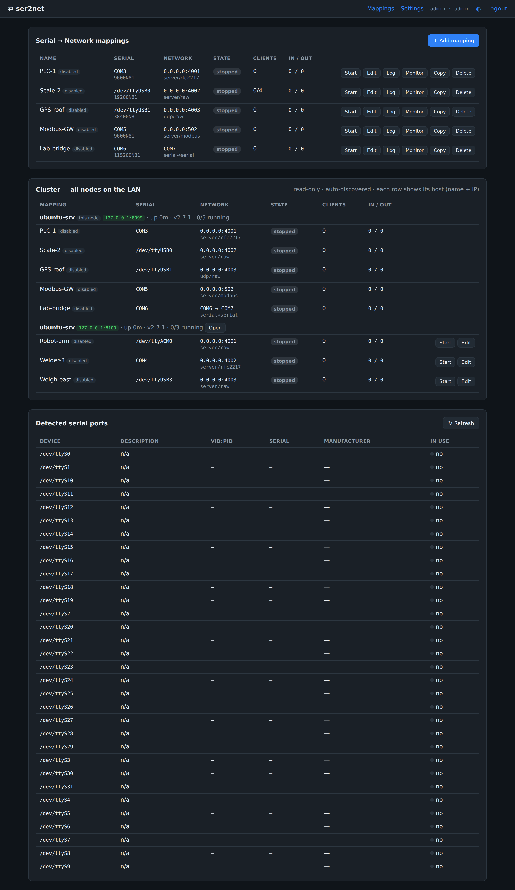
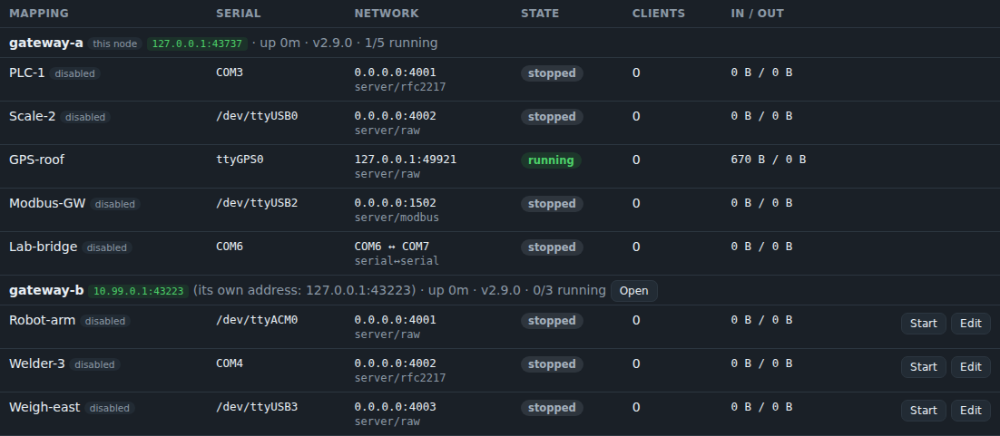
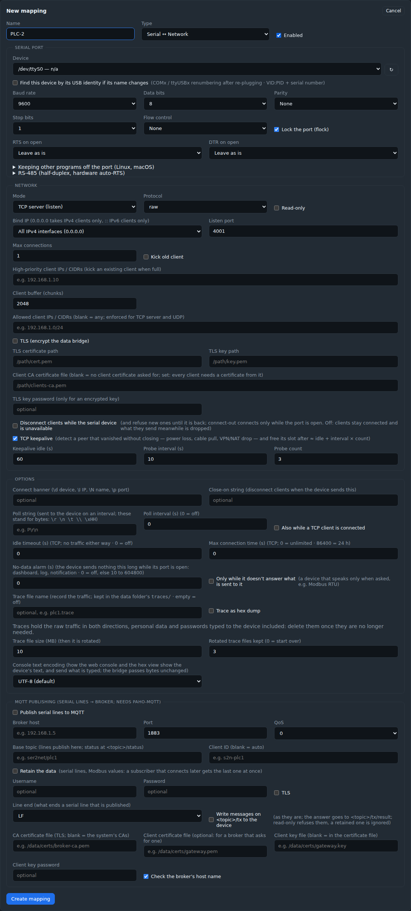
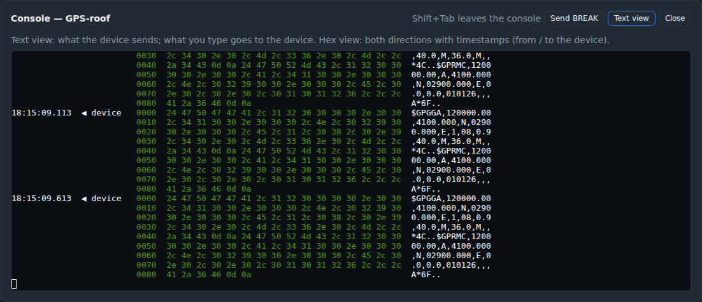
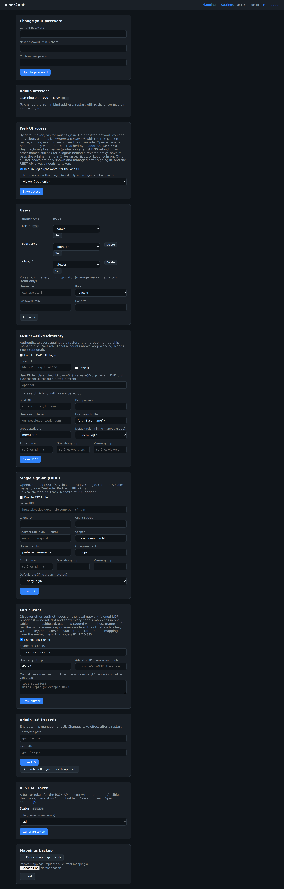
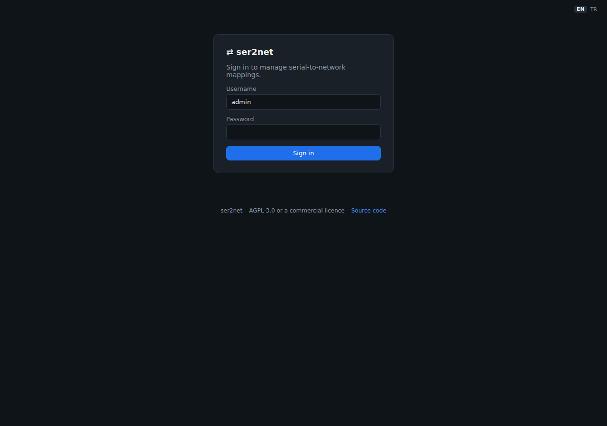

<!-- ser2net — README (Türkçe / varsayılan). English: README.en.md -->

**🌐 [Türkçe](README.md) · [English](README.en.md)**

# ser2net

[](LICENSE) [](COMMERCIAL_LICENSE.md) [](https://github.com/sponsors/haliskilic)

**Seri portları (COM / ttyUSB / ttyACM / ttyS) ağ üzerinden erişilebilir kılan,
web arayüzünden yönetilen, çapraz-platform (Windows + Linux) saf-Python köprü.**

> C dünyasındaki `ser2net`'in modern, web yönetimli karşılığı. Tek ekrandan onlarca
> seri portu IP:port'a eşleyin; raw / telnet / RFC2217; çift yönlü; düşük gecikme.

---

## 📸 Ekran Görüntüleri

**Pano — onlarca eşleme, canlı durum, algılanan portlar ve LAN cluster paneli:**



**LAN cluster — tüm düğümlerin eşlemeleri tek tabloda; düğüm sağlığı + uzaktan başlat/durdur:**



| Eşleme ekleme (tüm seri/ağ seçenekleri) | Tarayıcı-içi seri konsol (xterm.js) |
|---|---|
|  |  |

| Ayarlar (parola · TLS · cluster · yedek) | Giriş |
|---|---|
|  |  |

---

## 📌 Amaç

Endüstriyel cihazlar, PLC'ler, ölçüm aletleri, GPS/modem, mikrodenetleyiciler ve
konsol portları çoğunlukla **seri (RS-232/485/USB-serial)** haberleşir. Bu cihazlara
ağdaki herhangi bir bilgisayardan erişmek için her seri portu bir **TCP/UDP uç
noktasına** köprülemek gerekir. `ser2net` bunu yapar ve tüm yönetimi **parola
korumalı bir web arayüzünden** sunar — komut satırı veya elle config dosyası
düzenlemeye gerek yok.

**Tipik kullanım senaryoları:**
- Bir sunucuya bağlı 10+ USB-serial cihazı ağdaki uygulamalara açmak
- SCADA / Modbus-RTU cihazlarını uzak istemcilere ulaştırmak (raw veya RFC2217)
- Cihaz konsollarına (switch, router, gömülü kart) ağdan erişim
- Uzak baud/parity değişimi gereken cihazlar için RFC2217
- İki seri portu birbirine köprüleme (serial↔serial)

---

## ✨ Özellikler

- **Taşıma modları:** TCP **sunucu** (dinleme), TCP **istemci** (dışarı bağlanma),
  **UDP**, ve **serial↔serial** köprüleme. TCP köprüleri için isteğe bağlı **TLS**. UDP,
  cihazın çıktısını izinli bir IP'den gelen son datagram'ın göndericisine ya da her zaman
  sabit bir **yanıt adresine** (IP + port) gönderir; **karşı uç zaman aşımı** sessiz kalan
  göndericiyi unutturur. Datagram'lar seri portu en fazla 64 KiB'lık bir kuyrukta bekler:
  hattan hızlı gönderen birinin bunu aşan datagram'ları atılır, sayılır ve loglanır.
- **Protokoller:** `raw`, `telnet` (8-bit temiz), `rfc2217` (uzaktan canlı
  baud/parity/databit/stopbit/akış kontrolü değişimi), `modbus` (RTU↔TCP gateway). Portun
  yerine getiremediği bir RFC 2217 isteği (bozuk ya da ayrılmış bir değer veya seri portun
  reddettiği bir değer) RFC 2217'nin dediği gibi güncel ayarla yanıtlanır ve portu olduğu
  gibi bırakır; istemci bağlı kalır. Kaybolan seri port yeniden açılırken de RFC 2217
  istemcisi bağlı kalır ve yeniden açılan port onun ayarlarını alır; istenirse istemci
  ayrılınca port eşlemenin ayarlarına döner (bkz.
  [`docs/VIRTUAL-COM.md`](docs/VIRTUAL-COM.md)). 1 KiB'tan uzun bir telnet ya da RFC 2217
  alt müzakeresi (gerçekleri birkaç bayttır) o istemcinin oturumunu sonlandırır; nedeni
  log'a yazılır.
- **Modbus ağ geçidi:** Modbus/TCP master'larını seri Modbus/RTU slave'lere köprüler —
  çoklu master, paylaşımlı bus'ta transaction serileştirme + transaction-id koruması,
  RTU yanıtı gelmezse `0x0B` (gateway-timeout) exception. Seri port kaybolursa (USB
  adaptör çıkarıldığında) master'lar bu sürede hemen `0x0A` (gateway yolu yok) alır ve
  port, her eşlemede olduğu gibi yeniden açılır (durum `reconnecting`, cihaz
  kayboldu/geri geldi bildirimleri).
  Master'lar diğer istemciler gibi kabul edilir (izinli IP'ler, max bağlantı, öncelikli
  IP'ler, eski-kullanıcıyı-at); **salt okunur** bir gateway okuma olmayan her isteği
  (FC5/6/15/16/22/23 gibi yazmalar, slave'i yeniden başlatan ya da susturan tanılama
  komutları, bilinmeyen fonksiyon kodları) hatta göndermeden `0x01` exception ile yanıtlar.
  Banner, open/close string ve `closeon` burada kullanılmaz (Modbus çerçevelerini bozar).
  **Edge modu:** coil ve register'ları periyodik okuyup MQTT'ye yayınlar (bool,
  uint/int/float 16/32, ölçek); `"writable": true` noktalar MQTT'den yazılır
  (`<topic>/<nokta>/set`, yalnızca o noktaya tek değer: coil için FC5, holding register için
  kendi bir ya da iki register'ına FC6/FC16; JSON liste ya da başka bir metin
  `.../set/result`'ta `error: …` alır). **Salt okunur** bu yazmaları da reddeder (`error:
  mapping is read-only`; reddedilen DCMD loglanır); MQTT'den yazma alan eşlemeler panoda
  **CMD** etiketiyle gösterilir (bkz. Güvenlik: kimin komut gönderebileceğine broker karar
  verir). İstenirse **Sparkplug B**
  edge node olarak, her Modbus unit'i bir cihaz (`unit1`, …): `bdSeq` ile NBIRTH/NDEATH,
  `seq` ile DBIRTH/DDATA, DCMD ile yazma, NCMD ile rebirth. Bir komut yayınlandığında bir
  kez yazılır: broker'ın yeniden bağlanma, yeniden başlatma ya da config kaydından sonra
  tekrar gönderdiği retained bir `/set`, **Retained /set komutunu her bağlantıdan sonra
  yeniden uygula** işaretli değilse yok sayılır (ve loglanır); retained bir Sparkplug
  NCMD/DCMD her zaman yok sayılır, boş bir mesaj (retained mesajı temizleyen) komut
  değildir ve ser2net bağlı değilken yayınlanan bir komut sonradan iletilmez.
- **Client-side sanal COM:** uzaktaki portu yerel `COMx`/`tty` olarak göstermek için
  reçeteler (pyserial `rfc2217://`, Linux `socat`, Windows com0com+com2tcp / HW VSP3) —
  bkz. [`docs/VIRTUAL-COM.md`](docs/VIRTUAL-COM.md).
- **Tam seri yapılandırma:** baud (custom dahil), data bit, parity, stop bit, akış
  kontrolü (none/RTS-CTS/XON-XOFF/DSR-DTR), açılışta RTS/DTR, exclusive open ve RS-485
  donanım auto-RTS (Linux `TIOCSRS485`: aç + TX öncesi/sonrası gecikme + TX'te RTS seviyesi).
- **Canlı port listesi:** ayrıcalık gerektirmeyen polling + isteğe bağlı olay-tabanlı
  hotplug (Linux pyudev / Windows WM_DEVICECHANGE), yoksa polling'e düşer. Linux'ta
  arkasında donanım olmayan `ttyS` portları gizlenir, `/dev/serial/by-id` kalıcı adları
  gösterilir ve seçilebilir.
- **Cihazı USB kimliğiyle bulma:** eşleme formundaki kutu işaretlenince adaptör VID:PID
  (+ seri no) ile bağlanır; çıkarılıp takılınca `ttyUSB0`→`ttyUSB1` ya da COM numarası
  değişse de eşleme doğru cihazı açar.
- **IP seçici:** makineye atanmış IP'ler (localhost / LAN / 0.0.0.0) veya custom.
- **Onlarca eşleme:** tek ekrandan ekle/düzenle/sil/başlat/durdur, canlı durum; arama,
  durum filtresi, sıralama ve seçili eşlemeleri toplu başlat/durdur/yeniden başlat.
  Tablo yalnızca değiştiğinde yenilenir (titreme yok, seçimler korunur).
- **Erişim kontrolü (eşleme başına):** izinli IP/CIDR listesi, **yüksek-öncelikli**
  istemci IP'leri (doluyken eski istemciyi atar), max bağlantı, eski-kullanıcıyı-at,
  salt-okunur, banner, open/close string, `closeon` (Modbus gateway banner, open/close
  string ve `closeon` kullanmaz).
- **Bağlantı yaşam döngüsü (eşleme başına, TCP):** **TCP keepalive ile ölü bağlantı
  tespiti** — FIN/RST göndermeden kaybolan istemci ya da uzak sunucu (elektrik kesintisi,
  kablo çekilmesi, Wi-Fi/VPN/NAT düşmesi) artık sonsuza dek `ESTABLISHED` kalmaz:
  varsayılan ayarlarla (açık · 60 sn boşta · 10 sn aralık · 3 deneme) ~90 sn içinde
  düşürülür ve yuvası boşalır — cihaz veri gönderirken de (Linux `TCP_USER_TIMEOUT`).
  Ayrıca dışa bağlanmada **bağlantı zaman aşımı** (varsayılan 10 sn), **idle timeout**
  ve **maksimum bağlantı süresi** (ör. 24 sa); her kopuş nedeniyle loglanır.
- **Gözlemlenebilirlik:** per-mapping trafik trace (hex/timestamp, döner dosyalar,
  arayüzden indirilir), Prometheus `/metrics`, audit log ekranı, canlı log görüntüleyici,
  **tarayıcı-içi seri konsol** (xterm.js, WebSocket — trafiği izle veya cihaza yaz) ve
  iki yönlü, zaman damgalı **canlı hex görünümü**. Panodaki **Gelen / Giden** sayaçları
  (`/api/v1/status`'ta `bytes_in` / `bytes_out`, `/metrics`'te
  `ser2net_mapping_bytes_in_total` / `ser2net_mapping_bytes_out_total`) seri cihazdan
  okunan ve cihaza yazılan baytlardır; cihazı kaç istemci paylaşırsa paylaşsın bir kez
  sayılır (serial↔serial: A → B / B → A). Ağdan gelip cihaza yazılamayan veri (port açık
  değilken ya da bir UDP datagram'ı kuyruğu dolu bulduğunda) atılmış sayılır
  (`bytes_dropped`, `ser2net_mapping_bytes_dropped_total`), panoda işaretlenir ve loglanır.
- **Bildirimler:** cihaz koptuğunda/geri geldiğinde, eşleme başlamadığında, istemci
  bağlanıp düştüğünde ya da hatalı girişte webhook (JSON, Slack, Microsoft Teams,
  Discord, Telegram) ve/veya e-posta (SMTP); tekrarlar bastırılır, test mesajı gönderilir.
- **Güvenlik:** parola (ilk erişimde belirlenir, scrypt), CSRF, imzalı-çerez oturum,
  login oran sınırı, sıkı güvenlik başlıkları, parola değişince oturum iptali.
  Güvenilir ağlar için giriş zorunluluğu **Ayarlar → Web arayüzü erişimi**'nden kapatılabilir
  (ziyaretçiler seçilen rolle parolasız kullanır; bkz. Güvenlik).
- **Çok-kullanıcı / RBAC:** `admin` / `operator` / `viewer` rolleri — viewer salt-okunur,
  operator eşlemeleri yönetir, admin her şey + kullanıcı yönetimi. Tek-parola kurulumları
  otomatik olarak bir `admin` kullanıcısına geçer.
- **LDAP / Active Directory auth (opsiyonel):** kullanıcılar dizine bind ederek doğrulanır;
  LDAP grup üyeliği role eşlenir. Yerel hesaplarla birlikte çalışır; `ldap3` gerektirir.
- **OIDC tek-oturum (SSO, opsiyonel):** Keycloak/Entra ID/Google/Okta ile authorization-code
  akışı; id_token doğrulanır (imza/iss/aud/exp/nonce), claim→rol eşlenir. `authlib` gerektirir.
- **REST API:** otomasyon için JSON API (`/api/v1`) — eşleme CRUD, başlat/durdur/yeniden,
  durum ve portlar; **bearer-token** kimlik doğrulama (rol seçilebilir — `viewer`
  salt-okunur); OpenAPI 3.0 (`/api/v1/openapi.json`). Token, Ayarlar'dan üretilir.
- **LAN cluster (filo yönetimi):** aynı ağdaki düğümler birbirini **otomatik bulur**
  (imzalı UDP broadcast — mDNS yok) ve bir düğüm **tüm düğümlerin eşlemelerini tek
  tabloda** gösterir; her satır hangi bilgisayara ait olduğunu (ad + IP) ve her düğümün
  **sağlığını** (uptime · sürüm · çalışan/toplam) belirtir. Operatörler bu ekrandan
  başka bir host'un eşlemelerini **uzaktan başlat/durdur/yeniden başlat ve düzenle** edebilir.
  Broadcast'in ulaşmadığı yönlendirilmiş/L3 ağlar için **manuel peer** (host:port)
  eklenebilir. Güven = her düğümde **aynı paylaşılan anahtar**; varsayılan kapalı,
  Ayarlar → LAN cluster'dan açılır.
- **Dağıtım:** resmi **Docker** imajı + `docker-compose`; **systemd** birimi;
  Linux+Windows × Python 3.10–3.13 **CI** (GitHub Actions).
- **MQTT yayınlama (opsiyonel):** seri satırlarını eşleme başına bir MQTT broker'ına
  yayınlar (host/port/topic/QoS/TLS/kimlik), retained birth/death durumuyla. `paho-mqtt`
  gerektirir (opsiyonel; yoksa köprü normal çalışır).
- **Klasik ser2net'ten geçiş:** `ser2net.yaml` (4.x) ve `ser2net.conf` (3.x) dosyaları
  Ayarlar → içe aktarma ile önizlemeli olarak alınır; karşılığı olmayan seçenekler uyarı
  olarak gösterilir.
- **Türkçe / İngilizce arayüz:** üst menüdeki **TR / EN** ile seçilir (tarayıcıda hatırlanır);
  seçilmemişse tarayıcının dili ya da admin'in **Ayarlar → Web arayüzü erişimi**'nde seçtiği
  varsayılan dil.
  Bildirimler varsayılan dille gider; log'lar, audit log ve REST API İngilizce kalır.
- **Tamamen offline:** tüm bağımlılıklar wheel olarak birlikte gelir; internet gerekmez.

---

## 🧰 Gereklilikler

- **Python 3.10+** (sistemde kurulu). Başka hiçbir şey gerekmez — bağımlılıklar
  `vendor/wheels/` içinde gelir ve ilk çalıştırmada `./lib`'e kurulur (offline).
- Linux'ta seri portu **açmak** için kullanıcının `dialout` grubunda olması gerekir
  (port **listelemek** için ayrıcalık gerekmez):
  ```bash
  sudo usermod -aG dialout "$USER"   # ardından oturumu kapatıp aç
  ```
- Windows'ta COM portları için ek yetki gerekmez.
- (Opsiyonel) TLS self-signed üretimi için `openssl`; olay-tabanlı hotplug için
  `pyudev` (Linux) / `pywin32` (Windows) — yoksa polling kullanılır.

---

## 🚀 Kurulum & Çalıştırma

```bash
# Linux / macOS
python3 ser2net.py            # veya: ./start.sh

# Windows
start.bat
```

### Standalone binary (başka hiçbir şey kurmak gerekmez)
Her sürümde Windows `.exe` ve Linux binary'si **GitHub Releases**'a eklenir. İkisi de
her şeyi içinde taşıyan tek bir dosyadır: Python, OpenSSL, VC++ runtime (Windows),
MQTT / LDAP / OIDC desteği. Python, `openssl` ya da başka bir paket gerekmez. İndir,
çalıştır; config/log `data/` altında binary'nin yanına yazılır.

| Dosya | Çalıştığı sistemler |
|---|---|
| `ser2net-windows-x64.exe` | Windows 10/11, Windows Server 2016 ve sonrası (x64) |
| `ser2net-linux-x64` | glibc ≥ 2.28 olan x86_64 Linux: RHEL / AlmaLinux / Rocky 8+, Debian 11+, Ubuntu 20.04+, Fedora, openSUSE Leap 15 (musl/Alpine değil — orada Docker kullanın) |
| `ser2net-linux-arm64` | glibc ≥ 2.28 olan 64-bit ARM Linux: Raspberry Pi 3/4/5 (64-bit Raspberry Pi OS 11+ veya Ubuntu), ARM endüstriyel gateway'ler, AWS Graviton, aynı dağıtımlar |

Her sürümde ayrıca `SHA256SUMS`, her binary için CycloneDX SBOM (`*.cdx.json`) ve lisans
metinleri yayımlanır; binary'ler GitHub'ın derleme kaynağı imzasıyla (build provenance)
doğrulanabilir: `sha256sum -c SHA256SUMS --ignore-missing`,
`gh attestation verify ser2net-linux-x64 -R haliskilic/ser2net`. Windows exe'si, bir imzalama
servisi tanımlandığında sürümlerde imzalanır ([`docs/SIGNING.md`](docs/SIGNING.md)).

Bu, her PR'da ve her sürümde test edilir (`tests/test_standalone.py`):
- paketin içindekiler işletim sisteminin temel kütüphanelerinden (glibc ≤ 2.28 / Windows
  sistem DLL'leri) başka bir şeye ihtiyaç duymamalı (Linux'ta x86_64 ve arm64);
- binary boş bir `PATH` ile (Python yok, `openssl` yok) çalışmalı;
- Linux binary'si temiz AlmaLinux 8/9, Debian 11/12, Ubuntu 20.04/22.04/24.04,
  openSUSE Leap 15.6 ve Fedora konteynerlerinde çalışmalı.

Linux notları:
- `chmod +x ser2net-linux-x64`; seri portlar genellikle `dialout` grubunu gerektirir.
- Binary açılışta kendini `$TMPDIR`'e (varsayılan `/tmp`) açar. `/tmp` `noexec` ile
  bağlıysa `TMPDIR`'i öyle olmayan bir klasöre yönlendirin.
- Sertifika kontrolleri (TLS üzerinden MQTT, OIDC) için dağıtımın CA paketini, ayarlıysa
  `SSL_CERT_FILE`'ı kullanır.

`ser2net --about` sürümleri (Python, OpenSSL, bileşenler) gösterir; hata bildirirken
ekleyin. `ser2net --licenses` binary'nin içindeki her bileşenin lisans metnini yazar
(sürümlere `*.THIRD-PARTY-LICENSES.txt` olarak da eklenir).

Kendin derlemek için:
- Windows: `pip install -r requirements.txt -r requirements-optional.txt pyinstaller && pyinstaller ser2net.spec`
- Linux (eski dağıtımlarda da çalışsın diye eski glibc'li bir konteynerde):
  `docker run --rm -v "$PWD:/src" -w /src almalinux:8 bash tools/build_standalone_linux.sh`

İlk çalıştırmada:
1. **Konsolda** arayüzün hangi IP'den erişileceği sorulur (makine IP'leri veya custom)
   ve port (varsayılan 8080). Başsız/servis ortamında güvenli varsayılan **127.0.0.1**.
2. Tarayıcıda açılan adrese gidin; **ilk ekranda admin parolasını belirleyin**.
3. Panodan **+ Eşleme ekle** ile COM/tty seçip IP:port'a eşleyin.

Bind IP'yi sonradan değiştirmek:
```bash
python3 ser2net.py --reconfigure
```

### Offline kurulum (internetsiz makine)
Bağımlılıklar `vendor/wheels/` içinde bulunur; `ser2net.py` ilk açılışta bunları
`./lib`'e kurar (`pip install --no-index`). İnternet gerektirmez. Set, Linux x86_64 ve
Windows x64'te Python 3.10–3.14'ü kapsar; `requirements.txt` değişince
`python3 tools/refresh_wheels.py` ile yenilenir (`tests/test_vendor_wheels.py` denetler).
Opsiyonel özellikleri (MQTT/LDAP/OIDC) offline kaynak kurulumunda etkinleştirmek için
wheel'lerini de indirip kurun: `pip download -r requirements-optional.txt -d vendor/wheels`
ardından `pip install --no-index --find-links vendor/wheels -r requirements-optional.txt`.
(Standalone binary bunları zaten içerir.)

### Docker
```bash
docker compose up -d        # docker-compose.yml içindeki `devices:` satırını düzenleyin
# veya:
docker build -t ser2net . && docker run -d -p 8080:8080 \
  --device /dev/ttyUSB0 --group-add dialout -v ser2net-data:/data ser2net
```
Hazır imaj (amd64 + arm64, her sürümde): `docker pull ghcr.io/haliskilic/ser2net:latest`
(ya da `:2.8`, `:2.8.0`); `docker-compose.yml` bunu kullanır.
Container'da arayüz `0.0.0.0`'a bağlanır (`SER2NET_BIND_IP` / `SER2NET_PORT` env ile
ayarlanır — başsız ortamda interaktif seçici çalışamaz). Süreç root olarak değil, `ser2net`
kullanıcısıyla (uid 10001) çalışır; eski (root ile çalışan) imajların yazdığı `/data`
volume'u ilk açılışta otomatik devralınır, yükseltmede elle bir şey yapmak gerekmez.
İmajda `HEALTHCHECK` var (`ser2net --healthcheck`). Ayrıntılar:
[`docs/DOCKER.md`](docs/DOCKER.md).

---

## 🖥️ Kullanım

- **Eşleme ekle:** Ad, tür (Serial↔Network / Serial↔Serial), seri port + parametreler,
  ağ modu (server/client/udp), protokol, bind/remote IP:port, erişim kuralları.
- **Başlat/Durdur/Yeniden başlat/Kopyala/Sil:** her satırda.
- **Log:** eşlemenin geçmiş logu (en yeni üstte, restart sonrası kalıcı).
- **Monitor:** tarayıcıda canlı seri terminal (xterm.js); ağ eşlemelerinde cihaza yazılabilir.
- **Ayarlar:** parola değiştir, **web arayüzü erişimi** (giriş zorunlu / parolasız rol),
  admin TLS (yol ver veya self-signed üret), **REST API token'ı** üret/iptal et, mapping
  **yedek al/yükle** (JSON), durum.
- **/metrics:** Prometheus formatında metrikler (kimlik doğrulamalı): eşleme başına
  çalışıp çalışmadığı, istemcileri, gelen / giden / atılan baytlar, yeniden bağlanmalar ve
  düşürülen yavaş istemciler; süreç için açık dosya sayısı ve sınırı (`ser2net_open_fds`,
  `ser2net_fd_limit`, POSIX), yönetim arayüzünün bağlantıları, süren ve sıra bekleyen TLS
  el sıkışmaları ve kabulden hemen sonra reddedilen bağlantılar
  (`ser2net_connections_refused_total`, nedene göre).

---

## 🔌 REST API

Tarayıcı arayüzünün yanında, otomasyon için JSON bir API (`/api/v1`). Kimlik doğrulama
`Authorization: Bearer <token>` ile yapılır; token'ı **Ayarlar → REST API token**'dan
üretin (yalnızca bir kez gösterilir). Tam tanım: `GET /api/v1/openapi.json`.

```bash
TOKEN="s2n_..."   # Ayarlar'dan üretilen token
# tüm eşlemeler (config + canlı durum)
curl -H "Authorization: Bearer $TOKEN" http://HOST:8080/api/v1/mappings
# eşleme oluştur
curl -X POST -H "Authorization: Bearer $TOKEN" -H "Content-Type: application/json" \
  -d '{"name":"PLC-1","kind":"net","serial":{"port":"/dev/ttyUSB0","baudrate":9600},
       "network":{"mode":"server","bind_ip":"0.0.0.0","port":4001}}' \
  http://HOST:8080/api/v1/mappings
# başlat / durdur / yeniden başlat
curl -X POST -H "Authorization: Bearer $TOKEN" http://HOST:8080/api/v1/mappings/<id>/stop
```
Uç noktalar: `GET/POST /mappings`, `GET/PUT/DELETE /mappings/{id}`,
`POST /mappings/{id}/{start|stop|restart}`, `GET /status`, `GET /ports`,
`GET /health` (kimlik doğrulamasız), `GET /openapi.json`.

---

## 🔒 Güvenlik

Arayüz **varsayılan olarak parola korumalı**. Varsayılan bind **127.0.0.1**; ağa açmak
için açılışta IP seçimi gerekir ve TLS'siz ağ bind'inde uyarı verilir. LAN'a açılan
kurulumlarda TLS (`admin_ui.tls_*`) ve eşleme bazlı `allowed_client_ips` önerilir.
Raw TCP düz-metindir — güvensiz ağlarda dikkat. Allowed/priority listesinde tek başına
`0.0.0.0`/`::` "herkes" demektir. Bir eşlemenin seri portu yalnızca cihaz yolu ya da COM
adı olabilir; pyserial URL işleyicileri (`socket://`, `rfc2217://`, `spy://`, `loop://`, ...)
port olarak kabul edilmez.

**Bağlantı sınırları:** TLS'li bir eşlemede `allowed_client_ips` listesinde olmayan bir host,
TLS el sıkışmasından önce kapatılır; el sıkışma 15 sn içinde bitmelidir ve bir adresten aynı
anda en fazla 32 (toplamda 128) el sıkışma yürür. Fazlası, bunlardan birinin bitmesini 15 sn'ye
kadar bekler (bir adresten en fazla 64, toplamda 256 bağlantı); böylece bir istemcinin toplu
yeniden bağlanması reddedilmez, sırayla karşılanır. Kapasite, `kick_old_user` ve "Busy"
satırı yine el sıkışmadan sonra gelir. Yönetim arayüzü, bağlandıktan ya da son yanıttan sonra
`admin_ui.request_timeout_s` (10 sn) içinde tam bir istek başlığı göndermeyen, ardından
istek gövdesi gelmeyi kesen (gövdeye bu süre artı gelen her KiB için bir saniye tanınır) ya
da bir yanıttan bu süre boyunca hiçbir şey almayan bağlantıyı kapatır (konsol WebSocket'i
süreye tabi değildir) ve aynı anda en fazla `admin_ui.max_connections`
(256), bir adresten en fazla `admin_ui.max_connections_per_ip` (64) bağlantı kabul eder;
TLS el sıkışması bir eşleminkiyle aynı sınırlara tabidir. Bu anahtarlar yalnızca
`config.json`'dadır (0 = sınır yok); bir reverse proxy arkasında tüm kullanıcılar proxy'nin
adresinden gelir, gerekirse adres başına sınırı yükseltin. Süreç açık dosya sınırına
yaklaşınca yeni bağlantılar (her eşlemeye ve arayüze) log'a bir satır yazılarak reddedilir;
böylece seri portlar, log'lar ve yapılandırma ihtiyaç duydukları dosyaları açabilir.

**UDP eşlemeleri:** `allowed_client_ips` her datagram için denetlenir, ama baktığı şey
datagram'ın kaynak adresidir ve ağdaki bir gönderici bu adresi taklit edebilir; yani UDP'de
izin listesi kimlik doğrulama değildir. Yanıt adresi yoksa izinli her gönderici (ya da izinli
bir adresi taklit eden biri) tek bir datagram'la cihazın çıktısını devralır, salt okunur
eşlemede bile; göndericinin her değişimi loga yazılır (en fazla dakikada bir). Çıktıyı doğru
makinede tutmak için bir **yanıt adresi** girin. Güvenilmeyen ağlarda TLS'li bir TCP eşlemesi
ya da bir güvenlik duvarı kullanın.

**MQTT komutları (Modbus edge modu):** yazılabilir noktalar, broker'ın `<topic>/<nokta>/set`
topic'ine ya da Sparkplug B'de `spBv1.0/<group>/NCMD/<node>` ve
`spBv1.0/<group>/DCMD/<node>/<cihaz>` topic'lerine yayın yapmasına izin verdiği her
istemciden değer alır. ser2net bu istemcilerin kimliğini kendisi doğrulamaz ve
`allowed_client_ips` yalnızca Modbus/TCP portunu kapsar; asıl yetkilendirme broker'ın erişim
kurallarıdır (ACL): komut topic'lerine yalnızca çıkışları anahtarlaması gereken istemciler
yayın yapabilsin, broker'a TLS ve kullanıcı adı/parola ile bağlanın. **Salt okunur** her
yazmayı reddeder. MQTT'den yazma alan eşlemeler panoda **CMD**, broker bağlantısında TLS ya
da kullanıcı adı yoksa **CMD ⚠** etiketiyle gösterilir (ayrıca açılışta loga uyarı düşer).
Örneğin `plant/line3` ana topic'i için bir Mosquitto `acl_file`:
```
user ser2net
topic readwrite plant/line3/#
user scada
topic write plant/line3/+/set
topic read plant/line3/#
user historian
topic read plant/line3/#
```

**Parolasız erişim (isteğe bağlı):** yalnızca güvenilir ağlar için, bir admin
**Ayarlar → Web arayüzü erişimi**'nden giriş zorunluluğunu kapatıp ziyaretçilere bir rol
(`viewer` salt-okunur / `operator` / `admin`) verebilir. Oturum açmak yine mümkündür
(kendi rolünüz geçerli olur), RBAC ve CSRF aynen uygulanır, **REST API her zaman
token ister**. Parolasız erişim yalnızca arayüze **IP adresi, `localhost` veya makinenin
kendi adıyla** gelindiğinde geçerlidir — başka bir alan adıyla (ör. DNS-rebinding yapan
kötü niyetli bir sayfa) gelen istekler giriş ekranına yönlendirilir. Ters proxy arkasında
proxy özgün adı `X-Forwarded-Host` ile iletmelidir (iletmiyorsa girişi açık tutun).
LAN cluster'daki **diğer düğümler** yalnızca oturum açınca görünür ve yönetilebilir;
erişim kapatılınca/rol değişince açık konsollar da kapanır. Açıkken arayüzde uyarı
gösterilir ve açılışta loga yazılır.

---

## ⚙️ Servis olarak çalıştırma

- **Docker:** resmi `Dockerfile` + `docker-compose.yml` (bkz. yukarısı ve
  [`docs/DOCKER.md`](docs/DOCKER.md)) — `restart: unless-stopped`, `/data` volume.
- **Linux (systemd):** `systemd/ser2net.service` — ayrı, yetkisiz bir kullanıcı,
  `SupplementaryGroups=dialout`, `Restart=on-failure`, sertleştirme direktifleri.
  **root ile çalıştırmayın.**
- **Windows:** ek bir program gerekmez. Yönetici olarak açılmış bir komut isteminde:
  ```bat
  ser2net-windows-x64.exe --install-service --data-dir C:\ser2net\data
  ```
  Servis açılışta başlar, kullanıcı oturumu gerektirmez (LocalSystem), çökerse ya da
  hatayla çıkarsa 5 sn sonra yeniden başlar. İlk kurulumda arayüz adresi konsolda sorulur.
  Kaldırmak: `--uninstall-service` (veri klasörü kalır). Farklı veri klasörleriyle birden
  fazla örnek için `--service-name`. Durdur/başlat: `sc stop ser2net` / `sc start ser2net`
  ya da *Hizmetler* (services.msc).
- **Çok sayıda eşleme:** çalışan bir eşleme yaklaşık üç dosyayı açık tutar (seri portu,
  dinleyicisi ve log'u), bağlı her istemci için bir tane daha. ser2net açılışta yumuşak
  açık dosya sınırını sert sınıra doğru yükseltir (en fazla 65536) ve sonucu log'a yazar
  (`open files: …`); systemd unit'i `LimitNOFILE=65536` ayarlar, Docker'daki düşük bir
  sert sınır `--ulimit nofile=65536` ile yükseltilir. Yapılandırılan eşlemeler sınıra
  yaklaşınca açılış log'unda bir uyarı çıkar.
- **Windows'ta çok sayıda bağlantı:** ser2net'in orada kullandığı event loop (`select()`) en
  fazla 512 soketi izler (dinleyiciler, istemciler, arayüz bağlantıları). Bu sınıra
  yaklaşınca yeni bağlantılar log'a bir satır yazılarak reddedilir ve servis çalışmaya
  devam eder. `SER2NET_WINDOWS_LOOP=proactor` ortam değişkeni (servis için: sistem ortam
  değişkeni) böyle bir sınırı olmayan proactor loop'una geçirir; yeni olduğundan,
  güvenmeden önce seri zamanlamayı (ör. Modbus RTU) onunla deneyin. Kullanılan loop açılış
  log'unda yazar.

---

## 🗂️ Yapılandırma & durum dosyaları

Tüm durum **veri dizininde** (varsayılan `data/`). Veri dizini yalnızca sahibe açık
kilitlenir (POSIX `0700`; Windows'ta `icacls` ile sahip/SYSTEM/Administrators), böylece
içindeki dosyalar başka kullanıcılarca okunamaz:
- `config.json` — admin IP, parola hash'i, tüm eşlemeler (atomik yazım).
- `backups/` — her değişiklikten önce `config.json`'un önceki hâli (son 50). Ayarlar →
  *Configuration backups*'tan indirilir ya da geri yüklenir; geri yükleme de geri alınabilir.
- `all.log` — global etkinlik (boyutla döner); `audit.log` — girişler ve config değişiklikleri,
  kim/nereden/ne (döner). Ayarlar → *Audit log*'da aranabilir, CSV olarak indirilebilir.
- `logs/<id>.log` — eşleme başına geçmiş (saatlik bakım: >15 gün veya >100MB kırpılır).
- `traces/<id>-<ad>` — eşlemenin trafik kaydı (trace). Trace dosyaları **yalnızca burada**
  tutulur; boyut sınırına gelince döner (varsayılan 10 MB × 3 eski dosya). v2.7'deki tam
  yollar dosya adına indirgenir ve açılışta log'a yazılır.
- `tls/` — self-signed üretilirse sertifika/anahtar.

Eşleme ID'leri (yukarıdaki `<id>`; REST API'de de kullanılır) 1–64 harf, rakam ya da `_`
içerir; yeni eşlemeler 12 hex haneli bir ID alır. Başka biçimdeki bir ID (elle düzenlenmiş
ya da içe aktarılmış) config yüklenirken ya da dosya içe aktarılırken değiştirilir; açılış
logu ya da içe aktarma önizlemesi bunu belirtir.

`config.json` + `all.log` silinince sistem **sıfırdan** başlar (orphan loglar otomatik
temizlenir; `backups/` kendiliğinden geri yüklenmez, isterseniz onu da silin).

**Oturum süresi:** Ayarlar → *Web arayüzü erişimi* → *Oturum süresi (dakika)* (varsayılan 8 saat).
**İçe aktarma:** önce önizleme gösterilir; *birleştir* (aynı adlı eşlemeleri güncelle,
yenileri ekle) ya da *hepsini değiştir* seçilir.

---

## 🧪 Test

Birleşik test koşucusu — taşınabilir (donanımsız, socat'sız) takım her işletim
sisteminde çalışır:
```bash
python3 tests/run_all.py            # taşınabilir takım (Windows + Linux)
python3 tests/run_all.py --socat    # + socat tabanlı veri-yolu testleri (Linux)
python3 tests/run_all.py -v         # geçen testlerin çıktısını da göster
```
socat (Linux) ile sanal seri portlar kullanılır; donanım gerekmez. Tek tek de
çalıştırılabilir, örn. `python3 tests/test_rest_api.py`. CI (GitHub Actions) her pull
request'te ruff, mypy, `pip-audit`, çevrimdışı wheel kontrolü, tam test matrisi
(ubuntu/windows × Python 3.10–3.13) ve coverage koşar
(`python3 tests/coverage_run.py`: testlerin başlattığı sunucular da ölçülür). Geliştirme
ortamı ve kurallar için [CONTRIBUTING.md](CONTRIBUTING.md).

`tests/test_dead_peer.py` ölü bağlantı tespitini **gerçek yarı-açık (half-open) TCP
bağlantılarıyla** da sınar: `SER2NET_BLACKHOLE_TESTS=1` verildiğinde bir loopback
akışının paketlerini düşürür (Linux: root/şifresiz sudo + `iptables`; Windows: Yönetici
+ `pip install pydivert`). Güvenlik duvarını değiştirdiği için yerelde isteğe bağlıdır
(Linux'ta tek kullanımlık bir network namespace içinde çalıştırmak önerilir); CI'da
her iki işletim sisteminde de her zaman koşar.

`tests/test_ui_layout.py` web arayüzünü gerçek bir tarayıcıda (Playwright + Chromium)
çok uzun eşleme adları ve cihaz yollarıyla, masaüstünden telefona farklı genişliklerde
açar. Panelinin dışına taşan bir şey olursa başarısız olur
(`pip install playwright && python -m playwright install chromium`; CI'da `ui` işi).
`tests/test_standalone.py` derlenmiş bir binary'yi sınar
(`SER2NET_STANDALONE_BIN=dist/ser2net`). CI'da bunu `standalone.yml` workflow'u yapar;
her sürüm de aynı workflow'dan geçer.

---

## 📜 Lisans

ser2net **çift lisanslıdır**:

- **Açık kaynak — [GNU AGPL-3.0](LICENSE):** kullanmak, incelemek, değiştirmek ve paylaşmak serbesttir. Dağıtırsan ya da değiştirilmiş bir sürümü ağ servisi olarak çalıştırırsan, tüm kaynak kodunu AGPL-3.0 ile sunman gerekir.
- **Ticari lisans:** AGPL-3.0 yükümlülükleri olmadan kapalı kaynak ürün, cihaz ya da SaaS için — bkz. [COMMERCIAL_LICENSE.md](COMMERCIAL_LICENSE.md) veya **mail@haliskilic.com.tr**.

Birlikte gelen üçüncü-taraf bileşenler kendi lisanslarını korur — bkz. [`THIRD-PARTY-NOTICES.md`](THIRD-PARTY-NOTICES.md);
binary'deki tam metinler: `ser2net --licenses`. LGPL lisanslı ldap3 binary'de kaynak
dosyaları olarak durur; `SER2NET_LIB_OVERRIDE=<klasör>` ile başka bir sürümü yüklenebilir.
Güvenlik açığı bildirimi: [SECURITY.md](SECURITY.md).

Katkılar memnuniyetle karşılanır! İlk pull request'inde tek seferlik bir [Katkıcı Lisans Sözleşmesi (CLA)](https://gist.github.com/haliskilic/7a7fdcd355f54d1db6943959d7b76823) imzalaman istenir; katkının telif hakkı sende kalır.

Telif © 2026 Halis KILIÇ.

## ❤️ Projeyi destekle

ser2net işine yarıyorsa **[GitHub Sponsors üzerinden destek olmayı ❤️](https://github.com/sponsors/haliskilic)** düşünebilirsin — sponsorluklar test donanımını ve projenin bakımına ayrılan zamanı karşılıyor.

GitHub hesabın yoksa **[bir kahve ısmarlayabilirsin ☕](https://buymeacoffee.com/haliskilic)**.

Yol haritası: [`ROADMAP.md`](ROADMAP.md) · English: [`README.en.md`](README.en.md)
